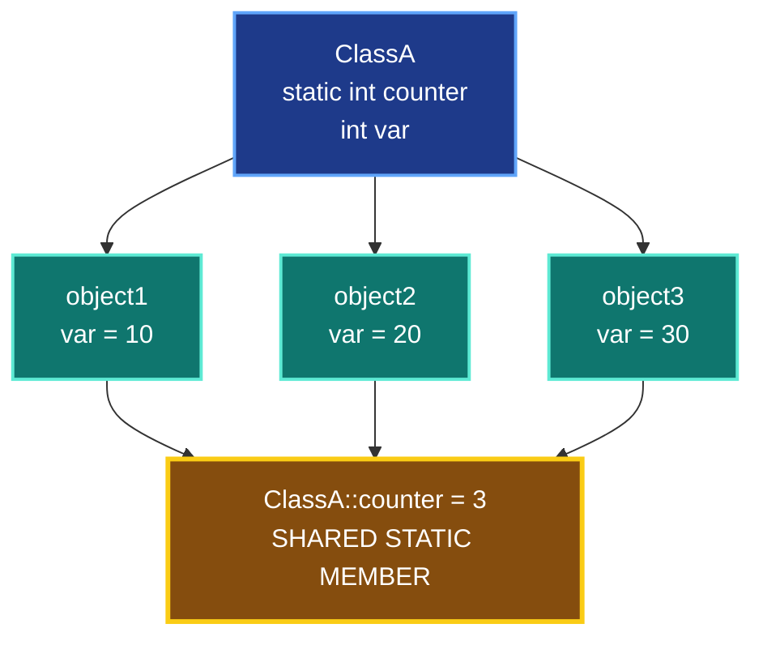

# Static Members in C++

**Course:** C++ Object-Oriented Programming (OOP)  
**Lesson 06:** Static Members & Methods  
**Topic 01:** Static Data Members

---

## 1. What Are Static Members?

A **static data member** is a variable that belongs to a class rather than to an individual object.

Unlike non-static data members, which have separate values for each object, a static data member is **shared among all objects of the same class**.

Static members are declared using the `static` keyword.

### Key Concepts

- Every object has its own non-static data members.
- Static data members belong to the class itself.
- All objects of the same class share one static data member.
- Changing a static member affects the value observed by all objects.
- Static members can be accessed using the class name and the scope resolution operator (`::`), provided access permissions allow it.
- In Visual Basic, a similar concept uses the `Shared` keyword.

---

## 2. Visualizing Static vs. Non-Static Members

The following diagram illustrates how three objects have their own non-static variables while sharing one static variable.



### Diagram Explanation

- `object1` has its own `var = 10`.
- `object2` has its own `var = 20`.
- `object3` has its own `var = 30`.
- All three objects share the same `ClassA::counter`.
- Since the constructor increments `counter` once for each object, its value becomes `3`.

**Important:** There are three separate `var` members, but only one shared `counter` member.

---

## 3. Declaring a Static Data Member

A static data member can be declared inside a class using the `static` keyword.

```cpp
class ClassA
{
public:
    int var;
    static int counter;
};
```

### Explanation

**Non-static member:**

```cpp
int var;
```

Each object has its own copy.

**Static member:**

```cpp
static int counter;
```

The member belongs to the class and is shared among all objects.

---

## 4. Defining and Initializing a Static Member

In the traditional approach, a non-inline static data member is declared inside the class and defined outside it.

```cpp
int ClassA::counter = 0;
```

### Explanation

- `int` specifies the data type.
- `ClassA::` identifies the class that owns the member.
- `counter` is the static member name.
- `= 0` initializes the shared variable.

The `::` operator is called the **Scope Resolution Operator**.

### Modern C++ (C++17 and Later)

Starting with C++17, an inline static data member can be initialized directly inside the class.

```cpp
class ClassA
{
public:
    inline static int counter = 0;
};
```

This eliminates the need for a separate definition outside the class.

---

## 5. Practical Example

```cpp
#include <iostream>
using namespace std;

class ClassA
{
public:
    int var;
    static int counter;

    ClassA()
    {
        var = 0;
        counter++;
    }

    void print() const
    {
        cout << "var = " << var << endl;
        cout << "counter = " << counter << endl;
    }
};

int ClassA::counter = 0;

int main()
{
    ClassA object1, object2, object3;

    object1.var = 10;
    object2.var = 20;
    object3.var = 30;

    object1.print();
    object2.print();
    object3.print();

    ClassA::counter = 500;

    cout << "\nAfter changing counter:\n";

    object1.print();
    object2.print();
    object3.print();

    return 0;
}
```

### Expected Output

```text
var = 10
counter = 3
var = 20
counter = 3
var = 30
counter = 3

After changing counter:
var = 10
counter = 500
var = 20
counter = 500
var = 30
counter = 500
```

### What Happens?

1. Three objects are created.
2. The constructor executes three times.
3. Each constructor call increments the shared `counter`.
4. The final counter value becomes `3`.
5. Each object's `var` receives a different value.
6. `ClassA::counter = 500` modifies the shared static variable.
7. All three objects now observe `counter = 500`.

---

## 6. Static vs. Non-Static Members

| Feature | Non-Static Member | Static Member |
|---|---|---|
| Ownership | Individual object | Class |
| Copies | One per object | One shared member |
| Declaration | `int var;` | `static int counter;` |
| Access | Through an object | Through class name or object |
| Changing Value | Affects one object | Affects the shared value |
| Object Required? | Yes, for ordinary member access | No |
| Lifetime | Associated with the object's lifetime | Static storage duration |

---

## 7. Accessing Static Members

A public static data member can be accessed using the class name.

```cpp
ClassA::counter = 100;
```

It can also be accessed through an object.

```cpp
object1.counter = 100;
```

Both statements modify the same shared variable.

**Best Practice:** Prefer accessing static members through the class name because it clearly communicates class-level ownership.

---

## 8. When Should We Use Static Members?

Static members are useful when multiple objects need to share common information.

### Common Use Cases

**Object Counter**

Track the number of objects created.

```cpp
static int counter;
```

**Shared Configuration**

Store a value shared by all objects of a class.

**Shared Statistics**

Maintain common statistics across multiple objects.

### Important Note About Object Counters

Incrementing a counter in the constructor tracks constructor executions, not necessarily the number of objects currently alive.

To track live objects correctly, additional handling is required for object destruction and copying.

---

## 9. Important Notes

- Static data members belong to the class.
- Non-static data members belong to individual objects.
- All objects share the same static member.
- Static data members have static storage duration.
- Static members can exist even when no objects have been created.
- Access specifiers such as `private` and `public` still apply to static members.
- A private static member cannot be accessed directly from outside the class.
- Static members are not automatically thread-safe.
- Traditional non-inline static data members generally require a separate definition.
- C++17 introduced inline static data members.

---

## 10. Key Takeaways

1. Use `static` to declare a shared class-level data member.
2. Every object has independent non-static data members.
3. Static data members are shared across objects of the same class.
4. Use `ClassName::memberName` to access an accessible static member.
5. Changing a static member changes the value seen by all objects.
6. Static members are useful for counters, configuration, and shared state.
7. In C++17 and later, `inline static` allows initialization inside the class.

---

## Summary

**Non-Static Member = Object-Level Data**

**Static Member = Class-Level Shared Data**

The main purpose of a static data member is to maintain information shared by all objects of the same class.
