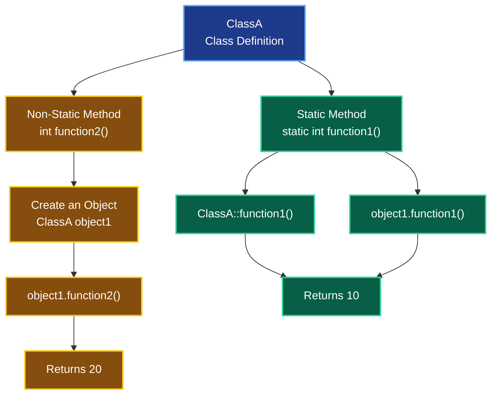

# Static Methods in C++

**Course:** C++ Object-Oriented Programming (OOP)  
**Lesson 06:** Static Members & Methods  
**Topic 02:** Static Methods (Functions)

---

## 1. What Are Static Methods?

A **static method** is a member function that belongs to a class rather than to a specific object.

Static methods are declared using the `static` keyword.

Unlike non-static member functions, static methods can be called without creating an object.

### Key Concepts

- Static methods belong to the class.
- They can be called without creating an object.
- They can also be called through an object.
- They do not have a `this` pointer.
- They can directly access static members of their class.
- They cannot directly access non-static members without an object.

---

## 2. Visualizing Static vs. Non-Static Methods

The following diagram illustrates how static methods can be called directly through the class, while non-static methods require an object.



### Diagram Explanation

**Static Method:**

```cpp
ClassA::function1();
```

Can be called directly without creating an object.

**Non-Static Method:**

```cpp
ClassA object1;
object1.function2();
```

Requires an object to be called.

---

## 3. Declaring a Static Method

A static method is declared using the `static` keyword inside a class.

```cpp
class ClassA
{
public:
    static int function1()
    {
        return 10;
    }
};
```

### Explanation

- `static` identifies the function as a static member function.
- `int` is the return type.
- `function1()` is the function name.
- `return 10;` returns an integer value.

The function belongs to `ClassA`, not to an individual object.

---

## 4. Calling Static Methods

There are two common ways to call an accessible static method.

### Method 1: Using the Class Name

```cpp
cout << ClassA::function1() << endl;
```

This is the preferred approach.

It clearly communicates that the method belongs to the class.

No object is required.

### Method 2: Using an Object

```cpp
ClassA object1;

cout << object1.function1() << endl;
```

This is also valid C++.

However, calling a static method through the class name is generally clearer.

---

## 5. Static vs. Non-Static Methods

| Feature | Static Method | Non-Static Method |
|---|---|---|
| Ownership | Class | Called on an object |
| Object Required | No | Yes, for ordinary calls |
| `this` Pointer | Not available | Available |
| Direct Access to Static Members | Yes | Yes |
| Direct Access to Non-Static Members | No | Yes |
| Typical Call | `ClassA::function1()` | `object1.function2()` |
| Can Be Virtual | No | Yes |

---

## 6. Practical Example

```cpp
#include <iostream>

using namespace std;

class ClassA
{
public:

    // Static method: Can be called without an object.
    static int function1()
    {
        return 10;
    }

    // Non-static method: Requires an object.
    int function2() const
    {
        return 20;
    }
};

int main()
{
    // Call static method using the class name.
    cout << ClassA::function1() << endl;

    // Create an object.
    ClassA object1;

    // Call static method using an object.
    cout << object1.function1() << endl;

    // Call non-static method using an object.
    cout << object1.function2() << endl;

    return 0;
}
```

### Expected Output

```text
10
10
20
```

### Explanation

1. `ClassA::function1()` calls the static method without an object.
2. `ClassA object1;` creates an object.
3. `object1.function1()` calls the same static method through the object.
4. `object1.function2()` calls the non-static method.

---

## 7. Static Methods and Data Members

A static method can directly access static members of its class, subject to the usual access rules.

However, it cannot directly access non-static data members without an object.

### Example

```cpp
class ClassA
{
private:
    int value = 10;
    inline static int counter = 0;

public:
    static int getCounter()
    {
        return counter; // Correct
    }

    static int getValue(const ClassA& object)
    {
        return object.value; // Correct
    }
};
```

### Explanation

- `counter` is a static data member.
- `getCounter()` accesses `counter` directly.
- `value` is a non-static data member.
- `getValue()` accesses `value` through the provided object.

**Important:** This example uses `inline static`, which requires C++17 or later.

---

## 8. Why Don't Static Methods Have a `this` Pointer?

In a non-static member function, `this` points to the object on which the function was called.

Static methods do not operate on a particular object.

Therefore, they do not have a `this` pointer.

### Invalid Example

```cpp
class ClassA
{
public:
    int value = 10;

    static void print()
    {
        // cout << this->value; // Error
        // cout << value;       // Error
    }
};
```

To access `value`, the static method needs an object or reference.

---

## 9. Defining Static Methods Outside the Class

Static methods can be declared inside the class and defined outside it.

```cpp
class ClassA
{
public:
    static int function1();
};

int ClassA::function1()
{
    return 10;
}
```

Notice that the `static` keyword appears in the declaration inside the class, but not in the out-of-class definition.

Unlike traditional static data members, a static member function does not require a separate variable definition or initialization.

---

## 10. When Should We Use Static Methods?

Static methods are useful when an operation logically belongs to a class but does not require a specific object's state.

### Common Use Cases

- Accessing or modifying shared static data.
- Maintaining class-level counters.
- Providing utility functions associated with a class.
- Creating factory functions that return objects.
- Managing shared class-level behavior.

---

## 11. Best Practices

1. Prefer calling static methods using the class name.
2. Use static methods when no particular object state is required.
3. Do not use static methods when an operation needs direct access to a specific object's non-static members.
4. Keep access specifiers in mind: static methods can be `public`, `private`, or `protected`.
5. Remember that static methods cannot be virtual.
6. Avoid unnecessary shared mutable state.

---

## 12. Key Takeaways

- Static methods belong to the class.
- Use the `static` keyword to declare them.
- They can be called without creating objects.
- They can also be called through objects.
- They have no `this` pointer.
- They can directly access static data members.
- They require an object to access non-static data members.
- They can be defined inside or outside the class.
- Calling them using `ClassName::MethodName()` is generally preferred.

---

## Summary

**Static Method = Class-Level Function**

**Non-Static Method = Function Operating on an Object**

Static methods are useful when a function logically belongs to a class but does not require a particular object's state.
