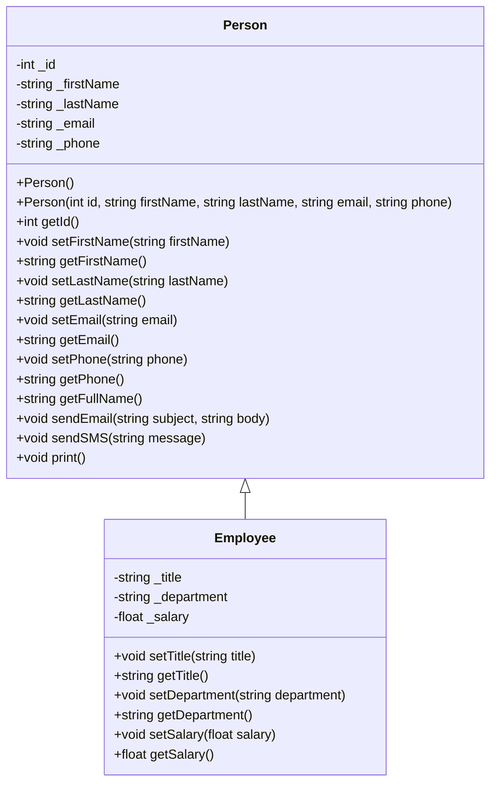
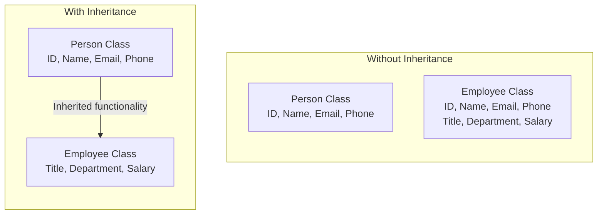
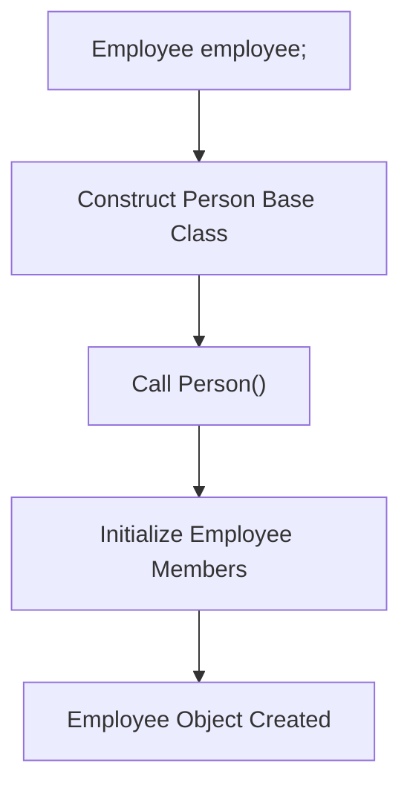

# Basic Inheritance in C++

## 1. Introduction

Inheritance is the third fundamental principle of Object-Oriented Programming (OOP).

Inheritance allows a new class to be created from an existing class, reusing its accessible properties and behaviors.

Instead of rewriting existing code, a new class can inherit functionality from another class and introduce additional members of its own.

### Definition

**Inheritance** is an OOP mechanism in which a new class (Derived Class) is created based on an existing class (Base Class).

### Main Benefits

- Code reusability
- Reduced code duplication
- Less development time and effort
- Better code organization
- Easier maintenance
- Extensibility

---

## 2. Base Class and Derived Class

Inheritance establishes a relationship between two classes.

### Base Class (Superclass)

The existing class whose members are inherited by another class.

### Derived Class (Subclass)

The new class that inherits from the Base Class.

The Derived Class can also define additional data members and member functions.

### Class Relationship



**Explanation:**

- `Person` is the Base Class.
- `Employee` is the Derived Class.
- `Employee` inherits from `Person`.
- `Employee` introduces three additional data members: `_title`, `_department`, and `_salary`.
- The inherited public member functions can be used through an `Employee` object.

---

## 3. Inheritance Syntax in C++

The general syntax for public inheritance is:

```cpp
class DerivedClass : public BaseClass
{
    // Additional members
};
```

### Example

```cpp
class Employee : public Person
{
    // Employee-specific members
};
```

### Syntax Explanation

| Element | Meaning |
|---|---|
| `Employee` | Derived Class |
| `:` | Introduces the inheritance relationship |
| `public` | Public inheritance mode |
| `Person` | Base Class |

This relationship means that an `Employee` is a specialized type of `Person`.

---

## 4. Why Use Inheritance?

Consider a system containing two classes:

- `Person`
- `Employee`

A person has information such as:

- ID
- First Name
- Last Name
- Email
- Phone

An employee is also a person, but has additional information:

- Title
- Department
- Salary

Without inheritance, we might duplicate the same personal information and related methods inside the `Employee` class.

With inheritance, we can reuse the existing `Person` functionality.

### Without Inheritance vs. With Inheritance



**Key Idea:**

Instead of implementing the same personal information and methods again, `Employee` inherits them from `Person`.

This improves code reusability and reduces duplication.

---

## 5. Implementing Inheritance

In this exercise, the `Person` class contains common personal information and methods.

The `Employee` class inherits from `Person` and introduces employee-specific properties.

### Base Class

```cpp
class Person
{
private:
    int _id;
    string _firstName;
    string _lastName;
    string _email;
    string _phone;

public:
    Person()
    {
    }

    // Other constructors and methods...
};
```

### Derived Class

```cpp
class Employee : public Person
{
private:
    string _title;
    string _department;
    float _salary;

public:
    void setTitle(string title)
    {
        _title = title;
    }

    string getTitle()
    {
        return _title;
    }

    void setDepartment(string department)
    {
        _department = department;
    }

    string getDepartment()
    {
        return _department;
    }

    void setSalary(float salary)
    {
        _salary = salary;
    }

    float getSalary()
    {
        return _salary;
    }
};
```

The `Employee` class does not need to redefine the public getters and setters already provided by `Person`.

---

## 6. Accessing Inherited Methods

An object of the Derived Class can use inherited public member functions.

### Example

```cpp
Employee employee;

employee.setFirstName("Fadi");
employee.setLastName("Davids");
employee.setEmail("Dd@gmail.com");
employee.setPhone("091340920394");

employee.print();
employee.sendEmail("Hi", "How are you?");
```

### Explanation

Although the methods `setFirstName()`, `setLastName()`, `setEmail()`, `setPhone()`, `print()`, and `sendEmail()` are defined inside `Person`, they can be called through the `Employee` object.

This is one of the main advantages of inheritance.

---

## 7. Access to Inherited Members

C++ provides three access specifiers:

- `public`
- `protected`
- `private`

For public inheritance:

| Base Class Member | Accessibility in Derived Class |
|---|---|
| `public` | Accessible; remains public |
| `protected` | Accessible; remains protected |
| `private` | Not directly accessible |

### Important Note

Private members of the Base Class are still part of the Base Class subobject within the Derived Class object.

However, the Derived Class cannot access them directly.

Instead, it can use accessible public or protected member functions of the Base Class.

### Example

```cpp
employee.setFirstName("Fadi");
```

This is valid because `setFirstName()` is a public method inherited from `Person`.

Directly accessing `_firstName` from `Employee` would not be allowed because it is private in `Person`.

---

## 8. Default Constructor and Inheritance

The `Person` class originally contained a parameterized constructor:

```cpp
Person(int id, string firstName, string lastName, string email, string phone)
{
    _id = id;
    _firstName = firstName;
    _lastName = lastName;
    _email = email;
    _phone = phone;
}
```

When we create an `Employee` object without arguments:

```cpp
Employee employee;
```

The Base Class must also be constructed.

Because the Base Class already has a user-declared parameterized constructor, C++ does not automatically generate an implicit default constructor.

For this introductory example, we explicitly added:

```cpp
Person()
{
}
```

This allows the Base Class to be default-constructed when creating an `Employee` object without constructor arguments.

### Constructor Execution Flow



### Important Consideration

In this example, the empty default constructor does not initialize `_id`.

Therefore, calling `getId()` before `_id` has been initialized results in undefined behavior.

This example is retained as an introductory inheritance exercise.

Passing arguments to Base Class constructors will be covered in the next lesson.

---

## 9. Limitation of the Inherited print() Method

The `Person` class contains a `print()` method that displays personal information:

- ID
- First Name
- Last Name
- Full Name
- Email
- Phone

However, `Employee` introduces additional information:

- Title
- Department
- Salary

The inherited `print()` method does not automatically display these additional members.

### Example

```cpp
Employee employee;
employee.print();
```

The method executes the implementation defined in `Person`.

It does not include the Employee-specific properties.

### How Can This Be Improved?

The Derived Class can define its own `print()` method to display additional information.

This introduces the concept of **Function Overriding**, which will be explored in a later lesson.

---

## 10. Important Terminology

| Term | Definition |
|---|---|
| Inheritance | Creating a new class based on an existing class |
| Base Class | The class being inherited from |
| Superclass | Another name for Base Class |
| Derived Class | The class that inherits from another class |
| Subclass | Another name for Derived Class |
| Code Reusability | Reusing existing code instead of rewriting it |
| Public Inheritance | An inheritance mode that preserves public and protected access levels |

---

## 11. Key Takeaways

1. Inheritance is the third fundamental OOP principle.
2. A Derived Class inherits from a Base Class.
3. Inheritance promotes code reusability.
4. It reduces code duplication and development effort.
5. A Derived Class can introduce additional properties and methods.
6. Public methods of the Base Class can be called through Derived Class objects.
7. Private Base Class members cannot be accessed directly by the Derived Class.
8. Base Class constructors participate in the construction of Derived Class objects.
9. An inherited method does not automatically include new properties introduced by the Derived Class.
10. Function Overriding allows a Derived Class to provide its own implementation of a method.

---

## 12. Summary

**Inheritance** allows developers to create new classes based on existing classes.

In this exercise, `Employee` inherits common personal information and functionality from `Person`, while adding employee-specific properties.

This demonstrates how inheritance reduces duplication and improves code organization.

### Next Topic

**Parameterized Constructor of the Base Class**

The next lesson explains how to initialize a Base Class using a parameterized constructor when creating an object of a Derived Class.
