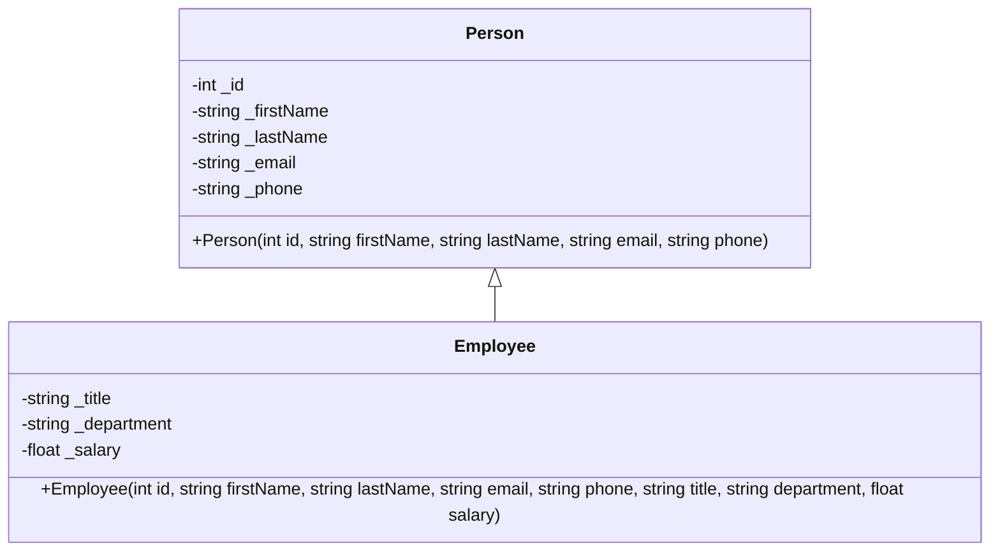
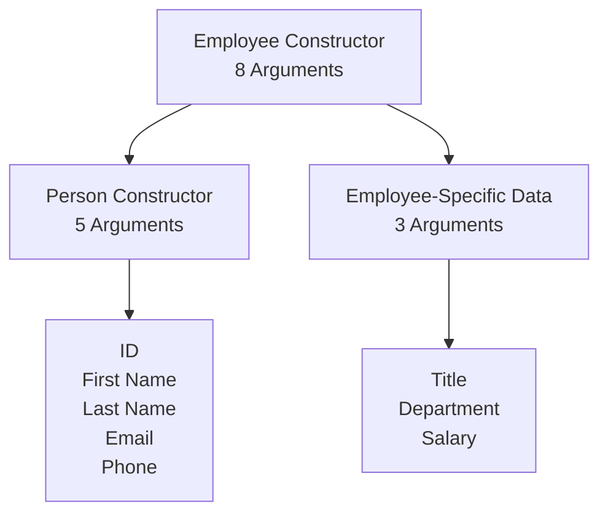
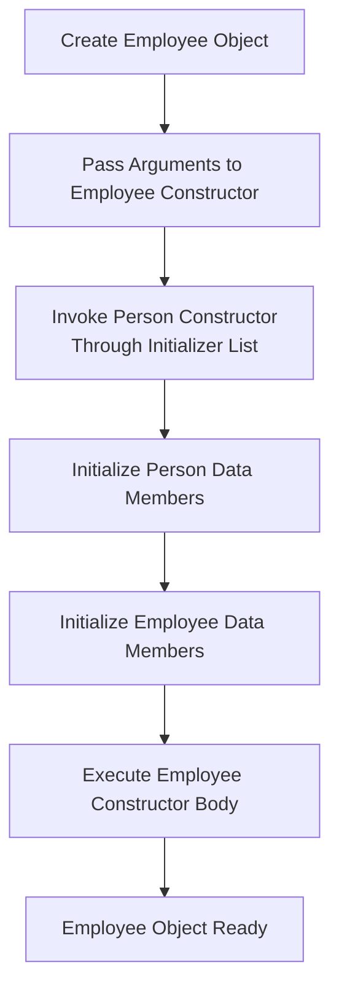

# Parameterized Constructor of the Base Class

## 1. Introduction

When working with inheritance in C++, a Derived Class can use a parameterized constructor to initialize both its own members and the Base Class portion of the object.

If the Base Class requires constructor arguments, the Derived Class must provide the necessary values.

This is accomplished using a **Constructor Initializer List**.

### Main Idea

A Derived Class constructor can:

1. Receive the required parameters.
2. Pass the Base Class parameters to its constructor.
3. Initialize additional members belonging to the Derived Class.

---

## 2. Understanding the Problem

Consider the following inheritance relationship:



The `Person` class contains a parameterized constructor that requires five arguments.

The `Employee` class inherits from `Person` and introduces three additional properties.

When creating an `Employee` object, we must initialize the `Person` part of the object as well.

---

## 3. Base Class Parameterized Constructor

The Base Class constructor receives the person's information.

```cpp
Person(int id, string firstName, string lastName,
       string email, string phone)
{
    _id = id;
    _firstName = firstName;
    _lastName = lastName;
    _email = email;
    _phone = phone;
}
```

This constructor initializes five private data members:

| Parameter | Data Member |
|---|---|
| `id` | `_id` |
| `firstName` | `_firstName` |
| `lastName` | `_lastName` |
| `email` | `_email` |
| `phone` | `_phone` |

Because this class has a user-declared parameterized constructor and no default constructor, an `Employee` constructor cannot simply rely on automatically default-constructing `Person`.

It must specify an appropriate Base Class constructor.

---

## 4. Derived Class Parameterized Constructor

The `Employee` constructor receives eight parameters:

- Five parameters for the `Person` Base Class.
- Three additional parameters for the `Employee` Derived Class.

### Example

```cpp
Employee(int id, string firstName, string lastName,
         string email, string phone, string title,
         string department, float salary)
    : Person(id, firstName, lastName, email, phone)
{
    _title = title;
    _department = department;
    _salary = salary;
}
```

### Explanation

**Step 1 — Define the Derived Class Constructor**

```cpp
Employee(int id, string firstName, string lastName,
         string email, string phone, string title,
         string department, float salary)
```

The constructor accepts all information required to create an employee.

**Step 2 — Use the Constructor Initializer List**

```cpp
: Person(id, firstName, lastName, email, phone)
```

The colon `:` introduces the Constructor Initializer List.

The expression `Person(...)` selects the Base Class constructor and supplies its required arguments.

**Step 3 — Initialize Additional Members**

```cpp
{
    _title = title;
    _department = department;
    _salary = salary;
}
```

The constructor body assigns values to the employee-specific members.

These assignments execute after the Base Class has been constructed.

---

## 5. General Syntax

```cpp
class DerivedClass : public BaseClass
{
public:
    DerivedClass(BaseParameters, AdditionalParameters)
        : BaseClass(BaseArguments)
    {
        // Initialize additional Derived Class members
    }
};
```

### Important Components

| Component | Purpose |
|---|---|
| `DerivedClass(...)` | Defines the Derived Class constructor |
| `:` | Introduces the initializer list |
| `BaseClass(...)` | Specifies the Base Class constructor |
| Constructor body `{}` | Executes after base and member initialization |

**Important:** The Derived Class does not inherit the Base Class constructor automatically in this example. Instead, its own constructor explicitly invokes the appropriate Base Class constructor.

---

## 6. Creating an Employee Object

In the `main()` function:

```cpp
Employee employee(
    10,
    "Fadi",
    "Davids",
    "Da@gmail.com",
    "0920590235",
    "Software Developer",
    "Computer Science",
    55000
);
```

The eight arguments are passed to the `Employee` constructor.

The first five are forwarded to `Person`, while the remaining three are used to initialize the Employee-specific data.

### Parameter Distribution



---

## 7. Constructor Execution Order

A fundamental rule of inheritance in C++ is:

**The Base Class is constructed before the Derived Class constructor body executes.**

### Execution Flow



### Execution Sequence

1. The program creates an `Employee` object.
2. The arguments are supplied to the `Employee` constructor.
3. The `Person` constructor is invoked through the initializer list.
4. The Base Class constructor initializes the person's information.
5. The Employee-specific members are initialized.
6. The `Employee` constructor body assigns the title, department, and salary.
7. Construction finishes and the object becomes ready to use.

### Key Rule

The Base Class constructor executes before the Derived Class constructor body.

The order is determined by C++ object construction rules, not by the visual order of statements in the constructor body.

---

## 8. What Happens If We Omit the Base Constructor Call?

Suppose we write:

```cpp
Employee(int id, string firstName, string lastName,
         string email, string phone, string title,
         string department, float salary)
{
    _title = title;
    _department = department;
    _salary = salary;
}
```

If `Person` has no accessible default constructor, this results in a compilation error.

### Why?

When a Derived Class constructor does not explicitly initialize its Base Class, C++ attempts to default-construct that Base Class.

However, the `Person` class in this exercise only provides a parameterized constructor.

Therefore, the compiler cannot construct `Person` without arguments.

### Solution

Explicitly invoke the Base Class parameterized constructor:

```cpp
: Person(id, firstName, lastName, email, phone)
```

### Important Exception

If the Base Class has an accessible default constructor, omitting an explicit Base Class initializer may be valid.

In that situation, the Base Class default constructor is called automatically.

---

## 9. Adding More Parameters to the Derived Class

A Derived Class constructor can accept additional parameters beyond those required by the Base Class.

In this example:

**Person requires:**

- ID
- First Name
- Last Name
- Email
- Phone

**Employee additionally requires:**

- Title
- Department
- Salary

The Base Class constructor handles the Person-related data.

The Derived Class constructor handles the Employee-specific data.

This allows the Derived Class to extend the functionality of the Base Class while reusing its existing initialization logic.

---

## 10. Why Does print() Still Show Only Person Information?

After constructing the Employee object, we call:

```cpp
employee.print();
```

The `print()` method is inherited from `Person`.

Therefore, it displays:

- ID
- First Name
- Last Name
- Full Name
- Email
- Phone

It does not automatically display:

- Title
- Department
- Salary

This is because the implementation of `print()` in the Base Class does not include those additional properties.

### Next Concept

In the next lesson, we will learn how a Derived Class can provide its own implementation of an inherited method.

This introduces **Function Overriding**.

---

## 11. Key Takeaways

1. A Derived Class can call a parameterized Base Class constructor.
2. The Constructor Initializer List is used to specify the Base Class constructor and its arguments.
3. The Derived Class constructor can receive both inherited and additional data.
4. The Base Class is constructed before the Derived Class constructor body executes.
5. Additional Derived Class members can be initialized after the Base Class constructor has run.
6. If the Base Class has no accessible default constructor, an appropriate Base Class constructor must be explicitly selected.
7. Constructor initialization helps maintain a clear relationship between the Base Class and Derived Class.
8. Inherited methods do not automatically display or process new members introduced by the Derived Class.

---

## 12. Summary

A **Parameterized Constructor of the Base Class** can be invoked from a Derived Class constructor using a Constructor Initializer List.

In this exercise, `Employee` receives eight arguments and forwards five of them to the `Person` constructor.

The remaining arguments are used to assign the Employee-specific properties.

This demonstrates how constructors work together in an inheritance relationship.

### Next Topic

**Function Overriding**

The next lesson explains how a Derived Class can redefine an inherited method to provide behavior specific to the Derived Class.
