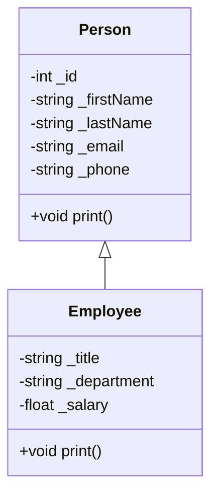
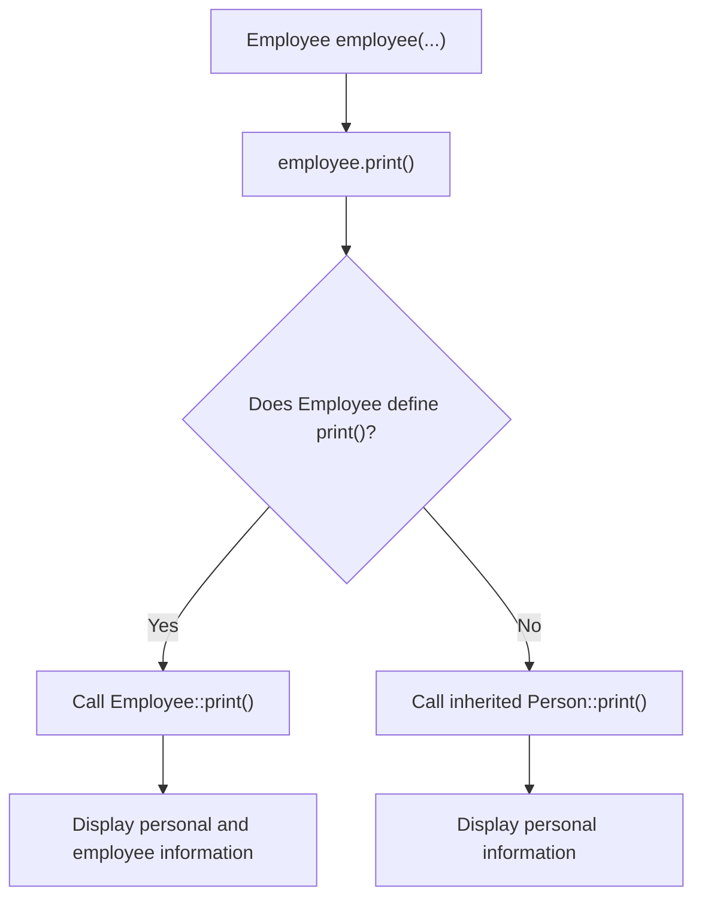

# Function Overriding in C++

## 1. Introduction

Inheritance allows a Derived Class to reuse the properties and methods of a Base Class.

However, an inherited method may not always provide the behavior required by the Derived Class.

A Derived Class can define a method with the same name and parameter list to provide its own implementation.

In C++, an important distinction exists between redefining a non-virtual method and overriding a virtual method.

This lesson demonstrates method redefinition using the `Person` and `Employee` classes.

---

## 2. Understanding the Problem

The `Person` class contains a `print()` method that displays personal information:

- ID
- First Name
- Last Name
- Full Name
- Email
- Phone

The `Employee` class inherits from `Person` and introduces additional properties:

- Title
- Department
- Salary

When we call:

```cpp
employee.print();
```

If `Employee` does not define its own `print()` method, the inherited `Person::print()` method executes.

However, that method only displays the information defined in the Base Class.

It does not automatically display the Employee-specific properties.

### The Problem

The inherited method does not provide all the information required by the Derived Class.

### The Solution

Define a new `print()` method inside `Employee` to display both personal and employee information.

---

## 3. Base Class vs. Derived Class



### Explanation

- `Person` is the Base Class.
- `Employee` is the Derived Class.
- Both classes define a method named `print()`.
- `Person::print()` displays personal information.
- `Employee::print()` displays personal information and employee-specific information.

In this exercise, `Employee::print()` hides the inherited non-virtual method with the same name.

---

## 4. Redefining a Method in the Derived Class

### Base Class Method

```cpp
void print()
{
    cout << "\nInfo\n";
    cout << "____________________________\n";
    cout << "ID       : " << getId() << endl;
    cout << "FirstName: " << getFirstName() << "\n";
    cout << "lastName : " << getLastName() << "\n";
    cout << "FullName : " << getFullName() << "\n";
    cout << "Email    : " << getEmail() << "\n";
    cout << "Phone    : " << getPhone() << endl;
    cout << "____________________________\n";
}
```

This method is defined inside the `Person` class.

### Derived Class Method

```cpp
void print()
{
    cout << "\nInfo\n";
    cout << "____________________________\n";
    cout << "ID        : " << getId() << endl;
    cout << "FirstName : " << getFirstName() << "\n";
    cout << "lastName  : " << getLastName() << "\n";
    cout << "FullName  : " << getFullName() << "\n";
    cout << "Email     : " << getEmail() << "\n";
    cout << "Phone     : " << getPhone() << endl;
    cout << "Title     : " << getTitle() << "\n";
    cout << "Department: " << getDepartment() << "\n";
    cout << "Salary    : " << getSalary() << endl;
    cout << "____________________________\n";
}
```

This method is defined inside the `Employee` class.

### What Changed?

The Derived Class implementation includes three additional properties:

```cpp
cout << "Title     : " << getTitle() << "\n";
cout << "Department: " << getDepartment() << "\n";
cout << "Salary    : " << getSalary() << endl;
```

These properties belong to `Employee`, not `Person`.

---

## 5. Calling the Derived Class Method

In the `main()` function:

```cpp
Employee employee(
    10,
    "Fadi",
    "Davids",
    "Da@gmail.com",
    "0920590235",
    "Software Developer",
    "Computer Science",
    55000
);

employee.print();
```

Because `employee` is an `Employee` object, the compiler selects `Employee::print()`.

### Method Selection



This diagram describes ordinary method lookup for the direct `Employee` object in this example.

It does not represent runtime polymorphic dispatch.

---

## 6. Calling the Base Class Method Explicitly

Sometimes we want to reuse the existing implementation from the Base Class instead of rewriting it.

C++ allows us to call a Base Class method explicitly using the scope resolution operator `::`.

### Syntax

```cpp
BaseClass::methodName();
```

### Example

```cpp
Person::print();
```

This explicitly calls the `print()` method defined in `Person`.

### Alternative Employee Implementation

The following is an alternative implementation, not a change to the original exercise code:

```cpp
void print()
{
    Person::print();

    cout << "Title     : " << getTitle() << "\n";
    cout << "Department: " << getDepartment() << "\n";
    cout << "Salary    : " << getSalary() << endl;
}
```

### Benefits

- Reuses the Base Class implementation.
- Reduces duplicated code.
- Makes maintenance easier.
- Allows the Derived Class to extend the displayed information.

**Note:** Because `Person::print()` already prints a closing separator, this simplified alternative may require formatting adjustments to display all information as one continuous card.

---

## 7. Understanding the Scope Resolution Operator

The scope resolution operator is written as:

```cpp
::
```

It identifies the class or scope to which a member belongs.

### Example

```cpp
Person::print();
```

### Explanation

| Part | Meaning |
|---|---|
| `Person` | Base Class name |
| `::` | Scope resolution operator |
| `print()` | Method defined in the Base Class |

Using `Person::print()` explicitly selects the Base Class implementation.

---

## 8. Redefinition vs. Virtual Function Overriding

This is an important distinction in C++.

### A. Non-Virtual Method Redefinition

In the original exercise:

```cpp
class Person
{
public:
    void print()
    {
        cout << "Person Information";
    }
};

class Employee : public Person
{
public:
    void print()
    {
        cout << "Employee Information";
    }
};
```

The Base Class method is not declared `virtual`.

Therefore, the Derived Class method hides the Base Class method with the same name.

When called directly through an `Employee` object:

```cpp
Employee employee;
employee.print();
```

The Derived Class implementation executes.

### B. Virtual Function Overriding

For runtime polymorphism, the Base Class method can be declared `virtual`.

```cpp
class Person
{
public:
    virtual void print()
    {
        cout << "Person Information";
    }
};

class Employee : public Person
{
public:
    void print() override
    {
        cout << "Employee Information";
    }
};
```

Now, calling `print()` through a Base Class pointer or reference can execute the Derived Class implementation.

### Comparison

| Feature | Non-Virtual Redefinition | Virtual Overriding |
|---|---|---|
| Same method name | Yes | Yes |
| Base method declared `virtual` | No | Yes |
| Derived method hides base name | Yes | Yes |
| Runtime polymorphism | No | Yes |
| Dispatch through Base Class pointer | Base implementation | Derived implementation, when the object is derived |

Virtual functions and runtime polymorphism will be explored in later lessons.

---

## 9. Base Class Pointer Example

Consider:

```cpp
Person* ptr = &employee;
ptr->print();
```

In the original exercise, `Person::print()` is not virtual.

Therefore, this call executes:

```cpp
Person::print();
```

The result is determined by the static type of the pointer.

If `Person::print()` were virtual and properly overridden by `Employee`, the call could execute:

```cpp
Employee::print();
```

This behavior is called runtime polymorphism.

---

## 10. Important Terminology

| Term | Meaning |
|---|---|
| Function Redefinition | Providing another implementation in the Derived Class |
| Name Hiding | A Derived Class declaration hides inherited declarations with the same name |
| Function Overriding | Replacing the behavior of an inherited virtual function |
| Scope Resolution Operator | `::`, used to identify a specific scope |
| Virtual Function | A function that supports runtime polymorphic dispatch |
| Runtime Polymorphism | Selecting an overridden virtual function based on the object's dynamic type |

---

## 11. Key Takeaways

1. An inherited method may not include additional properties defined in the Derived Class.
2. A Derived Class can define its own method with the same name.
3. In the original exercise, `Employee::print()` hides the non-virtual `Person::print()` method.
4. Calling `employee.print()` executes the Derived Class implementation.
5. The scope resolution operator `::` allows explicit access to a Base Class method.
6. `Person::print()` can be reused inside `Employee::print()` to reduce duplication.
7. True virtual function overriding requires a virtual function in the Base Class.
8. Runtime polymorphism is a separate concept that will be explored in later lessons.

---

## 12. Summary

In this exercise, the `Employee` class defines its own `print()` method to display both personal and employee information.

This demonstrates how a Derived Class can customize an inherited method's behavior.

The exercise also introduces the scope resolution operator, which allows explicit calls to Base Class methods.
