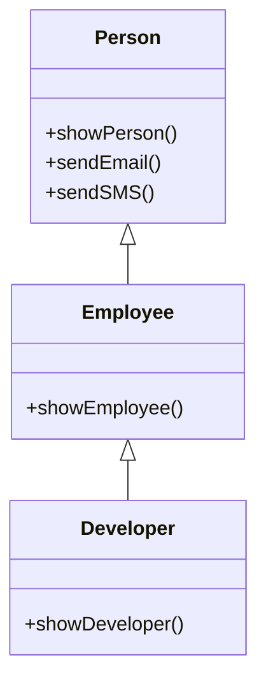
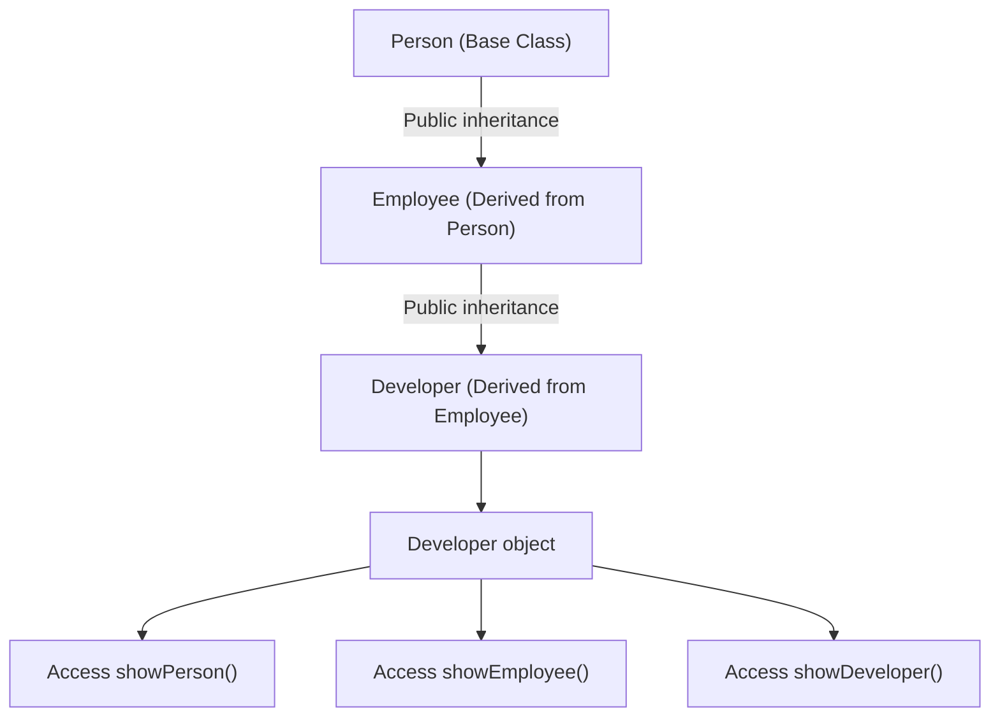
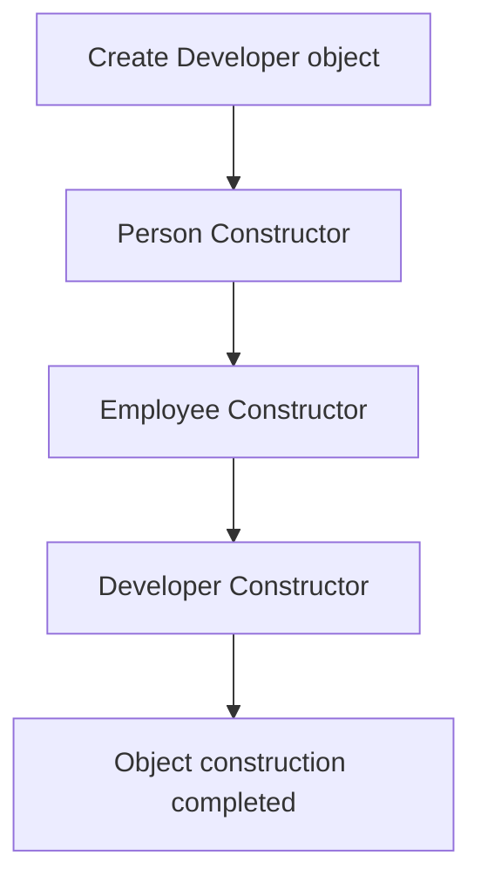
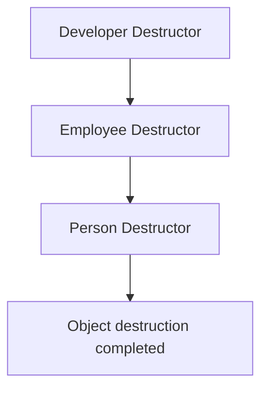
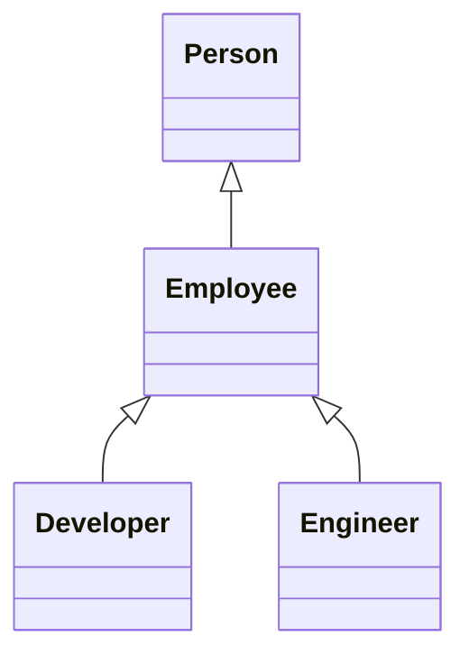

# Multilevel Inheritance in C++

## 1. Introduction

Multilevel Inheritance is a type of inheritance in Object-Oriented Programming (OOP) where a class inherits from another derived class.

This creates a chain of inheritance in which each new class can extend the functionality of the previous class.

### General Structure

```text
Base Class
    |
    v
Derived Class
    |
    v
Sub-Derived Class
```

A class can be both:

- A Derived Class of one class.
- A Base Class for another class.

This allows developers to create more specialized classes while reusing existing functionality.

---

## 2. Understanding Multilevel Inheritance

Consider three classes:

- `Person`
- `Employee`
- `Developer`

Their relationship is:

```text
Person
   |
   v
Employee
   |
   v
Developer
```

### Class Responsibilities

**Person**

The original Base Class.

It contains general personal information and functionality.

**Employee**

A Derived Class of `Person`.

It is also the Base Class of `Developer`.

It introduces employee-related information and functionality.

**Developer**

A Derived Class of `Employee`.

It introduces developer-specific information and functionality.

Because `Developer` inherits from `Employee`, and `Employee` inherits from `Person`, the `Developer` class can reuse accessible functionality from both classes.

---

## 3. Class Hierarchy Diagram



### Explanation

- `Person` is the original Base Class.
- `Employee` inherits from `Person`.
- `Developer` inherits from `Employee`.
- `Developer` indirectly inherits from `Person`.

This relationship is called **Multilevel Inheritance**.

---

## 4. Basic C++ Example

The following example demonstrates multilevel inheritance using three simple classes.

```cpp
#include <iostream>
using namespace std;

class Person
{
public:
    void showPerson()
    {
        cout << "I am a Person\n";
    }
};

class Employee : public Person
{
public:
    void showEmployee()
    {
        cout << "I am an Employee\n";
    }
};

class Developer : public Employee
{
public:
    void showDeveloper()
    {
        cout << "I am a Developer\n";
    }
};

int main()
{
    Developer developer;

    developer.showPerson();
    developer.showEmployee();
    developer.showDeveloper();

    return 0;
}
```

### Expected Output

```text
I am a Person
I am an Employee
I am a Developer
```

### Explanation

The `Developer` object can call:

```cpp
developer.showPerson();
```

This method is inherited indirectly from `Person`.

```cpp
developer.showEmployee();
```

This method is inherited from `Employee`.

```cpp
developer.showDeveloper();
```

This method belongs directly to `Developer`.

The example demonstrates how a derived class can reuse functionality across multiple inheritance levels.

---

## 5. How Inheritance Works Across Multiple Levels



When a `Developer` object is created, it contains the base-class subobjects required by its inheritance hierarchy.

This makes accessible inherited functionality available to the `Developer` object.

---

## 6. Access Specifiers in Multilevel Inheritance

C++ provides three main access specifiers:

- `public`
- `protected`
- `private`

Their accessibility affects how derived classes interact with inherited members.

### Public Inheritance

For the hierarchy:

```cpp
class Employee : public Person
{
};

class Developer : public Employee
{
};
```

The general rules are:

| Base Member Access | Accessible Directly in Derived Class? |
|---|---|
| Public | Yes |
| Protected | Yes |
| Private | No |

These rules apply to accessible inherited members when using public inheritance.

### Important Note About Private Members

Private data members of a Base Class remain part of the base-class subobject.

However, they cannot be accessed directly from the Derived Class.

For example:

```cpp
class Person
{
private:
    int _id;

public:
    int getId()
    {
        return _id;
    }
};
```

A derived class cannot directly access `_id`.

However, it can call the inherited public method:

```cpp
getId();
```

This demonstrates how encapsulation works together with inheritance.

---

## 7. Constructor Execution Order

When an object of the most-derived class is created, constructors execute from the Base Class to the most-derived class.

### Order

1. `Person`
2. `Employee`
3. `Developer`

### Example

```cpp
#include <iostream>
using namespace std;

class Person
{
public:
    Person()
    {
        cout << "Person Constructor\n";
    }
};

class Employee : public Person
{
public:
    Employee()
    {
        cout << "Employee Constructor\n";
    }
};

class Developer : public Employee
{
public:
    Developer()
    {
        cout << "Developer Constructor\n";
    }
};

int main()
{
    Developer developer;

    return 0;
}
```

### Expected Output

```text
Person Constructor
Employee Constructor
Developer Constructor
```

### Constructor Flow



**Rule:** Base-class constructors execute before derived-class constructor bodies.

---

## 8. Destructor Execution Order

Destructors execute in the reverse order of constructors.

### Order

1. `Developer`
2. `Employee`
3. `Person`

### Example

```cpp
#include <iostream>
using namespace std;

class Person
{
public:
    ~Person()
    {
        cout << "Person Destructor\n";
    }
};

class Employee : public Person
{
public:
    ~Employee()
    {
        cout << "Employee Destructor\n";
    }
};

class Developer : public Employee
{
public:
    ~Developer()
    {
        cout << "Developer Destructor\n";
    }
};

int main()
{
    Developer developer;

    return 0;
}
```

### Expected Output

```text
Developer Destructor
Employee Destructor
Person Destructor
```

### Destructor Flow



**Rule:** Derived-class destructors execute before base-class destructors.

---

## 9. Code Reusability

One of the main advantages of multilevel inheritance is code reusability.

Suppose the `Person` class contains a method for sending emails:

```cpp
void sendEmail(string subject, string body)
{
    // Send email
}
```

If this method is public, it can be used by both `Employee` and `Developer`.

There is no need to rewrite the same functionality in each class.

### Adding New Functionality

If a shared feature is appropriate for all classes in the hierarchy, it can be added to the Base Class.

For example:

```cpp
void sendFax()
{
    cout << "Sending Fax...\n";
}
```

If `sendFax()` is public in `Person`, it becomes accessible through the derived classes.

This helps reduce code duplication.

However, functionality should only be placed in the Base Class when it logically belongs to that class.

---

## 10. Maintainability and Extensibility

Multilevel inheritance can improve software maintainability when the class hierarchy is designed appropriately.

### Maintainability

Shared functionality can be implemented in a common Base Class.

When that functionality needs an update, the developer may only need to modify its original implementation.

### Extensibility

New specialized classes can be created without rewriting existing functionality.

For example:

```cpp
class Engineer : public Employee
{
    // Engineer-specific members
};
```

The `Engineer` class inherits accessible functionality from `Employee` and indirectly from `Person`.

### Extended Hierarchy



This structure allows multiple specialized employee types to share common functionality.

---

## 11. Organizing Classes into Separate Files

In larger C++ projects, classes are commonly organized into separate header and implementation files.

For example:

```text
Project/
├── Person.h
├── Person.cpp
├── Employee.h
├── Employee.cpp
├── Developer.h
├── Developer.cpp
└── main.cpp
```

### Benefits

- Better code organization.
- Easier maintenance.
- Improved readability.
- Separation of class declarations and implementations.
- Easier reuse across different parts of a project.

This is a common professional practice, but it is not a requirement for implementing multilevel inheritance.

For this learning exercise, keeping the classes together in one file is sufficient.

---

## 12. Multilevel Inheritance vs. Multiple Inheritance

These two concepts are different.

### Multilevel Inheritance

A class inherits from another derived class.

```text
Person
   |
Employee
   |
Developer
```

### Multiple Inheritance

A class inherits directly from more than one Base Class.

```text
Person     Worker
    \       /
     \     /
     Employee
```

**Important:** Multilevel inheritance and multiple inheritance are not the same concept.

This lesson focuses on multilevel inheritance.

---

## 13. Practical Application — Developer Class Project

The concept of multilevel inheritance was implemented in:

**Project 03 — Developer Class**

Project location:

```text
project_03_developer/
├── code.cpp
└── README.md
```

The project includes:

- `Person` as the original Base Class.
- `Employee` as the intermediate class.
- `Developer` as the most-derived class.
- Parameterized constructors.
- Constructor chaining.
- Encapsulation.
- Inherited getters and setters.
- Method redefinition.
- Developer-specific information.

The complete implementation is available in the project's `code.cpp` file.

The project demonstrates the same concepts in a more realistic example.

---

## 14. Advantages of Multilevel Inheritance

| Advantage | Description |
|---|---|
| Code Reusability | Reuses existing methods and accessible functionality |
| Maintainability | Centralizes shared functionality |
| Extensibility | Allows specialized classes to extend existing classes |
| Organization | Creates structured class hierarchies |
| Reduced Duplication | Avoids rewriting common functionality |
| Specialization | Supports adding class-specific properties and methods |

### Design Consideration

Deep inheritance hierarchies can also introduce complexity.

Inheritance should be used when the derived class represents a meaningful **is-a** relationship with its base class.

---

## 15. Key Takeaways

1. Multilevel inheritance creates a chain of related classes.
2. A class can be both a Derived Class and a Base Class.
3. The most-derived class can use accessible functionality inherited through multiple levels.
4. Private members are not directly accessible from derived classes.
5. Public and protected members follow C++ access-control rules.
6. Constructors execute from Base Class to most-derived class.
7. Destructors execute in the reverse order.
8. Shared functionality can be reused across multiple inheritance levels.
9. New specialized classes can extend an existing hierarchy.
10. Organizing classes into separate files can improve maintainability in larger projects.

---

## 16. Summary

**Multilevel Inheritance** occurs when a class inherits from another derived class, creating a chain of inheritance.

For example:

```text
Person → Employee → Developer
```

The `Developer` class inherits accessible functionality from `Employee` and indirectly from `Person`.

This approach supports code reuse, specialization, and maintainability when the hierarchy is designed appropriately.

### Next Topic

**Access Specifiers Review**

The next lesson reviews how public, protected, and private members behave in inheritance.
