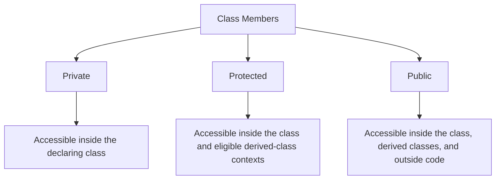
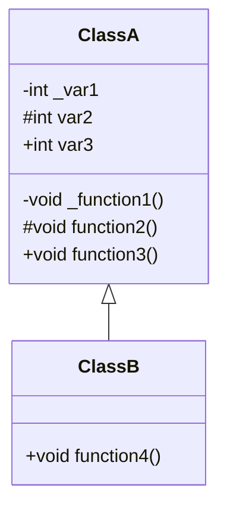
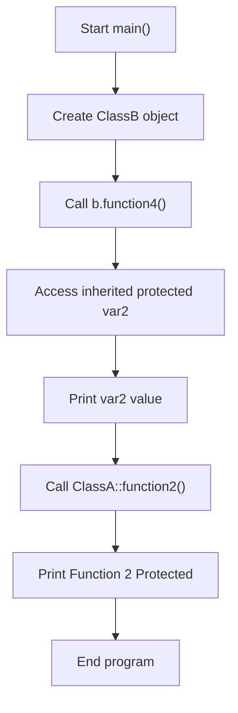

# Access Specifiers Review in C++

## 1. Introduction

One of the important advantages of Object-Oriented Programming (OOP) is the ability to control access to class members.

C++ provides **Access Specifiers**, also called **Access Modifiers**, to determine which parts of a program can directly access the data members and member functions of a class.

Access control is an important part of encapsulation.

It helps developers protect internal implementation details and define which operations are available to other classes and functions.

C++ provides three main access specifiers:

1. `private`
2. `protected`
3. `public`

This lesson reviews how these access specifiers behave inside a class, inside derived classes, and outside the class.

---

## 2. Why Do We Need Access Specifiers?

Access specifiers allow developers to control who can access class members.

There are three important access contexts:

1. **Inside the class:** Member functions of the class itself.
2. **Inside a derived class:** Member functions of classes that inherit from the original class.
3. **Outside the class:** Ordinary external code, such as the `main()` function.

Different access specifiers provide different levels of visibility.

### Access Control Overview



---

## 3. Private Access Specifier

The `private` access specifier restricts direct access to members of the declaring class.

### Example

```cpp
class ClassA
{
private:
    int _var1;

    void _function1()
    {
        cout << "Function 1 Private\n";
    }
};
```

### Rules

- Private members are accessible inside member functions of `ClassA`.
- Private members cannot be accessed directly from ordinary outside code.
- Private members cannot be accessed directly by member functions of a derived class.
- The class can provide public methods to expose controlled access to private data.

### Important Clarification

Private members are still part of the base-class subobject contained in a derived object.

However, the derived class cannot access them directly.

For example:

```cpp
class Person
{
private:
    int _id = 10;

public:
    int getId()
    {
        return _id;
    }
};

class Employee : public Person
{
public:
    void showId()
    {
        cout << getId();
    }
};
```

The `Employee` class cannot directly access `_id`, but it can use the inherited public method `getId()`.

This demonstrates how encapsulation and inheritance work together.

---

## 4. Protected Access Specifier

The `protected` access specifier allows members to be accessed inside the declaring class and in permitted derived-class contexts.

### Example

```cpp
class ClassA
{
protected:
    int var2 = 10;

    void function2()
    {
        cout << "Function 2 Protected\n";
    }
};
```

### Rules

- Protected members are accessible inside `ClassA`.
- Protected members are accessible inside derived classes, subject to C++ protected-access rules.
- Protected members cannot be accessed directly from ordinary outside code.
- Protected members are useful when derived classes need direct access to selected implementation details.

### Easy Way to Remember

**Protected = Restricted from outside code, but accessible to derived classes.**

This is a useful learning shortcut, although C++ has additional rules for protected access through objects and pointers.

---

## 5. Public Access Specifier

The `public` access specifier allows members to be accessed from ordinary outside code.

### Example

```cpp
class ClassA
{
public:
    int var3;

    void function3()
    {
        cout << "Function 3 Public\n";
    }
};
```

### Rules

- Public members are accessible inside `ClassA`.
- Public members are accessible inside derived classes.
- Public members are accessible from ordinary outside code when the object or expression is accessible.

### Example

```cpp
ClassA a;

a.var3 = 5;
a.function3();
```

This code is valid because `var3` and `function3()` are public members.

---

## 6. Access Specifiers Comparison

The following table describes direct member access for a publicly inherited class.

| Access Specifier | Inside Class | Derived Class | Outside Class |
|---|---|---|---|
| `private` | Yes | No | No |
| `protected` | Yes | Yes* | No |
| `public` | Yes | Yes | Yes |

*Protected access from derived classes is subject to the language's protected-member access rules.*

### Summary

**Private**

Accessible directly inside the declaring class.

**Protected**

Accessible inside the declaring class and permitted derived-class contexts.

**Public**

Accessible inside the class, derived classes, and ordinary outside code.

The table assumes normal access without special mechanisms such as friendship.

---

## 7. Access Specifiers with Inheritance

Consider the following class hierarchy:

```cpp
class ClassA
{
    // Base Class
};

class ClassB : public ClassA
{
    // Derived Class
};
```

`ClassB` inherits publicly from `ClassA`.

### Class Relationship



### UML Visibility Symbols

| Symbol | Access Specifier |
|---|---|
| `+` | Public |
| `#` | Protected |
| `-` | Private |

The diagram shows that `ClassB` inherits from `ClassA`.

However, inheritance does not automatically grant direct access to private members.

---

## 8. Accessing Protected Members from a Derived Class

In the exercise, `ClassB` inherits publicly from `ClassA`.

```cpp
class ClassB : public ClassA
{
public:
    void function4()
    {
        cout << ClassA::var2 << endl;
        ClassA::function2();
    }
};
```

### Explanation

The `function4()` method accesses two protected members from `ClassA`:

```cpp
ClassA::var2
```

and:

```cpp
ClassA::function2();
```

Both accesses are valid because they occur within an eligible derived-class member function.

### Scope Resolution Operator

The scope resolution operator `::` explicitly identifies the class that declares the member.

For example:

```cpp
ClassA::function2();
```

This specifies the `function2()` method inherited from `ClassA`.

### Alternative Syntax

The same members can be accessed without explicitly writing `ClassA::`:

```cpp
void function4()
{
    cout << var2 << endl;
    function2();
}
```

Both forms are valid in this example.

---

## 9. Accessing Members from main()

The `main()` function represents ordinary outside code.

### Public Members

```cpp
ClassA a;

a.var3 = 5;
a.function3();
```

This code is valid because both members are public.

### Protected Members

```cpp
ClassA a;

// a.var2 = 10;
// a.function2();
```

These operations are not allowed because protected members are not directly accessible from ordinary outside code.

### Private Members

```cpp
ClassA a;

// a._var1 = 10;
// a._function1();
```

These operations are also not allowed because the members are private.

---

## 10. Understanding the Exercise Output

The exercise creates an object of `ClassB`:

```cpp
ClassB b;

b.function4();
```

Inside `function4()`:

```cpp
cout << ClassA::var2 << endl;
ClassA::function2();
```

Assuming `var2` has been initialized to `10`, the output is:

```text
10
Function 2 Protected
```

### Important Note About Initialization

In the original example, `var2` was declared without an initial value:

```cpp
int var2;
```

Reading it before initialization causes undefined behavior.

For a predictable example, initialize it:

```cpp
int var2 = 10;
```

This makes the output deterministic.

---

## 11. Program Execution Flow



This diagram illustrates how a public method in the derived class can internally access protected members inherited from the base class.

---

## 12. Encapsulation and Access Control

Access specifiers are closely related to encapsulation.

Encapsulation involves grouping data and related functionality inside a class while controlling access to internal details.

### Example

```cpp
class Person
{
private:
    string _firstName;

public:
    void setFirstName(string firstName)
    {
        _firstName = firstName;
    }

    string getFirstName()
    {
        return _firstName;
    }
};
```

In this example:

- `_firstName` is private.
- `setFirstName()` is public.
- `getFirstName()` is public.

Outside code interacts with the private data through the class's public interface.

This provides an opportunity to add validation and other rules without exposing the internal variable directly.

---

## 13. Private vs. Protected

Both `private` and `protected` restrict direct access from ordinary outside code.

The main difference concerns derived classes.

| Feature | Private | Protected |
|---|---|---|
| Accessible inside declaring class | Yes | Yes |
| Accessible directly in derived class | No | Yes, subject to access rules |
| Accessible from ordinary outside code | No | No |
| Useful for hiding implementation details | Yes | Yes |
| Intended for direct derived-class access | No | Yes |

### Practical Guideline

Use `private` when a member should remain an implementation detail of its declaring class.

Use `protected` when derived classes genuinely need direct access to a member.

Use `public` for operations intended to be available through the class's external interface.

---

## 14. Important Distinction: Member Access vs. Inheritance Mode

This lesson focuses on access specifiers declared inside a class:

```cpp
private:
protected:
public:
```

However, C++ also supports inheritance access modes:

```cpp
class ClassB : public ClassA
{
};
```

```cpp
class ClassB : protected ClassA
{
};
```

```cpp
class ClassB : private ClassA
{
};
```

These inheritance modes affect the accessibility of inherited members.

They are different from the access specifiers used to declare class members.

**Inheritance visibility modes will be covered in the next lesson.**

---

## 15. Key Takeaways

1. C++ provides three access specifiers: `private`, `protected`, and `public`.
2. Access specifiers control direct access to class members.
3. Private members are directly accessible within their declaring class, not from ordinary derived-class code.
4. Protected members are accessible within the class and permitted derived-class contexts.
5. Public members form the externally accessible interface of a class.
6. A derived class can access inherited protected members when C++ access rules permit it.
7. Private base-class members remain part of the base-class subobject.
8. Public getters and setters can provide controlled access to private data.
9. The scope resolution operator `::` can explicitly identify inherited members.
10. Access specifiers support encapsulation and maintainability.

---

## 16. Summary

Access Specifiers determine who can directly access class members.

### Private

Accessible directly inside the declaring class.

### Protected

Accessible inside the declaring class and permitted derived-class contexts.

### Public

Accessible from ordinary outside code as well as within the class hierarchy.

In the exercise, `ClassB` successfully accesses protected members inherited from `ClassA`.

This demonstrates how access control and inheritance work together in C++.

### Next Topic

**Inheritance Visibility Modes**

The next lesson explores the differences between public, protected, and private inheritance.
