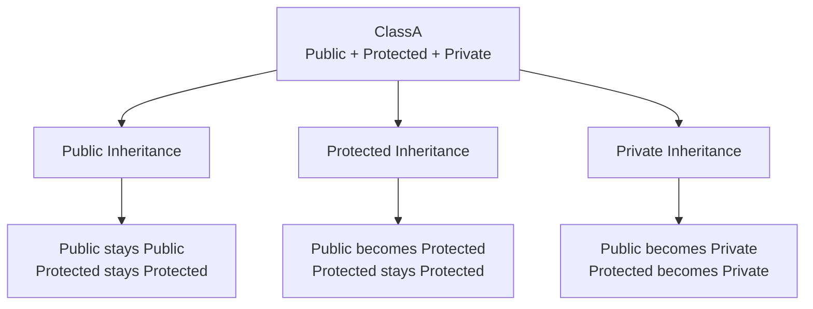

# Inheritance Visibility Modes in C++

## 1. Introduction

C++ provides three inheritance visibility modes:

1. Public Inheritance
2. Protected Inheritance
3. Private Inheritance

These modes control how the accessible members of a Base Class are exposed through a Derived Class.

Inheritance visibility modes are different from the access specifiers declared inside a class.

The access specifiers determine how members can be accessed, while inheritance visibility modes determine how inherited members are exposed through the derived class.

---

## 2. General Syntax

```cpp
class DerivedClassName : VisibilityMode BaseClassName
{
    // Derived class members
};
```

For example:

```cpp
class ClassB : public ClassA
{
};
```

The inheritance visibility mode is specified after the colon (`:`).

### Available Modes

```cpp
class ClassB : public ClassA
{
};

class ClassC : protected ClassA
{
};

class ClassD : private ClassA
{
};
```

### Default Inheritance Mode

When using the `class` keyword, the default inheritance mode is `private`.

```cpp
class ClassB : ClassA
{
};
```

This is equivalent to:

```cpp
class ClassB : private ClassA
{
};
```

When using the `struct` keyword, the default inheritance mode is `public`.

---

## 3. Understanding the Base Class

The exercise uses a class named `ClassA`.

```cpp
class ClassA
{
private:
    int v1;

    int function1()
    {
        return 1;
    }

protected:
    int v2;

    int function2()
    {
        return 2;
    }

public:
    int v3;

    int function3()
    {
        return 3;
    }
};
```

The class contains three groups of members.

| Access Specifier | Data Member | Member Function |
|---|---|---|
| Private | `v1` | `function1()` |
| Protected | `v2` | `function2()` |
| Public | `v3` | `function3()` |

Each group has different accessibility rules.

The inheritance mode determines how the public and protected members are exposed through derived classes.

---

## 4. Public Inheritance

### Syntax

```cpp
class ClassB : public ClassA
{
};
```

Public inheritance preserves the access levels of inherited public and protected members.

### Rules

- Public members remain public.
- Protected members remain protected.
- Private members are not directly accessible in the Derived Class.

### Example

```cpp
class ClassB : public ClassA
{
public:
    int getValue()
    {
        return function3();
    }
};
```

Outside code can directly call the inherited public method:

```cpp
ClassB b;

cout << b.function3();
```

This works because `function3()` remains public.

However, outside code cannot directly access `function2()` because it remains protected.

### Public Inheritance and the Is-A Relationship

Public inheritance commonly represents an **is-a** relationship.

For example:

```text
Employee is a Person.
Developer is an Employee.
```

Public inheritance allows a derived object to be used as an object of its accessible public Base Class.

---

## 5. Protected Inheritance

### Syntax

```cpp
class ClassB : protected ClassA
{
};
```

Protected inheritance changes inherited public members into protected members.

### Rules

- Public members become protected.
- Protected members remain protected.
- Private members are not directly accessible in the Derived Class.

### Example

```cpp
class ClassB : protected ClassA
{
public:
    int getValue()
    {
        return function3();
    }
};
```

Inside `ClassB`, `function3()` is accessible.

However, outside code cannot directly call the inherited method:

```cpp
ClassB b;

// b.function3(); // Error
```

The inherited method is protected through `ClassB`.

The public method `getValue()` remains accessible:

```cpp
cout << b.getValue();
```

### Further Inheritance

A class derived from `ClassB` can access the inherited protected members when C++ protected-access rules permit it.

```cpp
class ClassC : public ClassB
{
public:
    int getInheritedValue()
    {
        return function3();
    }
};
```

This is valid because `function3()` is protected through `ClassB`.

---

## 6. Private Inheritance

### Syntax

```cpp
class ClassB : private ClassA
{
};
```

Private inheritance changes inherited public and protected members into private members through the Derived Class.

### Rules

- Public members become private.
- Protected members become private.
- Private members are not directly accessible in the Derived Class.

### Example

```cpp
class ClassB : private ClassA
{
public:
    int getValue()
    {
        return function3();
    }
};
```

Inside `ClassB`, the inherited `function3()` method is accessible.

However, outside code cannot call it directly:

```cpp
ClassB b;

// b.function3(); // Error
```

Outside code can still call the new public method:

```cpp
cout << b.getValue();
```

### Important Distinction

Private inheritance does not remove inherited functionality.

It restricts access to inherited members through the Derived Class.

A class derived from `ClassB` cannot directly access the inherited members that became private in `ClassB`.

However, it can still use public methods exposed by `ClassB`.

---

## 7. Complete Inheritance Visibility Table

This is the most important table in the lesson.

| Base Class Member | Public Inheritance | Protected Inheritance | Private Inheritance |
|---|---|---|---|
| Public | Public | Protected | Private |
| Protected | Protected | Protected | Private |
| Private | Inaccessible directly | Inaccessible directly | Inaccessible directly |

### Easy Rules

**Public Inheritance**

```text
Public    → Public
Protected → Protected
Private   → Not directly accessible
```

**Protected Inheritance**

```text
Public    → Protected
Protected → Protected
Private   → Not directly accessible
```

**Private Inheritance**

```text
Public    → Private
Protected → Private
Private   → Not directly accessible
```

The original access declarations inside the Base Class do not change.

The table describes accessibility through the derived class.

---

## 8. Inheritance Visibility Diagram



### Important Note

In all three modes, the Base Class private members remain inaccessible directly to the Derived Class.

---

## 9. Multilevel Inheritance and Visibility Modes

Inheritance visibility becomes particularly important when more than two classes are involved.

Consider:

```text
ClassA → ClassB → ClassC
```

The inheritance mode used between `ClassA` and `ClassB` affects which inherited members `ClassC` can access.

### Case 1 — Public Inheritance

```cpp
class ClassB : public ClassA
{
};

class ClassC : public ClassB
{
};
```

The public and protected members of `ClassA` retain their respective accessibility through both inheritance levels.

`ClassC` can directly access the inherited public and protected members, subject to normal access rules.

### Case 2 — Protected Inheritance

```cpp
class ClassB : protected ClassA
{
};

class ClassC : public ClassB
{
};
```

The original public and protected members of `ClassA` become protected through `ClassB`.

They remain accessible in eligible derived-class contexts inside `ClassC`.

However, they are not publicly exposed through `ClassB` or `ClassC`.

### Case 3 — Private Inheritance

```cpp
class ClassB : private ClassA
{
};

class ClassC : public ClassB
{
};
```

The original public and protected members of `ClassA` become private through `ClassB`.

`ClassC` cannot directly access those inherited members.

However, `ClassC` can use public and protected functionality independently provided by `ClassB`, subject to access rules.

### Comparison

| First Inheritance Mode | Access from ClassB | Direct Access from ClassC |
|---|---|---|
| Public | Public and Protected | Yes, according to access rules |
| Protected | Public and Protected become Protected | Yes, according to access rules |
| Private | Public and Protected become Private | No, for those inherited members |

This is why inheritance visibility modes are important when designing multilevel class hierarchies.

---

## 10. Understanding the Original Exercise

The original code contains:

```cpp
class ClassB : ClassA
{
public:
    int function4()
    {
        return 4;
    }
};
```

Because `ClassB` uses the `class` keyword and does not explicitly specify an inheritance mode, the inheritance is private.

It is equivalent to:

```cpp
class ClassB : private ClassA
{
public:
    int function4()
    {
        return 4;
    }
};
```

### What Happens?

- `ClassA::function3()` becomes private through `ClassB`.
- `ClassA::function2()` becomes private through `ClassB`.
- `ClassA::function1()` remains inaccessible directly to `ClassB`.
- `ClassB::function4()` remains public because it is declared in the public section of `ClassB`.

### Example

```cpp
ClassB b;

cout << b.function4();
```

This is valid.

However:

```cpp
// cout << b.function3(); // Error
```

This is not allowed because `function3()` is privately inherited.

---

## 11. Access from Outside the Class

The inheritance mode affects access to inherited members from ordinary external code, such as `main()`.

### Public Inheritance

Inherited public members remain accessible from outside.

### Protected Inheritance

Inherited public members become protected and are not directly accessible from outside.

### Private Inheritance

Inherited public members become private and are not directly accessible from outside.

### Important Exception to Remember

New public methods declared inside the Derived Class remain public, regardless of the inheritance mode.

For example:

```cpp
class ClassB : private ClassA
{
public:
    int function4()
    {
        return 4;
    }
};
```

The following is valid:

```cpp
ClassB b;

cout << b.function4();
```

Inheritance visibility does not automatically change the access specifiers of members newly declared inside the Derived Class.

---

## 12. Access Specifiers vs. Inheritance Visibility Modes

These concepts are related but different.

### Access Specifiers

Declared inside a class:

```cpp
private:
protected:
public:
```

They control access to the class's members.

### Inheritance Visibility Modes

Declared in the inheritance relationship:

```cpp
class ClassB : public ClassA
```

```cpp
class ClassB : protected ClassA
```

```cpp
class ClassB : private ClassA
```

They control how inherited public and protected members are exposed through the Derived Class.

### Comparison

| Concept | Purpose |
|---|---|
| Access Specifiers | Control access to class members |
| Inheritance Visibility Modes | Control accessibility of inherited members through the Derived Class |

---

## 13. Important Notes About Private Members

A common simplified explanation is:

"Private members are not inherited."

A more technically precise explanation is:

**Private members remain part of the Base Class subobject, but they cannot be accessed directly from ordinary Derived Class code.**

For example:

```cpp
class Person
{
private:
    int _id = 10;

public:
    int getId()
    {
        return _id;
    }
};

class Employee : public Person
{
public:
    int showId()
    {
        return getId();
    }
};
```

Although `_id` is private, `Employee` can use the inherited public method `getId()` to retrieve its value.

The private member is still present in the `Person` base-class subobject.

---

## 14. Practical Design Guidelines

### Use Public Inheritance When

- The Derived Class represents an is-a relationship.
- Objects of the Derived Class should be usable as objects of the Base Class.
- The Base Class public interface should remain publicly available.

### Use Protected Inheritance When

- The implementation should be available to further derived classes.
- The inherited Base Class interface should not be publicly exposed.
- The relationship is intentionally restricted.

### Use Private Inheritance When

- The Derived Class needs to reuse Base Class implementation details.
- The Base Class interface should not be publicly exposed through the Derived Class.
- The relationship represents implementation reuse rather than a public is-a relationship.

In many designs, composition is also worth considering as an alternative to private inheritance.

---

## 15. Key Takeaways

1. C++ provides public, protected, and private inheritance.
2. Public inheritance preserves public and protected access levels.
3. Protected inheritance makes inherited public and protected members protected.
4. Private inheritance makes inherited public and protected members private.
5. Private Base Class members cannot be accessed directly from ordinary derived-class code.
6. The default inheritance mode for `class` is private.
7. The default inheritance mode for `struct` is public.
8. Public methods newly declared inside a Derived Class remain public regardless of the inheritance mode.
9. Inheritance visibility affects access in further derived classes.
10. Public inheritance is commonly used to model is-a relationships.

---

## 16. Summary

Inheritance Visibility Modes determine how a Derived Class exposes accessible members inherited from its Base Class.

### Public Inheritance

```text
Public    → Public
Protected → Protected
```

### Protected Inheritance

```text
Public    → Protected
Protected → Protected
```

### Private Inheritance

```text
Public    → Private
Protected → Private
```

In all cases, private Base Class members remain inaccessible directly to ordinary derived-class code.

The inheritance mode affects the accessibility of inherited members, not the original member declarations inside the Base Class.

### Next Topic

**Types of Inheritance**

The next lesson introduces the different inheritance structures supported by C++.
