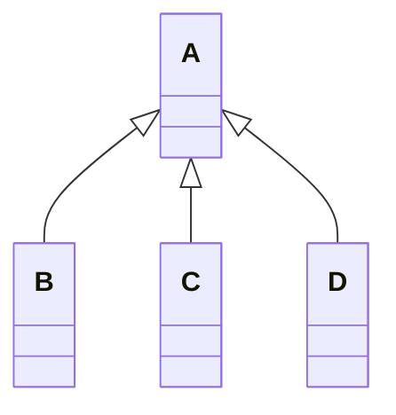
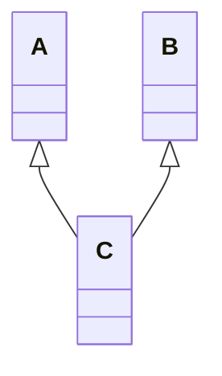
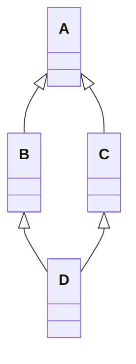
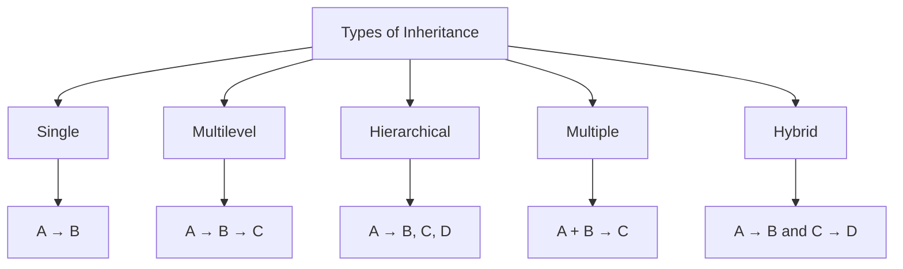

# Types of Inheritance in C++

## 1. Introduction

Inheritance is one of the fundamental concepts of Object-Oriented Programming (OOP).

It allows a Derived Class to reuse and extend the functionality of an existing Base Class.

C++ supports several inheritance structures, commonly classified into five types:

1. Single Inheritance
2. Multilevel Inheritance
3. Hierarchical Inheritance
4. Multiple Inheritance
5. Hybrid Inheritance

Each type describes a different relationship between Base Classes and Derived Classes.

---

## 2. Single Inheritance

### Definition

Single Inheritance occurs when one Derived Class inherits from one Base Class.

### Structure

```text
Class A
   |
   v
Class B
```

- `A` is the Base Class.
- `B` is the Derived Class.
- `B` inherits from `A`.

### Mermaid Diagram


### C++ Example

```cpp
class A
{
public:
    void functionA()
    {
    }
};

class B : public A
{
public:
    void functionB()
    {
    }
};
```

### Explanation

`B` inherits the accessible functionality of `A`.

An object of `B` can call its own public methods and inherited public methods.

### Real-World Example

```text
Person → Employee
```

An Employee is a Person.

---

## 3. Multilevel Inheritance

### Definition

Multilevel Inheritance occurs when a Derived Class becomes the Base Class for another class.

This creates a chain of inheritance.

### Structure

```text
Class A
   |
   v
Class B
   |
   v
Class C
```

- `B` inherits from `A`.
- `C` inherits from `B`.
- `C` indirectly inherits from `A`.

### Mermaid Diagram


### C++ Example

```cpp
class A
{
public:
    void functionA()
    {
    }
};

class B : public A
{
public:
    void functionB()
    {
    }
};

class C : public B
{
public:
    void functionC()
    {
    }
};
```

### Explanation

An object of `C` can use accessible public functionality from:

- Class `A`
- Class `B`
- Class `C`

### Practical Example

```text
Person → Employee → Developer
```

This inheritance type was implemented in:

**Project 03 — Developer Class**

The project demonstrates constructor chaining, inherited methods, encapsulation, and class specialization.

---

## 4. Hierarchical Inheritance

### Definition

Hierarchical Inheritance occurs when multiple Derived Classes inherit from the same Base Class.

### Structure

```text
        Class A
       /   |   \
      v    v    v
      B    C    D
```

- `A` is the common Base Class.
- `B`, `C`, and `D` are separate Derived Classes.
- Each Derived Class inherits directly from `A`.

### Mermaid Diagram



### C++ Example

```cpp
class Person
{
public:
    void showPerson()
    {
    }
};

class Employee : public Person
{
};

class Student : public Person
{
};

class Customer : public Person
{
};
```

### Explanation

`Employee`, `Student`, and `Customer` all inherit accessible functionality from `Person`.

However, they do not automatically inherit functionality from one another.

### Advantage

Hierarchical inheritance allows several specialized classes to share a common Base Class.

---

## 5. Multiple Inheritance

### Definition

Multiple Inheritance occurs when one Derived Class inherits directly from more than one Base Class.

### Structure

```text
Class A     Class B
     \       /
      v     v
       Class C
```

- `A` is a Base Class.
- `B` is another Base Class.
- `C` inherits from both `A` and `B`.

### Mermaid Diagram



### C++ Example

```cpp
class A
{
public:
    void functionA()
    {
    }
};

class B
{
public:
    void functionB()
    {
    }
};

class C : public A, public B
{
public:
    void functionC()
    {
    }
};
```

### Explanation

An object of `C` can use accessible public methods inherited from both `A` and `B`.

### Potential Problems

Multiple inheritance can introduce complexity.

For example, if both Base Classes define a method with the same name, an unqualified call through the Derived Class may become ambiguous.

```cpp
class A
{
public:
    void print()
    {
    }
};

class B
{
public:
    void print()
    {
    }
};

class C : public A, public B
{
};
```

The following call is ambiguous:

```cpp
C obj;

// obj.print(); // Compilation error: ambiguous call
```

The ambiguity can be resolved by explicitly selecting a Base Class:

```cpp
obj.A::print();
obj.B::print();
```

### Important Note

Multiple inheritance is not exclusive to C++.

Some programming languages support multiple class inheritance, while others restrict it or provide alternatives such as interfaces.

Multiple inheritance is valid C++ and does not automatically produce compilation errors.

---

## 6. Hybrid Inheritance

### Definition

Hybrid Inheritance combines two or more inheritance structures.

A common example combines hierarchical inheritance with multiple inheritance.

### Structure

```text
        Class A
        /     \
       v       v
    Class B  Class C
       \       /
        v     v
        Class D
```

- `B` inherits from `A`.
- `C` inherits from `A`.
- `D` inherits from both `B` and `C`.

### Mermaid Diagram



This structure is commonly called the **Diamond Inheritance Structure**.

### C++ Example

```cpp
class A
{
public:
    void functionA()
    {
    }
};

class B : public A
{
};

class C : public A
{
};

class D : public B, public C
{
};
```

### Understanding the Problem

In this example, `D` inherits through two different paths:

```text
D → B → A
D → C → A
```

Without virtual inheritance, a `D` object contains two separate `A` base-class subobjects.

Therefore:

```cpp
D obj;

// obj.functionA(); // Ambiguous
```

The compiler cannot determine which inherited `A::functionA()` should be called.

### Possible Solution: Virtual Inheritance

C++ provides virtual inheritance to share a common virtual Base Class subobject.

```cpp
class A
{
public:
    void functionA()
    {
    }
};

class B : virtual public A
{
};

class C : virtual public A
{
};

class D : public B, public C
{
};
```

Now `D` contains one shared `A` virtual base-class subobject.

This resolves the duplicated-base ambiguity in this example.

### Important Note

Hybrid inheritance does not always cause errors.

However, it can introduce more complicated class relationships and requires careful design.

---

## 7. Comparison of Inheritance Types

| Type | Structure | Description |
|---|---|---|
| Single | A → B | One Derived Class inherits from one Base Class |
| Multilevel | A → B → C | A chain of inheritance |
| Hierarchical | A → B, C, D | Multiple classes inherit from one Base Class |
| Multiple | A, B → C | One class inherits from multiple Base Classes |
| Hybrid | Combination | Combines multiple inheritance structures |

---

## 8. Visual Comparison



The five types describe different class relationship structures.

The correct type depends on the design requirements of the program.

---

## 9. Inheritance Support Across Programming Languages

Inheritance features vary across programming languages.

### Commonly Supported Structures

Single, multilevel, and hierarchical inheritance are supported by many object-oriented languages that provide class inheritance.

### Multiple Inheritance

Some languages, including C++ and Python, support inheriting from multiple classes.

Other languages, such as Java and C#, do not support multiple inheritance of classes directly.

Instead, they allow a class to implement multiple interfaces.

### Important Distinction

Multiple class inheritance and implementing multiple interfaces are not identical features.

Programming languages use different mechanisms to support code reuse and polymorphism.

---

## 10. Advantages and Considerations

### Advantages

- Code reusability
- Reduced duplication
- Class specialization
- Better organization of related functionality
- Easier extension of well-designed class hierarchies

### Design Considerations

- Deep inheritance hierarchies can become difficult to maintain.
- Multiple inheritance can introduce name ambiguity.
- Hybrid inheritance can introduce diamond-shaped class relationships.
- Inheritance should represent a meaningful relationship between classes.
- Composition may be preferable when inheritance does not match the intended relationship.

---

## 11. Key Takeaways

1. C++ supports five commonly described inheritance structures.
2. Single inheritance connects one Base Class to one Derived Class.
3. Multilevel inheritance creates a chain of inheritance.
4. Hierarchical inheritance allows multiple Derived Classes to share one Base Class.
5. Multiple inheritance allows one class to inherit from multiple Base Classes.
6. Hybrid inheritance combines different inheritance structures.
7. Multiple inheritance is not exclusive to C++.
8. Multiple and hybrid inheritance may introduce ambiguity, but they are not inherently invalid.
9. Virtual inheritance can resolve duplicated-base problems in diamond-shaped hierarchies.
10. Choosing an inheritance structure depends on the program's design requirements.

---

## 12. Summary

### Single Inheritance

```text
A → B
```

One class inherits from another class.

### Multilevel Inheritance

```text
A → B → C
```

A Derived Class inherits from another Derived Class.

### Hierarchical Inheritance

```text
A → B
A → C
A → D
```

Multiple Derived Classes inherit from one Base Class.

### Multiple Inheritance

```text
A + B → C
```

One Derived Class inherits from multiple Base Classes.

### Hybrid Inheritance

```text
A → B
A → C
B + C → D
```

A combination of inheritance structures.

### Next Topic

**Upcasting and Downcasting**

The next lesson introduces conversions between Base Class and Derived Class pointers or references.
