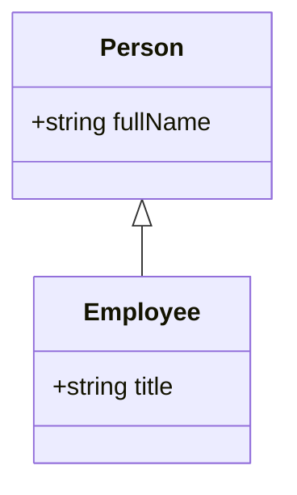
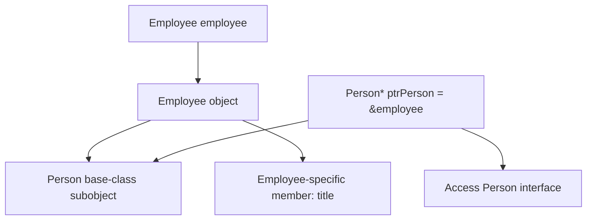
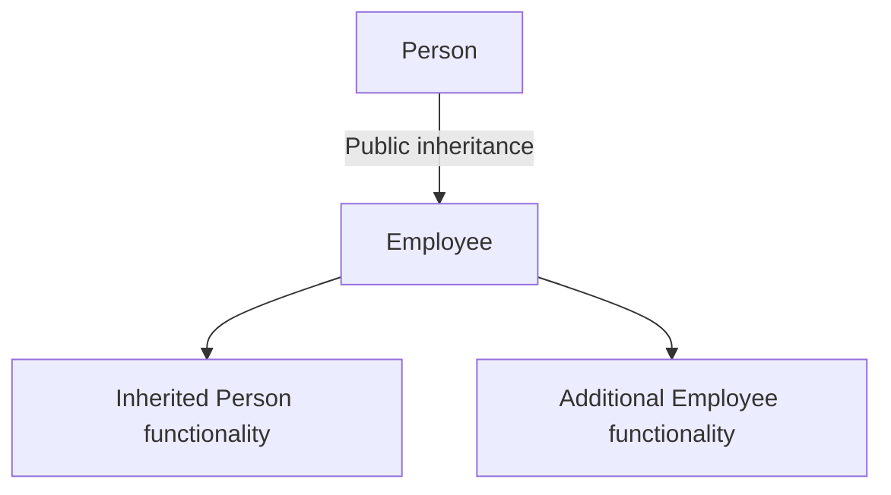
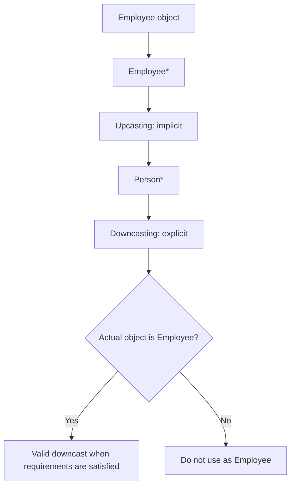

# Upcasting and Downcasting in C++

## 1. Introduction

Inheritance establishes a relationship between Base Classes and Derived Classes.

In C++, pointers and references can be used to work with objects through different class types.

Two important concepts related to inheritance are:

1. Upcasting
2. Downcasting

These concepts describe conversions between Base Class and Derived Class pointers or references.

Understanding these conversions is important when working with inheritance and polymorphism.

---

## 2. Understanding the Class Hierarchy

Consider two classes:

```cpp
class Person
{
public:
    string fullName = "Dony Ronny";
};

class Employee : public Person
{
public:
    string title = "CEO";
};
```

### Class Relationship



### Explanation

- `Person` is the Base Class.
- `Employee` is the Derived Class.
- `Employee` inherits from `Person`.
- `Employee` adds its own member named `title`.

An `Employee` object contains a `Person` base-class subobject and the additional data belonging to `Employee`.

This leads to an important relationship:

**Every Employee is a Person, but not every Person is an Employee.**

---

## 3. What Is Upcasting?

Upcasting is the conversion of a Derived Class pointer or reference to a Base Class pointer or reference.

### Direction

```text
Derived Class → Base Class
Employee*     → Person*
```

For an accessible, unambiguous public Base Class, this conversion can happen automatically.

### Example

```cpp
Employee employee;

Person* ptrPerson = &employee;
```

### Explanation

1. An `Employee` object is created.
2. `&employee` provides its address.
3. A `Person*` pointer is initialized to point to the `Person` base-class subobject of `employee`.
4. No explicit cast is required.

This is called **Implicit Upcasting**.

---

## 4. Accessing Members After Upcasting

Consider:

```cpp
Employee employee;

Person* ptrPerson = &employee;

cout << ptrPerson->fullName << endl;
```

### Expected Output

```text
Dony Ronny
```

The pointer has the static type:

```cpp
Person*
```

Therefore, member access through this pointer uses the interface available through `Person`.

### Important Example

```cpp
cout << ptrPerson->fullName; // Valid
```

However:

```cpp
// cout << ptrPerson->title; // Compilation error
```

Even though the actual object is an `Employee`, the pointer's static type is `Person*`.

The `Person` class does not declare a member named `title`.

### Key Concept

**The static type of a pointer determines which members are directly accessible through that pointer.**

Virtual functions can introduce runtime dispatch behavior, which is covered in later lessons.

---

## 5. Upcasting Diagram



Upcasting does not create a new object.

The Base Class pointer refers to the base-class subobject within the existing Derived Class object.

The Employee-specific members still exist, but they are not directly accessible through a `Person*` pointer.

---

## 6. What Is Downcasting?

Downcasting is a conversion from a Base Class pointer or reference type to a Derived Class pointer or reference type.

### Direction

```text
Base Class → Derived Class
Person*    → Employee*
```

Unlike ordinary public upcasting, downcasting is not performed implicitly.

It requires an explicit cast and careful consideration of the actual object type.

### Important Rule

A Base Class pointer can point to a Derived Class object.

However, a Derived Class pointer must not be used to treat an unrelated or Base-only object as if it were a Derived Class object.

---

## 7. Invalid Downcasting Example

The original exercise includes:

```cpp
Person person;

Employee* ptrEmployee = &person;
```

This code does not compile.

### Why?

The expression:

```cpp
&person
```

has type:

```cpp
Person*
```

But the destination pointer has type:

```cpp
Employee*
```

C++ does not allow this conversion implicitly.

More importantly, the actual object is a `Person`, not an `Employee`.

It does not contain an `Employee` subobject or the additional `title` member.

### Important Warning

Forcing this conversion with an inappropriate cast does not transform a `Person` object into an `Employee` object.

Using the resulting pointer as though it referred to an Employee can cause undefined behavior.

---

## 8. Understanding the Pointer Rule

### Upcasting

```cpp
Employee employee;

Person* ptrPerson = &employee;
```

**Valid**

The pointer refers to the `Person` base-class subobject of a real `Employee` object.

### Invalid Assignment

```cpp
Person person;

Employee* ptrEmployee = &person;
```

**Invalid**

A `Person*` cannot be implicitly converted to an `Employee*`.

The actual object is also not an `Employee`.

### Comparison

| Scenario | Result |
|---|---|
| `Person*` points to an `Employee` object | Valid upcasting |
| `Employee*` points to an actual `Employee` object | Valid |
| `Employee*` is implicitly assigned a `Person*` | Compilation error |
| Forced cast of a Base-only object to Derived, then used as Derived | Unsafe; may cause undefined behavior |

---

## 9. Why Is the Derived Class More Specialized?

The `Employee` class inherits the functionality of `Person` and introduces additional members.

### Person

```text
fullName
```

### Employee

```text
Person base-class subobject
    fullName

Employee-specific data
    title
```

An `Employee` object includes its `Person` base-class subobject.

However, an independently created `Person` object does not automatically include Employee-specific data.

### Relationship



This is why the following statement is useful:

**Every Employee is a Person, but not every Person is an Employee.**

The Derived Class is more specialized, not necessarily larger in every technical sense.

---

## 10. Can Downcasting Ever Be Valid?

Yes.

Downcasting can be valid when a Base Class pointer or reference actually refers to an object of the appropriate Derived Class.

For example:

```cpp
Employee employee;

Person* ptrPerson = &employee;
```

Here, `ptrPerson` has type `Person*`, but it refers to the `Person` base-class subobject of an actual `Employee`.

An explicit downcast back to `Employee*` can be valid when the required type and inheritance conditions are satisfied.

### Example with static_cast

```cpp
Employee* ptrEmployee =
    static_cast<Employee*>(ptrPerson);

cout << ptrEmployee->title;
```

This is valid in this specific example because the original object is an `Employee`.

However, `static_cast` does not perform a runtime check to verify the object's dynamic type.

It must not be used blindly.

### Safer Checked Downcasting

For polymorphic Base Classes, C++ provides `dynamic_cast`.

It can check whether the object is compatible with the requested Derived Class type.

This requires a polymorphic Base Class, typically one containing at least one virtual function.

The details of virtual functions and runtime polymorphism are covered in later lessons.

---

## 11. Upcasting vs. Downcasting

| Feature | Upcasting | Downcasting |
|---|---|---|
| Direction | Derived → Base | Base → Derived |
| Typical pointer conversion | `Employee*` → `Person*` | `Person*` → `Employee*` |
| Implicit conversion | Usually allowed for accessible, unambiguous public bases | Not allowed |
| Explicit cast required | Usually no | Yes |
| Runtime type checking | Not required for ordinary upcasting | Recommended when appropriate |
| Safety | Generally safe | Depends on actual object type and cast |
| Typical purpose | Use Base Class interface | Access Derived Class functionality |

---

## 12. Upcasting and Downcasting Flow



The important distinction is between:

- The pointer's static type.
- The actual type of the object it refers to.

---

## 13. Original Exercise Review

The exercise contains two parts.

### Part 1 — Upcasting

```cpp
Employee employee;

Person* ptrPerson = &employee;

cout << ptrPerson->fullName << endl;
```

This part is valid.

It prints:

```text
Dony Ronny
```

### Part 2 — Invalid Conversion

```cpp
Person person;

Employee* ptrEmployee = &person;
```

This part causes a compilation error.

The compiler rejects the implicit Base-to-Derived pointer conversion.

### Compilable Version

To keep the original lesson example while allowing the program to compile, the invalid statements can be commented out.

```cpp
#include <iostream>
#include <string>

using namespace std;

class Person
{
public:
    string fullName = "Dony Ronny";
};

class Employee : public Person
{
public:
    string title = "CEO";
};

int main()
{
    Employee employee;

    // Upcasting
    Person* ptrPerson = &employee;

    cout << ptrPerson->fullName << endl;

    Person person;

    // Invalid downcasting example:
    // Employee* ptrEmployee = &person;
    // cout << ptrEmployee->fullName;

    return 0;
}
```

### Expected Output

```text
Dony Ronny
```

---

## 14. Common Misunderstandings

### Misunderstanding 1

"Downcasting is always impossible."

**Correction:** Downcasting is possible with explicit casts when the necessary conditions are satisfied.

### Misunderstanding 2

"Upcasting converts the entire object into a Base Class object."

**Correction:** Pointer or reference upcasting does not replace or copy the object. It refers to the Base Class subobject of the existing Derived Class object.

### Misunderstanding 3

"A Base Class pointer can access every member of the Derived Class."

**Correction:** Ordinary member access is restricted by the pointer's static type.

### Misunderstanding 4

"A cast can turn a Base-only object into a Derived Class object."

**Correction:** Casting a pointer does not change the actual object's type or create missing Derived Class members.

---

## 15. Key Takeaways

1. Upcasting converts a Derived Class pointer or reference to a Base Class pointer or reference.
2. Public upcasting is generally implicit when the Base Class is accessible and unambiguous.
3. Downcasting converts a Base Class pointer or reference to a Derived Class pointer or reference.
4. Downcasting is not implicit.
5. A Base Class pointer can refer to a Derived Class object.
6. A Base-only object must not be treated as a Derived Class object.
7. The static pointer type determines which members are directly accessible.
8. Pointer upcasting does not create a new object.
9. Explicit downcasting can be valid when the actual object type is compatible.
10. `dynamic_cast` provides checked downcasting for suitable polymorphic class hierarchies.

---

## 16. Summary

### Upcasting

```cpp
Employee employee;

Person* ptrPerson = &employee;
```

**Derived → Base**

Valid and implicit for this public inheritance relationship.

### Downcasting

```cpp
Person person;

Employee* ptrEmployee = &person;
```

**Base → Derived**

Not implicitly allowed.

An explicit downcast may be valid only when the actual object and conversion requirements permit it.

### Important Rule

**Every Employee is a Person, but not every Person is an Employee.**

### Next Topic

**Virtual Functions**

The next lesson explains how virtual functions enable runtime polymorphism through Base Class pointers and references.
