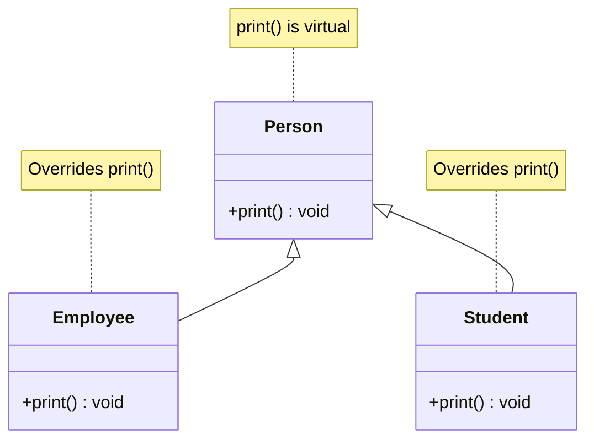
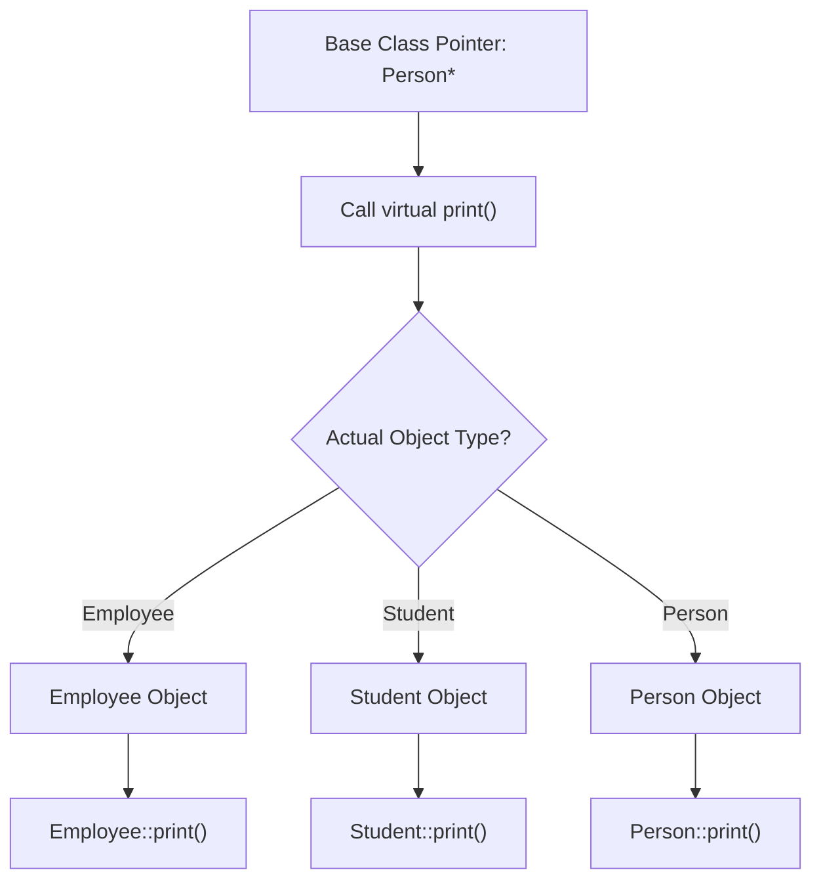
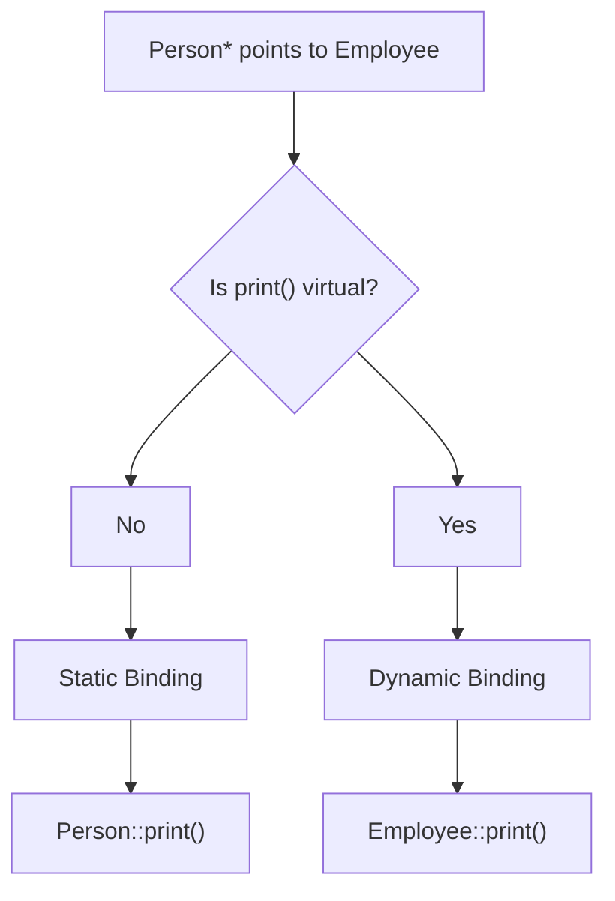

# Virtual Functions in C++

## 1. Introduction

A **Virtual Function** is a member function declared in a Base Class using the `virtual` keyword.

It allows Derived Classes to provide their own implementations of the function.

When a virtual function is called through a Base Class pointer or reference, C++ can select the appropriate implementation based on the actual object type at runtime.

This mechanism is called **Runtime Polymorphism** or **Dynamic Polymorphism**.

Virtual functions are closely related to three important OOP concepts:

1. Inheritance
2. Function Overriding
3. Runtime Polymorphism

---

## 2. What Is a Virtual Function?

A virtual function is a member function declared with the `virtual` keyword in a Base Class.

### Syntax

```cpp
class Person
{
public:
    virtual void print()
    {
        cout << "Hi, I'm Person." << endl;
    }
};
```

The keyword `virtual` tells C++ that a Derived Class may override this function.

When the function is called through a Base Class pointer or reference, virtual dispatch allows the appropriate implementation to be selected according to the actual object type.

### Important Note

Declaring a function as `virtual` does not force Derived Classes to override it.

If a Derived Class does not override the function, it can inherit the Base Class implementation.

---

## 3. Understanding Function Overriding

**Function Overriding** occurs when a Derived Class provides its own implementation of an inherited virtual function with a matching signature and compatible return type.

### Example

```cpp
class Person
{
public:
    virtual void print()
    {
        cout << "Hi, I'm Person." << endl;
    }
};

class Employee : public Person
{
public:
    void print()
    {
        cout << "Hi, I'm Employee." << endl;
    }
};
```

Here:

- `Person` is the Base Class.
- `Employee` is the Derived Class.
- `Person::print()` is virtual.
- `Employee::print()` overrides `Person::print()`.

The Derived Class provides its own behavior for the inherited function.

### Important Concept

The function remains virtual in the Derived Class even if the `virtual` keyword is not repeated.

---

## 4. Original Lesson Example

The exercise contains three classes:

- `Person`
- `Employee`
- `Student`

Both `Employee` and `Student` inherit publicly from `Person`.

### Complete Code

```cpp
#include <iostream>

using namespace std;

class Person
{
public:
    virtual void print()
    {
        cout << "Hi, I'm Person." << endl;
    }
};

class Employee : public Person
{
public:
    void print()
    {
        cout << "Hi, I'm Employee." << endl;
    }
};

class Student : public Person
{
public:
    void print()
    {
        cout << "Hi, I'm Student." << endl;
    }
};

int main()
{
    Employee employee;
    Student student;

    Person* ptrPerson1 = &employee;
    Person* ptrPerson2 = &student;

    ptrPerson1->print();
    ptrPerson2->print();

    return 0;
}
```

### Expected Output

```text
Hi, I'm Employee.
Hi, I'm Student.
```

---

## 5. Class Hierarchy



### Explanation

`Person` defines a virtual function named `print()`.

Both Derived Classes provide their own implementations:

```cpp
Employee::print()
```

and:

```cpp
Student::print()
```

Although both classes inherit from `Person`, each class can behave differently when `print()` is called.

This is one of the main benefits of Runtime Polymorphism.

---

## 6. Upcasting and Virtual Functions

The following code demonstrates Upcasting:

```cpp
Employee employee;
Student student;

Person* ptrPerson1 = &employee;
Person* ptrPerson2 = &student;
```

Both pointers have the same static type:

```cpp
Person*
```

However, they point to objects of different actual types.

| Pointer | Static Pointer Type | Actual Object Type |
|---|---|---|
| `ptrPerson1` | `Person*` | `Employee` |
| `ptrPerson2` | `Person*` | `Student` |

### Calling the Virtual Function

```cpp
ptrPerson1->print();
ptrPerson2->print();
```

Because `print()` is virtual, C++ uses the actual object type to select the appropriate override.

Therefore:

```cpp
ptrPerson1->print();
```

calls:

```cpp
Employee::print()
```

And:

```cpp
ptrPerson2->print();
```

calls:

```cpp
Student::print()
```

---

## 7. Runtime Polymorphism

Runtime Polymorphism allows the same function call to produce different behavior depending on the actual object type.

### Example

```cpp
Person* ptrPerson1 = &employee;
Person* ptrPerson2 = &student;

ptrPerson1->print();
ptrPerson2->print();
```

The expression:

```cpp
ptrPerson->print();
```

can invoke different implementations when `ptrPerson` refers to different Derived Class objects.

### Runtime Dispatch Diagram



### Key Principle

**The actual object type determines which override is executed when virtual dispatch is used.**

---

## 8. What Happens Without Virtual?

Consider removing the `virtual` keyword from the Base Class.

### Base Class

```cpp
class Person
{
public:
    void print()
    {
        cout << "Hi, I'm Person." << endl;
    }
};
```

The Derived Classes still define their own `print()` functions.

However, the Base Class function is no longer virtual.

### Example

```cpp
Employee employee;
Student student;

Person* ptrPerson1 = &employee;
Person* ptrPerson2 = &student;

ptrPerson1->print();
ptrPerson2->print();
```

### Expected Output

```text
Hi, I'm Person.
Hi, I'm Person.
```

### Why?

Both expressions use pointers of type:

```cpp
Person*
```

Without virtual dispatch, these calls are resolved using the static type of the pointer.

Therefore, both calls invoke:

```cpp
Person::print()
```

This behavior illustrates **Static Binding**.

---

## 9. What Happens With Virtual?

Now consider:

```cpp
class Person
{
public:
    virtual void print()
    {
        cout << "Hi, I'm Person." << endl;
    }
};
```

The same function calls:

```cpp
ptrPerson1->print();
ptrPerson2->print();
```

produce:

```text
Hi, I'm Employee.
Hi, I'm Student.
```

### Why?

The `virtual` keyword enables virtual dispatch.

The implementation is selected according to the actual object type.

This behavior illustrates **Dynamic Binding**.

---

## 10. With Virtual vs. Without Virtual

| Feature | Without Virtual | With Virtual |
|---|---|---|
| Binding mechanism | Static | Dynamic for virtual calls |
| Selection in this example | Static pointer type | Actual object type |
| Base pointer to Employee | Calls `Person::print()` | Calls `Employee::print()` |
| Base pointer to Student | Calls `Person::print()` | Calls `Student::print()` |
| Runtime Polymorphism | No | Yes |
| Function overriding | No virtual override | Supports virtual overriding |

### Comparison Diagram



---

## 11. The override Keyword

C++ provides the `override` specifier to indicate that a Derived Class function is intended to override a virtual function.

### Example

```cpp
class Employee : public Person
{
public:
    void print() override
    {
        cout << "Hi, I'm Employee." << endl;
    }
};
```

### Benefits

- Makes the programmer's intention clear.
- Helps the compiler detect incorrect function signatures.
- Improves code readability and maintainability.

### Important Note

The `override` specifier is recommended in modern C++, but it is not required for overriding to work.

The original lesson code is correct without it.

---

## 12. What If a Derived Class Does Not Override?

A Derived Class is not required to override an ordinary virtual function.

### Example

```cpp
class Person
{
public:
    virtual void print()
    {
        cout << "Hi, I'm Person." << endl;
    }
};

class Employee : public Person
{
};
```

### Usage

```cpp
Employee employee;

Person* ptrPerson = &employee;

ptrPerson->print();
```

### Output

```text
Hi, I'm Person.
```

Because `Employee` does not override `print()`, the inherited Base Class implementation is used.

### Important Rule

**Virtual means a function can be overridden, not that it must be overridden.**

---

## 13. Virtual Destructors

Virtual destructors are especially important when deleting Derived Class objects through Base Class pointers.

### Example

```cpp
class Person
{
public:
    virtual ~Person()
    {
        cout << "Person destructor" << endl;
    }
};

class Employee : public Person
{
public:
    ~Employee()
    {
        cout << "Employee destructor" << endl;
    }
};
```

### Usage

```cpp
Person* ptrPerson = new Employee();

delete ptrPerson;
```

### Expected Output

```text
Employee destructor
Person destructor
```

### Explanation

Because the Base Class destructor is virtual, deleting the object through a `Person*` correctly invokes the Derived Class destructor followed by the Base Class destructor.

Without a virtual destructor, deleting a Derived Class object through a Base Class pointer has undefined behavior.

### Important Rule

**A Base Class intended for polymorphic deletion should have a virtual destructor.**

### Connection to the Original Exercise

The original exercise creates objects on the stack:

```cpp
Employee employee;
Student student;
```

It does not dynamically allocate or delete objects through Base Class pointers.

Therefore, a virtual destructor is not necessary for the specific operations demonstrated in this lesson.

---

## 14. Common Misunderstandings

### Misunderstanding 1

"The virtual keyword forces the Derived Class to override the function."

**Correction:**

An ordinary virtual function can be inherited without being overridden.

### Misunderstanding 2

"Function overriding and Runtime Polymorphism are exactly the same."

**Correction:**

Overriding provides a Derived Class implementation of an inherited virtual function.

Runtime Polymorphism is the mechanism that selects the appropriate implementation during virtual dispatch.

### Misunderstanding 3

"A Base Class pointer always calls Base Class functions."

**Correction:**

A Base Class pointer can call a Derived Class override when the function is virtual and the actual object has an applicable override.

### Misunderstanding 4

"Repeating virtual in every Derived Class is mandatory."

**Correction:**

Once a function is virtual in the Base Class, corresponding overrides remain virtual automatically.

### Misunderstanding 5

"Virtual destructors are only used to prevent memory leaks."

**Correction:**

Virtual destructors ensure correct destruction when deleting Derived Class objects through Base Class pointers.

Without them, such deletion can cause undefined behavior.

---

## 15. Key Takeaways

1. A virtual function is declared using the `virtual` keyword.
2. Virtual functions support Runtime Polymorphism.
3. Derived Classes can override inherited virtual functions.
4. Ordinary virtual functions do not require an override.
5. Base Class pointers can point to Derived Class objects.
6. Virtual dispatch selects the appropriate implementation based on the actual object type.
7. Without `virtual`, the original exercise calls the Base Class implementation through `Person*`.
8. The `override` specifier improves compile-time checking.
9. Virtual destructors are important for polymorphic deletion.
10. Virtual functions connect inheritance, overriding, and dynamic binding.

---

## 16. Simple Summary

### Without Virtual

```text
Base Class Pointer
        |
        v
Static Binding
        |
        v
Base Class Function
```

### With Virtual

```text
Base Class Pointer
        |
        v
Virtual Function Call
        |
        v
Actual Object Type
        |
        v
Appropriate Function Override
```

### Final Rule

**Without virtual:** In the original example, the executed function depends on the pointer's static type.

**With virtual:** Virtual dispatch selects the implementation according to the actual object type.

---

## 17. Next Topic

**Early Binding vs. Late Binding**

The next lesson explores the difference between:

- Static Binding (Early Binding)
- Dynamic Binding (Late Binding)

It also explains how virtual functions affect function dispatch in C++.
