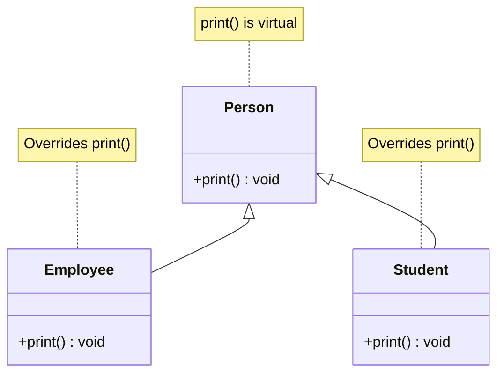
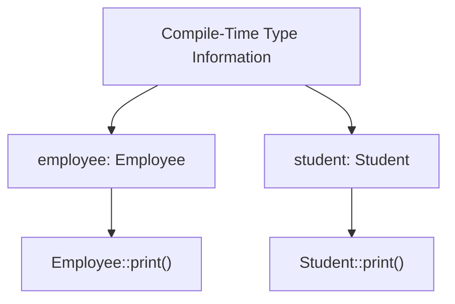
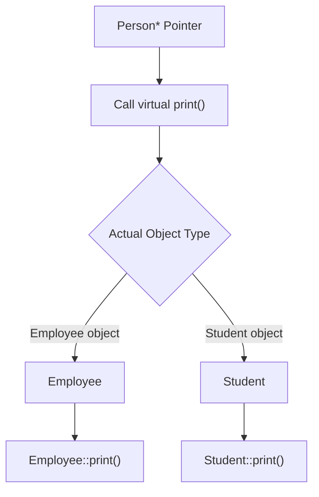
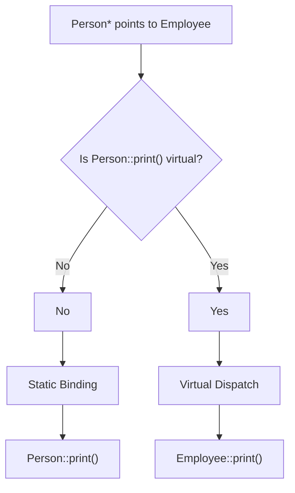

# Early Binding vs. Late Binding in C++

## 1. Introduction

In C++, binding refers to the process of associating a function call with the function implementation that will be executed.

There are two important types of binding:

1. Early Binding (Static Binding)
2. Late Binding (Dynamic Binding)

The main difference is when and how the appropriate function implementation is determined.

These concepts are closely related to:

- Inheritance
- Function Overriding
- Virtual Functions
- Base Class Pointers
- Runtime Polymorphism

---

## 2. What Is Early Binding?

**Early Binding**, also known as **Static Binding**, occurs when the function implementation can be determined using information available at compile time.

The compiler uses the static types and other compile-time information to resolve the function call.

### Key Characteristics

- Function selection is determined at compile time.
- Commonly used with non-virtual functions.
- Does not require runtime polymorphism.
- The selected implementation is based on compile-time information.

### Example

```cpp
class Person
{
public:
    void print()
    {
        cout << "Hi, I'm Person." << endl;
    }
};

class Employee : public Person
{
public:
    void print()
    {
        cout << "Hi, I'm Employee." << endl;
    }
};
```

### Usage

```cpp
Employee employee;

employee.print();
```

### Output

```text
Hi, I'm Employee.
```

The compiler knows that `employee` is an `Employee` object.

Therefore, the call can be resolved using compile-time information.

---

## 3. Static Binding Through a Base Class Pointer

Consider a non-virtual Base Class function:

```cpp
Person* ptrPerson = &employee;

ptrPerson->print();
```

If `Person::print()` is not virtual, the call uses the static type of the pointer.

The pointer has type:

```cpp
Person*
```

Therefore, the selected function is:

```cpp
Person::print()
```

### Output

```text
Hi, I'm Person.
```

### Important Rule

For a non-virtual function call through a Base Class pointer, function selection is based on the pointer's static type.

---

## 4. What Is Late Binding?

**Late Binding**, also known as **Dynamic Binding**, occurs when the appropriate virtual function implementation is selected according to the actual object type at runtime.

In C++, dynamic binding is associated with virtual function dispatch.

### Key Characteristics

- Uses virtual functions.
- Supports Runtime Polymorphism.
- Allows Derived Classes to override Base Class behavior.
- Selects the appropriate final overrider based on the actual object type.

### Example

```cpp
class Person
{
public:
    virtual void print()
    {
        cout << "Hi, I'm Person." << endl;
    }
};

class Employee : public Person
{
public:
    void print()
    {
        cout << "Hi, I'm Employee." << endl;
    }
};
```

### Usage

```cpp
Employee employee;

Person* ptrPerson = &employee;

ptrPerson->print();
```

### Output

```text
Hi, I'm Employee.
```

Although `ptrPerson` has the static type `Person*`, it points to an actual `Employee` object.

Because `print()` is virtual, the appropriate Derived Class implementation is selected.

---

## 5. Original Lesson Code

The original exercise demonstrates both binding concepts using three classes:

- `Person`
- `Employee`
- `Student`

### Complete Example

```cpp
#include <iostream>

using namespace std;

class Person
{
public:
    virtual void print()
    {
        cout << "Hi, I'm Person." << endl;
    }
};

class Employee : public Person
{
public:
    void print()
    {
        cout << "Hi, I'm Employee." << endl;
    }
};

class Student : public Person
{
public:
    void print()
    {
        cout << "Hi, I'm Student." << endl;
    }
};

int main()
{
    Employee employee;
    Student student;

    // Static-Early Binding [Compile time]
    employee.print();
    student.print();

    Person* ptrPerson1 = &employee;
    Person* ptrPerson2 = &student;

    // Dynamic-Late Binding [Run time]
    ptrPerson1->print();
    ptrPerson2->print();

    return 0;
}
```

### Expected Output

```text
Hi, I'm Employee.
Hi, I'm Student.
Hi, I'm Employee.
Hi, I'm Student.
```

The output is identical for both groups of calls.

However, the concepts used to explain function selection are different.

---

## 6. Class Hierarchy



### Explanation

- `Person` declares a virtual function.
- `Employee` overrides the function.
- `Student` also overrides the function.
- Each Derived Class provides its own implementation.

---

## 7. Early Binding in the Original Exercise

The first two calls are:

```cpp
employee.print();
student.print();
```

The variables have known concrete types:

| Object | Type | Selected Function |
|---|---|---|
| `employee` | `Employee` | `Employee::print()` |
| `student` | `Student` | `Student::print()` |

These calls illustrate how the compiler can determine the appropriate implementation using compile-time type information.

### Diagram



### Technical Note

The functions are still virtual.

Direct calls on objects whose concrete types are known may be resolved or optimized by the compiler.

Therefore, the example is useful for understanding early resolution, but it does not establish a universal rule that every call using the dot operator is statically bound.

---

## 8. Late Binding in the Original Exercise

The next part creates two Base Class pointers:

```cpp
Person* ptrPerson1 = &employee;
Person* ptrPerson2 = &student;
```

Both pointers have the same static type:

```cpp
Person*
```

However, they refer to objects of different actual types.

### Function Calls

```cpp
ptrPerson1->print();
ptrPerson2->print();
```

Because `Person::print()` is virtual, these calls use virtual dispatch.

### Results

| Pointer | Static Type | Actual Object Type | Selected Override |
|---|---|---|---|
| `ptrPerson1` | `Person*` | `Employee` | `Employee::print()` |
| `ptrPerson2` | `Person*` | `Student` | `Student::print()` |

### Diagram



### Key Principle

**Virtual dispatch selects the appropriate function implementation according to the actual object type.**

---

## 9. Early Binding vs. Late Binding

| Feature | Early Binding | Late Binding |
|---|---|---|
| Another name | Static Binding | Dynamic Binding |
| Resolution | Compile time | Runtime |
| Type information | Static types | Actual object type |
| Typical functions | Non-virtual functions | Virtual functions |
| Runtime Polymorphism | Not required | Supported |
| Flexibility | Compile-time selection | Runtime selection |
| Common example | Non-virtual member call | Virtual call through Base pointer |

### Important Distinction

The difference is not simply whether a function is called using `.` or `->`.

The important factors include:

- Whether the function is virtual.
- The static type of the expression.
- The actual object type.
- Whether the call uses virtual dispatch.

---

## 10. How the virtual Keyword Changes Binding

Consider a Base Class pointer:

```cpp
Employee employee;

Person* ptrPerson = &employee;
```

### Case 1 — Without Virtual

```cpp
class Person
{
public:
    void print()
    {
        cout << "Hi, I'm Person." << endl;
    }
};
```

Calling:

```cpp
ptrPerson->print();
```

selects:

```cpp
Person::print()
```

### Case 2 — With Virtual

```cpp
class Person
{
public:
    virtual void print()
    {
        cout << "Hi, I'm Person." << endl;
    }
};
```

If `Employee` overrides `print()`, calling:

```cpp
ptrPerson->print();
```

selects:

```cpp
Employee::print()
```

### Comparison Diagram



---

## 11. Static Type vs. Dynamic Type

Understanding these two terms is essential.

### Static Type

The type known from the declaration at compile time.

Example:

```cpp
Person* ptrPerson;
```

The pointer's static type is:

```cpp
Person*
```

### Dynamic Type

The actual type of the object being referred to during execution.

Example:

```cpp
Employee employee;

Person* ptrPerson = &employee;
```

The pointer has static type `Person*`, while the object it points to has dynamic type `Employee`.

### Summary

```text
Pointer Static Type: Person*
Actual Object Type:  Employee
Virtual Call:        Employee::print()
```

---

## 12. Can Virtual Functions Use Early Resolution?

Yes.

The `virtual` keyword enables virtual dispatch, but not every call to a virtual function necessarily requires runtime selection.

For example:

```cpp
Employee employee;

employee.print();
```

The compiler knows the concrete object type.

It may determine the implementation at compile time.

Another example is an explicitly qualified call:

```cpp
employee.Person::print();
```

The qualified call invokes the Base Class implementation directly and suppresses virtual dispatch for that call.

### Important Note

Compilers may also optimize virtual calls using techniques such as devirtualization.

This does not change the language-level behavior of virtual functions.

---

## 13. Why Is Dynamic Binding Useful?

Dynamic binding allows different Derived Classes to be handled through a common Base Class interface.

### Example

```cpp
void display(Person* person)
{
    person->print();
}
```

### Usage

```cpp
Employee employee;
Student student;

display(&employee);
display(&student);
```

### Output

```text
Hi, I'm Employee.
Hi, I'm Student.
```

The same function:

```cpp
display(Person* person)
```

works with multiple Derived Class objects.

It does not need separate implementations for `Employee` and `Student`.

### Benefits

1. Supports Runtime Polymorphism.
2. Encourages reusable code.
3. Allows common interfaces.
4. Reduces the need for explicit type checks.
5. Makes it easier to extend class hierarchies.

---

## 14. Common Misunderstandings

### Misunderstanding 1

"Static Binding only works with pointers."

**Correction:**

Static Binding can apply to calls through objects, pointers, and references.

### Misunderstanding 2

"Every function called using the dot operator uses Static Binding."

**Correction:**

Virtual dispatch can also occur through references and other expressions.

The operator alone does not determine the binding mechanism.

### Misunderstanding 3

"Virtual functions always require runtime lookup."

**Correction:**

The compiler may determine or optimize the selected implementation when enough information is available.

### Misunderstanding 4

"Dynamic Binding depends on the Base Class pointer type."

**Correction:**

Virtual dispatch uses the actual object type to select the appropriate final overrider.

### Misunderstanding 5

"Early Binding and Late Binding always produce different output."

**Correction:**

Both mechanisms can produce identical output while using different function-selection behavior.

---

## 15. Key Takeaways

1. Binding associates a function call with an implementation.
2. Early Binding is also called Static Binding.
3. Late Binding is also called Dynamic Binding.
4. Static Binding uses compile-time information.
5. Dynamic Binding uses runtime object type information.
6. Virtual functions enable Runtime Polymorphism.
7. Non-virtual calls through Base Class pointers use static type information.
8. Virtual calls through Base Class pointers can invoke Derived Class overrides.
9. The `virtual` keyword does not guarantee a runtime lookup for every call.
10. Static Binding and Dynamic Binding can produce identical output.

---

## 16. Simple Summary

### Static Binding — Early Binding

```text
Compile-Time Type Information
             |
             v
     Function Selection
             |
             v
     Selected Function
```

**Function selection is based on compile-time information.**

### Dynamic Binding — Late Binding

```text
Base Class Pointer / Reference
             |
             v
      Virtual Function
             |
             v
      Actual Object Type
             |
             v
    Appropriate Override
```

**Virtual dispatch selects the appropriate implementation according to the actual object type.**

---

## 17. Final Conclusion

Early Binding and Late Binding are important concepts in C++ object-oriented programming.

Early Binding uses compile-time information to determine the function implementation.

Late Binding allows virtual function calls to select the appropriate implementation based on the actual object type.

Together with inheritance and overriding, virtual functions provide the foundation for Runtime Polymorphism.

---

## "Inheritance Completed"

This topic completes the Inheritance section.

The section covered:

1. Basic Inheritance
2. Base Class Constructor
3. Function Overriding
4. Multilevel Inheritance
5. Access Specifiers Review
6. Inheritance Visibility Modes
7. Types of Inheritance
8. Upcasting and Downcasting
9. Virtual Functions
10. Early Binding vs. Late Binding

Practical Project:

**Project 03 — Developer Class**

The project demonstrates multilevel inheritance using:

```text
Person → Employee → Developer
```

These concepts establish an important foundation for understanding polymorphism and more advanced C++ object-oriented programming.
