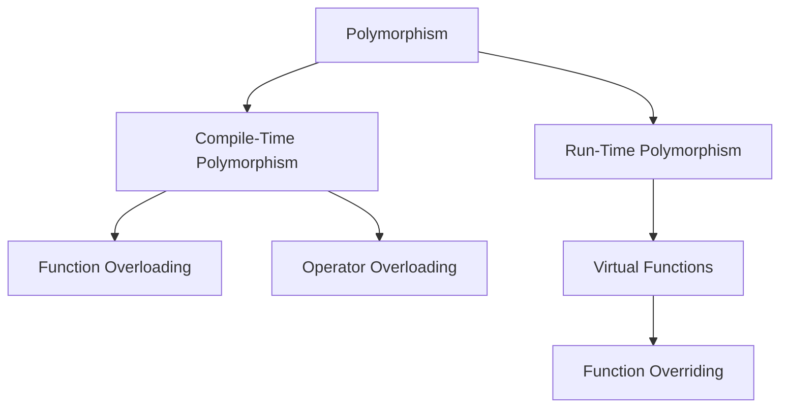
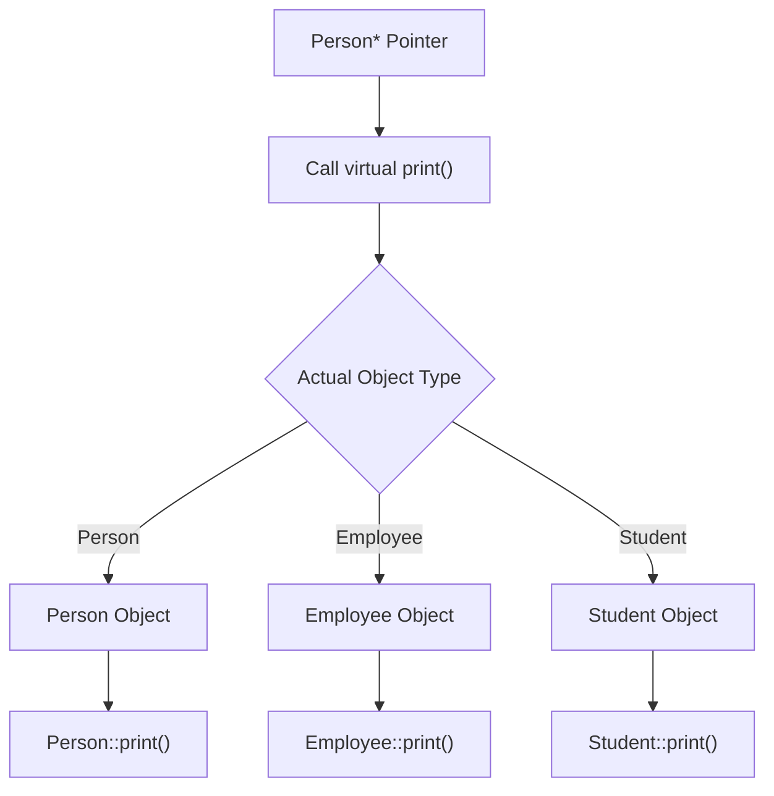
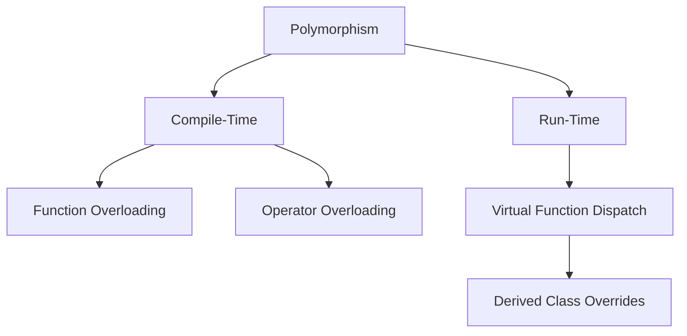
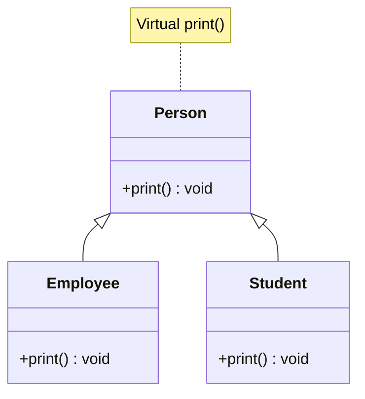

# Polymorphism in C++

## 1. Introduction

Polymorphism is one of the four fundamental principles of Object-Oriented Programming (OOP).

The word **Polymorphism** means **"many forms."**

In programming, polymorphism allows the same interface, function name, or operator to represent different behaviors depending on the context.

It helps developers write code that is:

- Flexible
- Reusable
- Consistent
- Extensible
- Easier to maintain

### Main Idea

**One interface, multiple forms of behavior.**

---

## 2. What Is Polymorphism?

Polymorphism allows different operations or objects to be handled through a common interface while supporting different implementations.

For example, different classes can provide their own implementations of a function named `print()`.

```cpp
class Person
{
public:
    virtual void print()
    {
        cout << "I'm a Person." << endl;
    }
};

class Employee : public Person
{
public:
    void print()
    {
        cout << "I'm an Employee." << endl;
    }
};

class Student : public Person
{
public:
    void print()
    {
        cout << "I'm a Student." << endl;
    }
};
```

Although the classes share a common interface, they can provide different behaviors.

---

## 3. Types of Polymorphism

In C++, polymorphism is commonly divided into two main categories:

1. Compile-Time Polymorphism (Static Polymorphism)
2. Run-Time Polymorphism (Dynamic Polymorphism)

### Classification Diagram



The original lesson introduces four related concepts:

- Function Overloading
- Operator Overloading
- Function Overriding
- Virtual Functions

These concepts demonstrate how polymorphism can be achieved in C++.

---

## 4. Function Overloading

Function Overloading allows multiple functions to share the same name while having different parameter lists.

The compiler selects the appropriate overload using the arguments supplied in the function call.

### Example

```cpp
class Calculator
{
public:
    int add(int a, int b)
    {
        return a + b;
    }

    double add(double a, double b)
    {
        return a + b;
    }

    int add(int a, int b, int c)
    {
        return a + b + c;
    }
};
```

### Usage

```cpp
Calculator calculator;

cout << calculator.add(5, 10) << endl;
cout << calculator.add(2.5, 3.5) << endl;
cout << calculator.add(1, 2, 3) << endl;
```

### Output

```text
15
6
6
```

### Key Points

- Functions share the same name.
- Their parameter lists differ.
- Differences may involve parameter types or parameter counts.
- The compiler performs overload resolution at compile time.
- Changing only the return type is not sufficient to overload a function.

**Category: Compile-Time Polymorphism**

---

## 5. Operator Overloading

Operator Overloading allows operators to have defined behaviors for different types, including user-defined types.

For example, the `+` operator can be used for numeric addition and string concatenation.

### Numeric Addition

```cpp
int a = 10;
int b = 20;

cout << a + b;
```

Output:

```text
30
```

### String Concatenation

```cpp
#include <string>

string firstName = "Dony";
string lastName = "Ronny";

cout << firstName + " " + lastName;
```

Output:

```text
Dony Ronny
```

The same operator symbol performs different operations depending on the operand types.

### Custom Operator Overloading

C++ also allows developers to overload supported operators for user-defined types.

For example, a custom `Complex` class could define how two complex numbers are added using `operator+`.

### Key Points

- The same operator can have different type-dependent behaviors.
- Operators can be overloaded for user-defined types.
- Operator Overloading is resolved using compile-time overload resolution.
- Not every operator can be overloaded.
- Operator Overloading does not change the fundamental precedence or number of operands of an operator.

**Category: Compile-Time Polymorphism**

---

## 6. Function Overriding

Function Overriding allows a Derived Class to provide its own implementation of an inherited virtual function.

The overriding function must have a matching signature and compatible return type.

### Example

```cpp
class Person
{
public:
    virtual void print()
    {
        cout << "I'm a Person." << endl;
    }
};

class Employee : public Person
{
public:
    void print()
    {
        cout << "I'm an Employee." << endl;
    }
};
```

### Explanation

- `Person` declares a virtual function.
- `Employee` inherits from `Person`.
- `Employee` overrides `print()`.
- The Derived Class provides its own implementation.

### Important Note

Defining a function with the same name in a Derived Class does not automatically enable Runtime Polymorphism.

Virtual dispatch is required for runtime selection of the appropriate override.

**Category: Run-Time Polymorphism when used with virtual dispatch**

---

## 7. Virtual Functions

A Virtual Function is a member function declared using the `virtual` keyword.

Virtual functions enable Runtime Polymorphism by allowing the appropriate override to be selected according to the actual object type.

### Example

```cpp
Employee employee;

Person* ptrPerson = &employee;

ptrPerson->print();
```

### Output

```text
I'm an Employee.
```

### Explanation

1. An `Employee` object is created.
2. A `Person*` pointer points to that object.
3. The virtual function `print()` is called.
4. C++ selects the appropriate override based on the actual object type.

### Key Principle

**Virtual functions enable dynamic dispatch through Base Class pointers and references.**

---

## 8. Runtime Polymorphism Diagram



The same Base Class interface can invoke different implementations.

This is the central idea of Runtime Polymorphism.

---

## 9. Compile-Time vs. Run-Time Polymorphism

| Feature | Compile-Time | Run-Time |
|---|---|---|
| Another name | Static Polymorphism | Dynamic Polymorphism |
| Function selection | Compile time | Runtime |
| Main mechanisms | Overloading | Virtual dispatch |
| Function Overloading | Yes | No |
| Operator Overloading | Yes | No |
| Virtual Functions | Not required | Required in C++ |
| Function Overriding | Not by itself | Used with virtual functions |
| Flexibility | Type-based selection | Object-based selection |

### Comparison Diagram



---

## 10. Relationship Between Polymorphism and Inheritance

Inheritance allows a Derived Class to reuse and extend a Base Class.

Polymorphism allows objects from related classes to provide different behavior through a shared interface.

### Example Hierarchy



### Important Distinction

Inheritance creates an **is-a relationship**.

Polymorphism allows different implementations to be used through a common interface.

Inheritance is commonly used with Runtime Polymorphism, but Function Overloading and Operator Overloading do not require inheritance.

---

## 11. Why Is Polymorphism Important?

### 1. Code Reusability

Common interfaces can work with multiple object types.

### 2. Flexibility

Different classes can provide different implementations of the same operation.

### 3. Maintainability

Code can be extended without rewriting every part that uses the common interface.

### 4. Consistency

Developers can use consistent function names and interfaces.

### 5. Extensibility

New Derived Classes can provide additional behaviors while following the same interface.

---

## 12. Common Misunderstandings

### Misunderstanding 1

"Polymorphism only means Function Overriding."

**Correction:**

Polymorphism also includes compile-time mechanisms such as Function Overloading and Operator Overloading.

### Misunderstanding 2

"Function Overloading and Function Overriding are the same."

**Correction:**

Function Overloading uses the same function name with different parameter lists.

Function Overriding provides a Derived Class implementation of an inherited virtual function.

### Misunderstanding 3

"Every function with the same name supports Runtime Polymorphism."

**Correction:**

Runtime Polymorphism in C++ relies on virtual dispatch.

### Misunderstanding 4

"Polymorphism always requires inheritance."

**Correction:**

Runtime Polymorphism commonly uses inheritance, but Compile-Time Polymorphism through overloading does not require inheritance.

---

## 13. Key Takeaways

1. Polymorphism means "many forms."
2. It allows a common interface or operation to support different behaviors.
3. Compile-Time Polymorphism includes Function Overloading and Operator Overloading.
4. Run-Time Polymorphism uses virtual function dispatch.
5. Function Overloading uses the same function name with different parameter lists.
6. Operator Overloading provides operator behavior for different types.
7. Function Overriding allows Derived Classes to provide their own implementations of inherited virtual functions.
8. Virtual Functions enable runtime selection of the appropriate override.
9. Polymorphism improves flexibility, consistency, and reusability.
10. Inheritance and Polymorphism work together to support extensible OOP designs.

---

## 14. Simple Summary

### Polymorphism

**One interface, multiple forms of behavior.**

### Compile-Time Polymorphism

- Function Overloading
- Operator Overloading

### Run-Time Polymorphism

- Virtual Functions
- Function Overriding through virtual dispatch

### Final Rule

**Compile-Time Polymorphism:** The appropriate operation is selected using compile-time information.

**Run-Time Polymorphism:** The appropriate virtual function implementation is selected according to the actual object type.

---

## 15. Next Topic

**Lesson 08.02 — Interfaces, Pure Virtual Functions and Abstract Classes**

The next lesson explains how C++ uses abstract classes and pure virtual functions to define common interfaces for Derived Classes.
