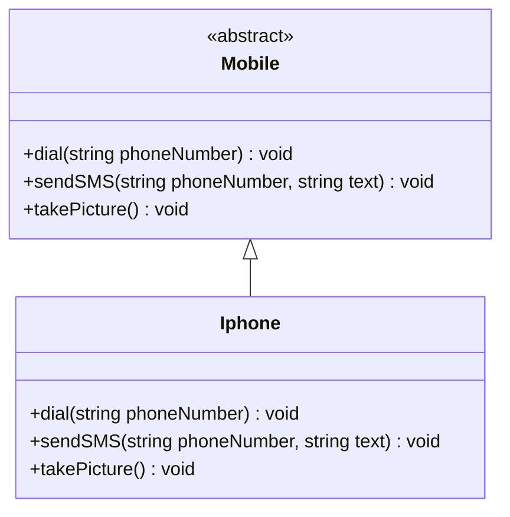
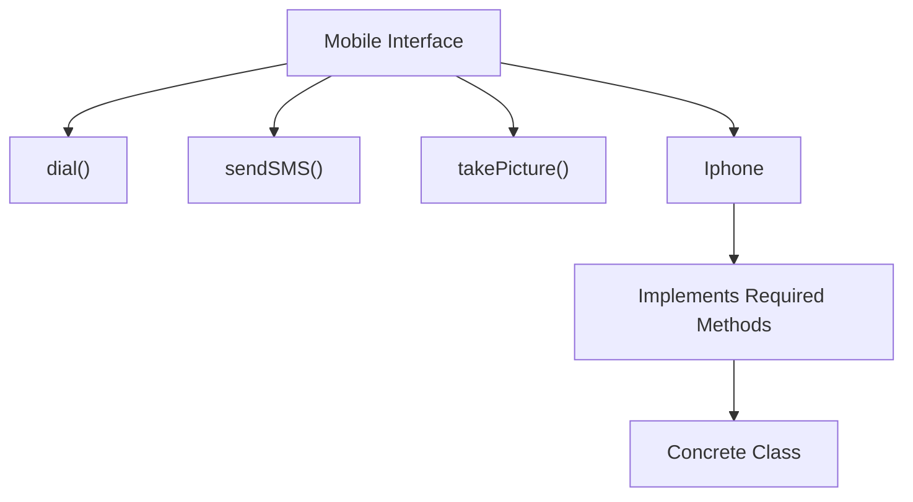
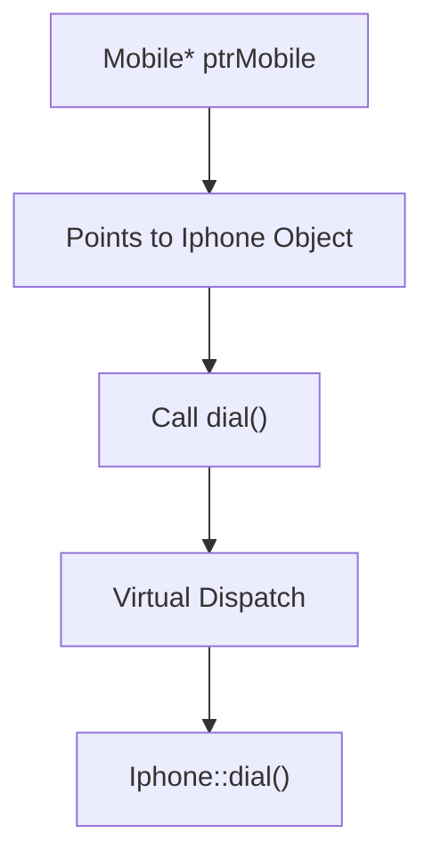

# Interfaces, Pure Virtual Functions and Abstract Classes in C++

## 1. Introduction

Interfaces and Abstract Classes are important concepts in Object-Oriented Programming (OOP).

They allow developers to define a common contract that Derived Classes can follow.

A contract specifies which operations must be supported without necessarily defining how those operations are implemented.

In C++, interfaces are commonly modeled using Abstract Classes and Pure Virtual Functions.

### Main Idea

**An interface defines what a class must provide, while the implementing class determines how those operations work.**

---

## 2. What Is an Abstract Class?

An **Abstract Class** is a class that cannot be instantiated directly.

A class becomes abstract when it declares or inherits at least one pure virtual function for which the final overrider remains pure.

### Example

```cpp
class Mobile
{
public:
    virtual void dial(string phoneNumber) = 0;
};
```

The `Mobile` class is abstract because `dial()` is a Pure Virtual Function.

### Important Rules

- An Abstract Class cannot be instantiated directly.
- It can be inherited by other classes.
- It can contain Pure Virtual Functions.
- It can also contain regular methods and data members.
- Pointers and references to Abstract Classes are allowed.

### Invalid Example

```cpp
Mobile mobile; // Compilation Error
```

An object of `Mobile` cannot be created because the class is abstract.

---

## 3. What Is a Pure Virtual Function?

A **Pure Virtual Function** is a virtual function declared using the pure-specifier `= 0`.

### Syntax

```cpp
virtual void functionName() = 0;
```

### Example

```cpp
virtual void takePicture() = 0;
```

### Explanation

- `virtual` declares a virtual function.
- `void` specifies the return type.
- `takePicture()` is the function name.
- `= 0` makes the function pure virtual.

Pure Virtual Functions are commonly used to define required operations in an Abstract Class.

### Important Note

A Pure Virtual Function usually has no implementation in an interface-style class.

However, C++ allows a Pure Virtual Function to have a separate definition outside the class in certain situations.

The function remains pure virtual even if such a definition exists.

---

## 4. What Is an Interface?

An **Interface** defines a contract that implementing classes are expected to follow.

In C++, there is no separate `interface` keyword.

Instead, developers commonly create interface-style classes using public Pure Virtual Functions.

### Example

```cpp
class Mobile
{
public:
    virtual void dial(string phoneNumber) = 0;
    virtual void sendSMS(string phoneNumber, string text) = 0;
    virtual void takePicture() = 0;
};
```

The `Mobile` class defines three required operations:

1. Dial a phone number.
2. Send a text message.
3. Take a picture.

It does not specify how those operations should be performed.

### Main Principle

**The interface defines what must be supported, not how the functionality is implemented.**

---

## 5. Original Lesson Code

The original exercise uses two classes:

- `Mobile`: Abstract Base Class
- `Iphone`: Derived Class

### Complete Example

The following version makes the required interface methods public and explicitly includes the string header.

```cpp
#include <iostream>
#include <string>

using namespace std;

// Abstract Class / Interface / Contract
class Mobile
{
public:
    virtual void dial(string phoneNumber) = 0;
    virtual void sendSMS(string phoneNumber, string text) = 0;
    virtual void takePicture() = 0;
};

class Iphone : public Mobile
{
public:
    void dial(string phoneNumber)
    {

    }

    void sendSMS(string phoneNumber, string text)
    {

    }

    void takePicture()
    {

    }
};

int main()
{
    return 0;
}
```

### Explanation

`Mobile` defines the required functions.

`Iphone` inherits publicly from `Mobile` and provides implementations for all three Pure Virtual Functions.

Therefore, `Iphone` is a Concrete Class.

The function bodies are empty because the exercise focuses on the interface contract rather than implementing actual phone functionality.

---

## 6. Class Hierarchy



### Explanation

The `Mobile` class declares three Pure Virtual Functions.

The `Iphone` class implements those functions.

The inheritance relationship establishes that `Iphone` follows the contract defined by `Mobile`.

---

## 7. Understanding the Contract

Imagine that several developers are creating different mobile phone classes.

Without a common interface, each developer might choose different function names.

For example:

```cpp
callNumber();
sendMessage();
capturePhoto();
```

Another developer might use:

```cpp
makeCall();
textUser();
takePhoto();
```

These differences can make it difficult to work with multiple implementations through a common interface.

An interface provides a shared set of operations.

### Contract

```cpp
virtual void dial(string phoneNumber) = 0;
virtual void sendSMS(string phoneNumber, string text) = 0;
virtual void takePicture() = 0;
```

Every Concrete Class implementing this interface must provide the required functionality.

### Contract Diagram



### Important Concept

**An interface standardizes how different implementations are accessed.**

---

## 8. Implementing Pure Virtual Functions

Consider the following interface:

```cpp
class Mobile
{
public:
    virtual void dial(string phoneNumber) = 0;
    virtual void sendSMS(string phoneNumber, string text) = 0;
    virtual void takePicture() = 0;
};
```

The `Iphone` class provides implementations:

```cpp
class Iphone : public Mobile
{
public:
    void dial(string phoneNumber)
    {
        cout << "Dialing: " << phoneNumber << endl;
    }

    void sendSMS(string phoneNumber, string text)
    {
        cout << "Sending SMS to: " << phoneNumber << endl;
        cout << "Message: " << text << endl;
    }

    void takePicture()
    {
        cout << "Taking a picture..." << endl;
    }
};
```

### Usage

```cpp
Iphone iphone;

iphone.dial("123456789");
iphone.sendSMS("123456789", "Hello!");
iphone.takePicture();
```

### Expected Output

```text
Dialing: 123456789
Sending SMS to: 123456789
Message: Hello!
Taking a picture...
```

This example demonstrates how a Concrete Class can provide its own implementation of the required interface.

The output is simulated; no real phone operations are performed.

---

## 9. What Happens If a Derived Class Does Not Implement Everything?

Consider:

```cpp
class Iphone : public Mobile
{
public:
    void dial(string phoneNumber)
    {

    }
};
```

The class implements only one of the three required methods.

The remaining Pure Virtual Functions are:

```cpp
sendSMS()
takePicture()
```

Therefore, `Iphone` remains an Abstract Class.

### Invalid Example

```cpp
Iphone iphone; // Compilation Error
```

### Important Rule

**A Derived Class must provide implementations for all remaining Pure Virtual Functions before it can be instantiated as a Concrete Class.**

A Derived Class is allowed to remain abstract.

---

## 10. Abstract Class vs. Concrete Class

| Feature | Abstract Class | Concrete Class |
|---|---|---|
| Can create objects directly | No | Yes |
| Can contain Pure Virtual Functions | Yes | Cannot have remaining pure final overriders |
| Can contain regular methods | Yes | Yes |
| Can contain data members | Yes | Yes |
| Can be inherited | Yes | Yes |
| Typical purpose | Define common behavior or contracts | Provide usable implementations |

### Example

```text
Mobile
  |
  | Abstract Class
  | Pure Virtual Functions
  |
  v
Iphone
  |
  | Implements Required Functions
  |
  v
Concrete Class
```

---

## 11. Can a Derived Class Add Additional Methods?

Yes.

A Derived Class can implement all required interface methods and introduce additional functionality.

### Example

```cpp
class Iphone : public Mobile
{
public:
    void dial(string phoneNumber)
    {

    }

    void sendSMS(string phoneNumber, string text)
    {

    }

    void takePicture()
    {

    }

    void faceID()
    {
        cout << "Face ID authentication" << endl;
    }
};
```

Here:

- `dial()` is required by the interface.
- `sendSMS()` is required by the interface.
- `takePicture()` is required by the interface.
- `faceID()` is additional functionality provided by `Iphone`.

### Key Concept

**An interface defines minimum required operations, not every operation a Derived Class may contain.**

---

## 12. Interfaces and Runtime Polymorphism

Interfaces work naturally with Runtime Polymorphism because they use Virtual Functions.

### Example

```cpp
Iphone iphone;

Mobile* ptrMobile = &iphone;

ptrMobile->dial("123456789");
```

### Explanation

1. An `Iphone` object is created.
2. A `Mobile*` pointer refers to the object.
3. The `dial()` function is called through the Base Class pointer.
4. Virtual dispatch selects `Iphone::dial()`.

### Diagram



### Key Principle

**Interfaces provide a common contract, while Runtime Polymorphism allows different implementations to be selected through that contract.**

---

## 13. Abstract Class vs. Interface

In C++, an interface is usually a design pattern implemented using an Abstract Class.

However, the two terms are not exactly identical.

### Abstract Class

An Abstract Class may contain:

- Pure Virtual Functions
- Regular Virtual Functions
- Non-Virtual Functions
- Data Members
- Constructors
- Destructors

### Interface-Style Class

An interface-style class typically focuses on:

- Public Pure Virtual Functions
- A Common Contract
- Minimal or no implementation details
- A Virtual Destructor when polymorphic deletion is intended

### Comparison

| Feature | Abstract Class | Interface-Style Class |
|---|---|---|
| C++ keyword | `class` | `class` |
| Pure Virtual Functions | May contain | Typically central |
| Regular methods | Allowed | Usually avoided |
| Data members | Allowed | Usually avoided |
| Main purpose | Shared abstraction | Define a contract |
| Can be instantiated | No | No |

### Important Note

Every interface-style class containing Pure Virtual Functions is abstract.

However, not every Abstract Class is designed as a pure interface.

---

## 14. Abstract Class vs. Abstraction

These concepts are related but not identical.

### Abstraction

Abstraction is one of the four fundamental principles of OOP.

It focuses on exposing essential functionality while hiding unnecessary implementation details.

### Abstract Class

An Abstract Class is a C++ language mechanism that can help implement abstraction.

### Comparison

| Abstraction | Abstract Class |
|---|---|
| OOP design principle | C++ class concept |
| Focuses on essential behavior | Cannot be instantiated directly |
| Hides unnecessary details | May contain Pure Virtual Functions |
| Can be implemented in different ways | One mechanism used to support abstraction |

### Key Principle

**Abstraction is a design concept; an Abstract Class is a language mechanism.**

---

## 15. Important Note About Access Specifiers

In C++, members of a `class` are private by default.

### Example

```cpp
class Mobile
{
    virtual void dial(string phoneNumber) = 0;
};
```

The function is private because no access specifier was provided.

A Derived Class can still override a private virtual function.

However, the function cannot be called publicly through a `Mobile*` pointer.

### Recommended Interface Design

```cpp
class Mobile
{
public:
    virtual void dial(string phoneNumber) = 0;
};
```

The `public` access specifier makes the function available through the interface.

### Important Rule

**Interface methods are commonly declared public so users of the interface can call them.**

---

## 16. Virtual Destructors in Interfaces

When a Base Class is intended to support polymorphic deletion, its destructor should be virtual.

### Example

```cpp
class Mobile
{
public:
    virtual void dial(string phoneNumber) = 0;

    virtual ~Mobile() = default;
};
```

### Why?

Consider:

```cpp
Mobile* ptrMobile = new Iphone();

delete ptrMobile;
```

A virtual destructor ensures that the Derived Class and Base Class destructors are invoked correctly.

Without a virtual Base Class destructor, deleting a Derived Class object through a Base Class pointer causes undefined behavior.

### Important Note

The original lesson does not perform dynamic allocation or polymorphic deletion.

Therefore, this is an additional best practice rather than a required change for the original exercise.

---

## 17. Common Misunderstandings

### Misunderstanding 1

"Every Abstract Class is an Interface."

**Correction:**

An Abstract Class can contain implementation details and data members. An interface-style class primarily defines a contract.

### Misunderstanding 2

"Derived Classes must always implement every Pure Virtual Function immediately."

**Correction:**

A Derived Class can remain abstract. It must provide implementations for all remaining Pure Virtual Functions to become concrete.

### Misunderstanding 3

"Pure Virtual Functions can never have implementations."

**Correction:**

Some Pure Virtual Functions can have separate definitions while remaining pure virtual.

### Misunderstanding 4

"An Abstract Class cannot be used with pointers."

**Correction:**

Pointers and references to Abstract Classes are allowed.

### Misunderstanding 5

"An Abstract Class is the same as the OOP principle of Abstraction."

**Correction:**

Abstraction is a general design principle. An Abstract Class is a specific C++ mechanism.

---

## 18. Key Takeaways

1. An Abstract Class cannot be instantiated directly.
2. A Pure Virtual Function uses `= 0`.
3. A class with at least one remaining Pure Virtual Function is abstract.
4. Interfaces define contracts for implementing classes.
5. C++ commonly implements interfaces using Abstract Classes.
6. Derived Classes can remain abstract.
7. Concrete Derived Classes must implement all remaining Pure Virtual Functions.
8. Derived Classes may introduce additional methods.
9. Interfaces work with Runtime Polymorphism.
10. Abstract Classes and the OOP principle of Abstraction are related but different.
11. Public access is commonly used for interface methods.
12. Virtual destructors are important when polymorphic deletion is intended.

---

## 19. Simple Summary

### Pure Virtual Function

```cpp
virtual void functionName() = 0;
```

A virtual function declared using the pure-specifier `= 0`.

### Abstract Class

A class that cannot be instantiated because it has at least one pure virtual final overrider.

### Interface

A common contract defining operations that implementing classes are expected to provide.

### Concrete Class

A class that provides implementations for all remaining Pure Virtual Functions and can be instantiated.

### Final Rule

**An interface defines what operations are required.**

**A Concrete Class provides the implementations of those operations.**

---
