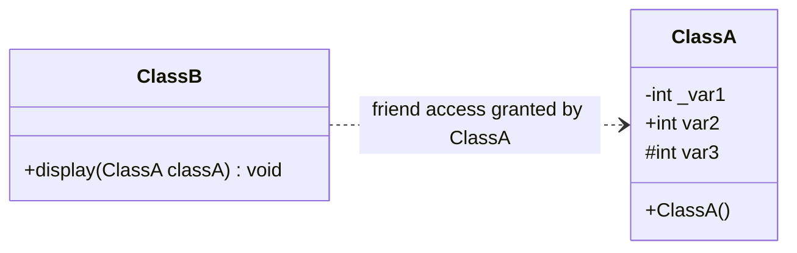
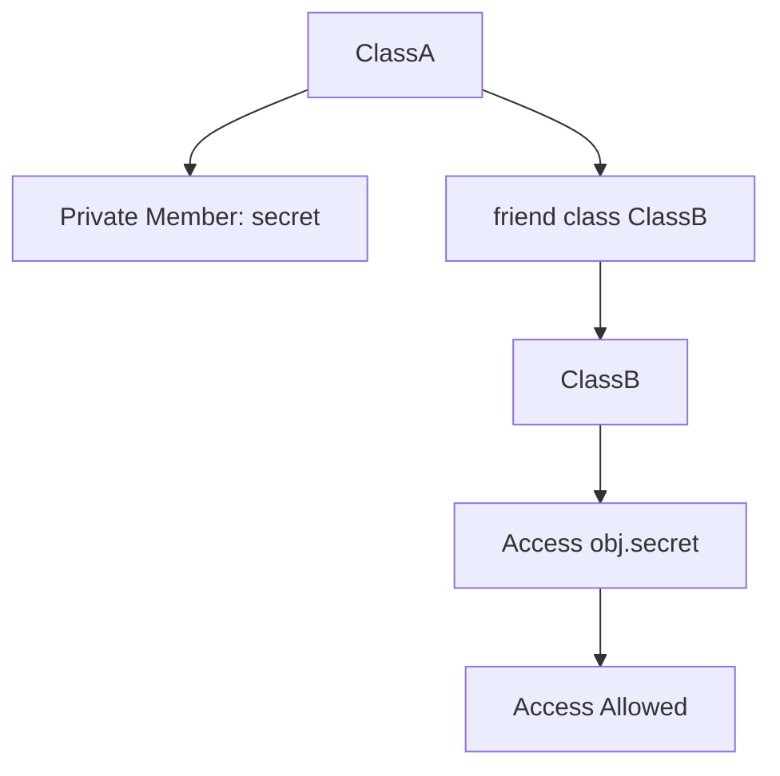
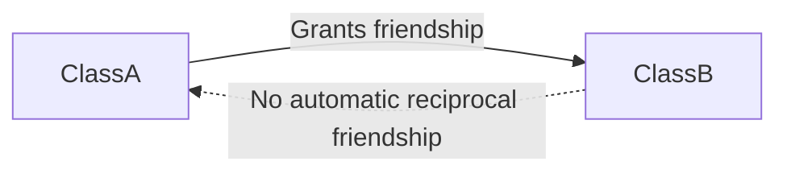
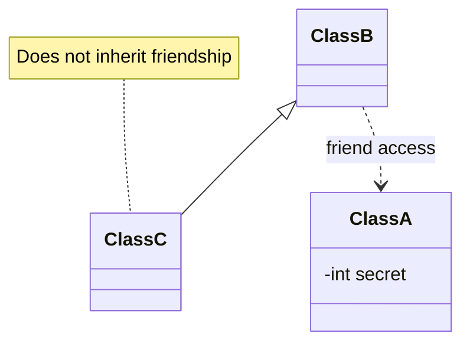
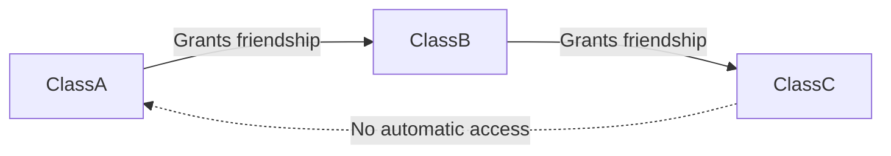

# Friend Classes in C++

## 1. Introduction

In C++, access specifiers control how class members can be accessed.

The three main access specifiers are:

- `public`
- `private`
- `protected`

Normally, private and protected members cannot be accessed directly from unrelated classes.

However, C++ provides a special mechanism called **Friendship**, which allows a class to grant another class access to its non-public members.

This mechanism is implemented using the `friend` keyword.

### Main Idea

**A Friend Class can access the private, protected, and public members of the class that grants it friendship.**

---

## 2. Access Specifiers Review

Before understanding Friend Classes, it is important to review the three access specifiers.

| Access Specifier | Same Class | Derived Class | Unrelated Class |
|---|---|---|---|
| `public` | Yes | Yes | Yes |
| `protected` | Yes | Yes* | No |
| `private` | Yes | No | No |

*Derived-class access to protected members follows additional C++ access rules.*

These restrictions apply under normal circumstances, without special friendship declarations.

### Private Members

Private members are accessible within their own class and by authorized friends.

```cpp
class Person
{
private:
    int _age = 25;
};
```

External code cannot directly access `_age`.

### Protected Members

Protected members are accessible within their own class, by authorized friends, and by derived classes under the relevant access rules.

```cpp
class Person
{
protected:
    int _age = 25;
};
```

### Public Members

Public members are accessible from outside the class, provided the object itself is accessible.

```cpp
class Person
{
public:
    int age = 25;
};
```

---

## 3. What Is a Friend Class?

A **Friend Class** is a class that has been granted special access privileges by another class.

A Friend Class can access:

1. Private members.
2. Protected members.
3. Public members.

### Syntax

```cpp
class ClassA
{
    friend class ClassB;
};
```

### Explanation

- `ClassA` grants friendship.
- `ClassB` receives friendship.
- `ClassB` can access private and protected members of `ClassA`.
- Friendship does not automatically work in the opposite direction.

### Important Principle

**Friendship is given, not taken.**

A class cannot grant itself access to another class's private members.

The class owning those members must explicitly grant friendship.

---

## 4. Original Lesson Code

```cpp
#include <iostream>

using namespace std;

class ClassA
{
private:
    int _var1;

public:
    int var2;

    ClassA()
    {
        _var1 = 10;
        var2 = 20;
    }

protected:
    int var3 = 30;

    // Grant ClassB access to all members of ClassA.
    friend class ClassB;
};

class ClassB
{
public:
    void display(ClassA classA)
    {
        cout << "The value of var1 = " << classA._var1;
        cout << "\nThe value of var2 = " << classA.var2;
        cout << "\nThe value of var3 = " << classA.var3;
    }
};

int main()
{
    ClassA classA;
    ClassB classB;

    classB.display(classA);

    return 0;
}
```

### Expected Output

```text
The value of var1 = 10
The value of var2 = 20
The value of var3 = 30
```

### Explanation

The `ClassA` class contains three variables:

| Variable | Access Specifier | Value |
|---|---|---|
| `_var1` | Private | 10 |
| `var2` | Public | 20 |
| `var3` | Protected | 30 |

Normally, an unrelated class cannot directly access `_var1` or `var3`.

However, `ClassA` contains:

```cpp
friend class ClassB;
```

This grants `ClassB` access to all members of `ClassA`.

Therefore, the `display()` method can read all three variables.

---

## 5. Friendship Relationship



### Explanation

`ClassA` declares `ClassB` as a friend.

As a result, member functions of `ClassB` can access the non-public members of `ClassA`.

The relationship does not represent inheritance.

**Friendship and Inheritance are different C++ mechanisms.**

---

## 6. How Does Friendship Work?

Consider:

```cpp
class ClassA
{
private:
    int secret = 100;

    friend class ClassB;
};
```

Now define:

```cpp
class ClassB
{
public:
    void show(ClassA obj)
    {
        cout << obj.secret;
    }
};
```

Even though `secret` is private, `ClassB` can access it because friendship was explicitly granted.

### Access Flow



### Key Concept

**The `friend` keyword grants access privileges without changing the access specifiers of the members themselves.**

The private member remains private to ordinary external code.

---

## 7. Friendship Is One-Way

Friendship in C++ is not automatically mutual.

Consider:

```cpp
class ClassA
{
private:
    int secretA = 10;

    friend class ClassB;
};

class ClassB
{
private:
    int secretB = 20;

public:
    void show(ClassA obj)
    {
        cout << obj.secretA;
    }
};
```

`ClassB` can access `ClassA::secretA`.

However, `ClassA` does not automatically gain access to `ClassB::secretB`.

### Diagram



### Important Rule

**If B is a friend of A, it does not mean A is a friend of B.**

To allow both classes to access each other's private members, each class must independently grant the appropriate friendship.

---

## 8. Friendship Is Not Inherited

Friendship privileges do not automatically pass to derived classes.

### Example

```cpp
class ClassA
{
private:
    int secret = 10;

    friend class ClassB;
};

class ClassB
{
};

class ClassC : public ClassB
{
};
```

Here:

- `ClassB` is a friend of `ClassA`.
- `ClassC` inherits from `ClassB`.
- `ClassC` does not automatically become a friend of `ClassA`.

### Diagram



### Important Rule

**Friendship is not inherited.**

---

## 9. Friendship Is Not Transitive

Friendship cannot be passed through a chain of friends.

### Example

Suppose:

- `ClassA` grants friendship to `ClassB`.
- `ClassB` grants friendship to `ClassC`.

This does not mean `ClassC` becomes a friend of `ClassA`.

### Diagram



### Important Rule

**Friendship is not transitive.**

Each friendship relationship must be explicitly granted.

---

## 10. Friendship Does Not Change Access Specifiers

Declaring a Friend Class does not make private or protected members public.

### Example

```cpp
class ClassA
{
private:
    int secret = 10;

    friend class ClassB;
};
```

The `secret` variable remains private.

This is invalid in `main()`:

```cpp
ClassA obj;

cout << obj.secret; // Compilation Error
```

However, a member function of `ClassB` can access it.

### Important Concept

**Friendship provides special access to specific authorized classes without exposing the members to everyone.**

---

## 11. Friendship vs. Inheritance

Friendship and Inheritance serve different purposes.

| Feature | Friendship | Inheritance |
|---|---|---|
| Main purpose | Grant special access | Establish a class relationship |
| Keyword | `friend` | `public`, `protected`, or `private` inheritance |
| Access to private Base Class members | Yes, if friendship is granted | No, not automatically |
| Represents an IS-A relationship | No | Often, with public inheritance |
| Automatically inherited | No | Base-class inheritance is part of the derived class |
| Mutual relationship | No | No |

### Example of Friendship

```cpp
friend class ClassB;
```

### Example of Inheritance

```cpp
class ClassB : public ClassA
{
};
```

### Key Difference

**Inheritance establishes a relationship between classes, while Friendship grants access privileges.**

---

## 12. Friend Classes and Encapsulation

Encapsulation is an important OOP principle that controls access to internal implementation details.

Friendship creates a deliberate exception to normal access restrictions.

It allows selected classes to access internal members while keeping those members inaccessible to unrelated code.

### Benefits

- Allows closely related classes to cooperate.
- Provides controlled access to internal implementation details.
- Can simplify certain designs involving tightly coupled classes.

### Potential Disadvantages

- Increases coupling between classes.
- Exposes implementation details to the friend.
- Can make maintenance more difficult if friendship is overused.

### Best Practice

**Use friendship when there is a clear design reason, rather than as a general replacement for public methods.**

---

## 13. Common Misunderstandings

### Misunderstanding 1

"Private members can never be accessed outside their own class."

**Correction:**

Authorized friends can access private members.

### Misunderstanding 2

"Protected members are accessible only through inheritance."

**Correction:**

Protected members are accessible within their own class, by authorized friends, and by derived classes under C++ access rules.

### Misunderstanding 3

"Friendship works in both directions."

**Correction:**

Friendship is one-way unless both classes explicitly grant friendship.

### Misunderstanding 4

"A derived class inherits the friendship privileges of its Base Class."

**Correction:**

Friendship is not inherited.

### Misunderstanding 5

"If A is a friend of B and B is a friend of C, then A is a friend of C."

**Correction:**

Friendship is not transitive.

### Misunderstanding 6

"Friendship converts private members into public members."

**Correction:**

Members keep their original access specifiers.

---

## 14. Key Takeaways

1. C++ uses the `friend` keyword to grant special access privileges.
2. A Friend Class can access private, protected, and public members of the class granting friendship.
3. Friendship is declared inside the class that grants access.
4. Friendship is one-way.
5. Friendship is not automatically mutual.
6. Friendship is not inherited.
7. Friendship is not transitive.
8. Friendship does not change member access specifiers.
9. Friendship and Inheritance are different concepts.
10. Friendship should be used carefully to avoid unnecessary coupling.

---

## 15. Simple Summary

### Friend Class

A class that has been granted access to another class's private and protected members.

### Syntax

```cpp
friend class ClassB;
```

### Main Rules

- Friendship is given, not taken.
- Friendship is one-way.
- Friendship is not symmetric.
- Friendship is not inherited.
- Friendship is not transitive.
- Friendship does not make private members public.

### Final Principle

**A Friend Class is a trusted class that receives special access privileges from another class.**

---

## Next Topic

**Friend Functions in C++**

The next topic explains how C++ can grant friendship to a specific function rather than an entire class.
