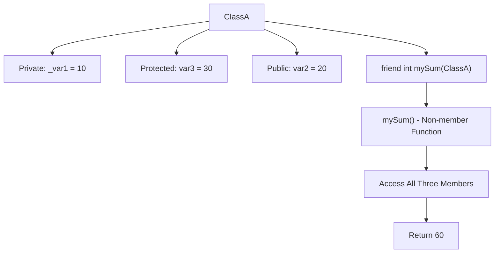
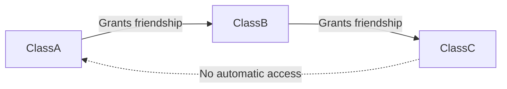
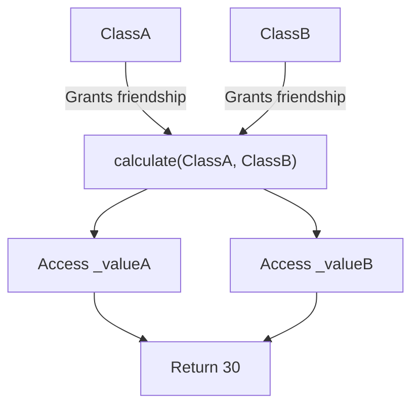

# Friend Functions in C++

## 1. Introduction

In C++, access specifiers control how class members can be accessed.

Normally, private and protected members cannot be accessed directly by unrelated functions.

However, C++ provides the `friend` keyword, which allows a class to grant special access privileges to a specific function.

This mechanism is called a **Friend Function**.

### Main Idea

**A Friend Function is a non-member function that has permission to access the private and protected members of a class that grants it friendship.**

---

## 2. What Is a Friend Function?

A Friend Function is a function that receives special access privileges from a class.

It is declared using the `friend` keyword inside the class granting access.

Unlike a Member Function, a Friend Function does not belong to that class.

### Syntax

```cpp
class ClassA
{
    friend int mySum(ClassA classA);
};
```

### Explanation

- `friend` grants special access privileges.
- `int` specifies the return type.
- `mySum` is the function name.
- `ClassA classA` is the function parameter.
- The declaration grants `mySum()` access to the non-public members of `ClassA`.

### Important Principle

**Friendship grants access privileges without making the function a member of the class.**

---

## 3. Original Lesson Code

```cpp
#include <iostream>

using namespace std;

class ClassA
{
private:
    int _var1;

protected:
    int var3;

public:
    int var2;

    ClassA()
    {
        _var1 = 10;
        var2 = 20;
        var3 = 30;
    }

    friend int mySum(ClassA classA);
};

int mySum(ClassA classA)
{
    return classA._var1 + classA.var2 + classA.var3;
}

int main()
{
    ClassA classA;

    cout << mySum(classA) << endl;

    return 0;
}
```

### Expected Output

```text
60
```

### Explanation

The `ClassA` class contains three variables:

| Variable | Access Specifier | Value |
|---|---|---|
| `_var1` | Private | 10 |
| `var3` | Protected | 30 |
| `var2` | Public | 20 |

Normally, a non-member function cannot directly access `_var1` or `var3`.

However, `ClassA` declares:

```cpp
friend int mySum(ClassA classA);
```

This grants `mySum()` permission to access the non-public members of `ClassA`.

The function returns:

```text
10 + 20 + 30 = 60
```

---

## 4. How Friend Functions Work

A Friend Function receives access privileges from the class containing its friendship declaration.

### Relationship Diagram



### Key Concept

**A class explicitly grants access to a specific function without exposing its private members to all external code.**

---

## 5. Friend Function vs. Member Function

Friend Functions and Member Functions are different.

### Member Function

A Member Function belongs to a class.

```cpp
class ClassA
{
private:
    int _value = 10;

public:
    int getValue()
    {
        return _value;
    }
};
```

Usage:

```cpp
ClassA obj;

cout << obj.getValue();
```

### Friend Function

A Friend Function is not a member of the class granting friendship.

```cpp
class ClassA
{
private:
    int _value = 10;

    friend int getValue(ClassA obj);
};

int getValue(ClassA obj)
{
    return obj._value;
}
```

Usage:

```cpp
ClassA obj;

cout << getValue(obj);
```

### Comparison

| Feature | Member Function | Friend Function |
|---|---|---|
| Belongs to the class | Yes | No |
| Declared with `friend` | No | Yes |
| Access to private members | Yes | Yes, when friendship is granted |
| Called using an object | Usually | No |
| Has a `this` pointer | Yes, for non-static members | No |
| Can receive class objects as parameters | Yes | Yes |

### Important Difference

A Friend Function does not have a `this` pointer because it is not a Member Function.

---

## 6. Friend Functions and Access Specifiers

Friend Functions can access members declared as:

- `private`
- `protected`
- `public`

### Example

```cpp
class ClassA
{
private:
    int _privateValue = 10;

protected:
    int protectedValue = 20;

public:
    int publicValue = 30;

    friend void display(ClassA obj);
};
```

The Friend Function:

```cpp
void display(ClassA obj)
{
    cout << obj._privateValue << endl;
    cout << obj.protectedValue << endl;
    cout << obj.publicValue << endl;
}
```

All three member accesses are valid.

### Important Note

The `friend` keyword does not change the access specifiers of the class members.

Private members remain private to ordinary external code.

---

## 7. Friendship Is Given, Not Taken

Friendship must be explicitly granted by the class that owns the members.

### Example

```cpp
class ClassA
{
private:
    int secret = 100;

    friend void showSecret(ClassA obj);
};
```

The function `showSecret()` receives permission to access `secret`.

An unrelated function does not automatically receive the same permission.

### Main Principle

**A function cannot declare itself a friend of another class. The class must grant that friendship.**

---

## 8. Friendship Is Not Automatically Mutual

Friendship is not automatically reciprocal.

For Friend Functions, access is granted only by the classes that explicitly declare the function as a friend.

### Example

```cpp
class ClassA
{
private:
    int secret = 10;

    friend void show(ClassA obj);
};
```

The function `show()` can access the private members of `ClassA`.

However, this does not give the function access to private members of unrelated classes.

### Key Principle

**Friendship is an explicit access relationship, not a general permission to access private data everywhere.**

---

## 9. Friendship Is Not Inherited

Friendship privileges are not automatically inherited.

If a function is declared as a friend of a Base Class, it does not automatically gain access to private members introduced by a Derived Class.

### Example

```cpp
class Base
{
private:
    int baseSecret = 10;

    friend void display(Base& obj);
};

class Derived : public Base
{
private:
    int derivedSecret = 20;
};
```

The friendship declaration in `Base` does not automatically grant `display()` access to `Derived::derivedSecret`.

### Important Rule

**Friendship is not inherited.**

---

## 10. Friendship Is Not Transitive

Friendship cannot automatically be passed from one class or function to another.

Suppose:

- `ClassA` grants friendship to `ClassB`.
- `ClassB` grants friendship to `ClassC`.

This does not automatically grant `ClassC` access to the private members of `ClassA`.

### Diagram



### Important Rule

**Friendship is not transitive.**

---

## 11. Can a Friend Function Be Defined Inside a Class?

Yes.

A Friend Function can be defined inside the class granting friendship while remaining a non-member function.

### Example

```cpp
class ClassA
{
private:
    int _value = 10;

public:
    friend int getValue(ClassA obj)
    {
        return obj._value;
    }
};
```

The function is defined inside the class definition, but it is not a Member Function of `ClassA`.

### Important Note

Such an inline friend definition has special name-lookup rules.

For example, a call such as:

```cpp
ClassA obj;

cout << getValue(obj);
```

can find the function through argument-dependent lookup.

### Key Principle

**Where a Friend Function is defined does not automatically make it a Member Function.**

---

## 12. Friend Functions and Multiple Classes

A single function can be granted friendship by more than one class.

This is useful when a function needs access to non-public members of multiple objects.

### Example

```cpp
class ClassB;

class ClassA
{
private:
    int _valueA = 10;

    friend int calculate(ClassA a, ClassB b);
};

class ClassB
{
private:
    int _valueB = 20;

    friend int calculate(ClassA a, ClassB b);
};

int calculate(ClassA a, ClassB b)
{
    return a._valueA + b._valueB;
}
```

### Usage

```cpp
ClassA a;
ClassB b;

cout << calculate(a, b);
```

### Expected Output

```text
30
```

### Explanation

Both classes explicitly grant friendship to the same function.

Therefore, `calculate()` can access private members from both classes.

### Diagram



---

## 13. Friend Functions and Pass by Value

In the original lesson, the function receives an object by value.

```cpp
int mySum(ClassA classA)
```

This creates a copy of the argument.

For small classes, this may be acceptable.

However, larger objects can be expensive to copy.

### Alternative: Pass by Const Reference

```cpp
friend int mySum(const ClassA& classA);
```

Function definition:

```cpp
int mySum(const ClassA& classA)
{
    return classA._var1 + classA.var2 + classA.var3;
}
```

### Advantages

- Avoids unnecessary object copying.
- Allows reading members without modifying them through the reference.
- Can improve performance for larger objects.

### Important Note

This is an optional improvement.

The original lesson code is valid and correctly demonstrates Friend Functions.

---

## 14. Friend Functions vs. Friend Classes

Both mechanisms use the `friend` keyword, but they grant different levels of access.

### Friend Function

```cpp
friend int mySum(ClassA classA);
```

Grants access to one specific function.

### Friend Class

```cpp
friend class ClassB;
```

Grants access to member functions of the specified class.

### Comparison

| Feature | Friend Function | Friend Class |
|---|---|---|
| Grants access to | A specific function | An entire class |
| Uses `friend` keyword | Yes | Yes |
| Can access private members | Yes | Yes |
| Can access protected members | Yes | Yes |
| Automatically mutual | No | No |
| Automatically inherited | No | No |
| Access scope | Narrower | Broader |

### Key Difference

**Friend Functions provide targeted access, while Friend Classes provide access to an entire class.**

---

## 15. Friend Functions and Encapsulation

Encapsulation protects internal implementation details from unrestricted access.

Friendship creates a controlled exception to those restrictions.

### Advantages

- Allows selected functions to access internal data.
- Supports cooperation between closely related components.
- Can simplify certain operations involving multiple classes.

### Disadvantages

- Introduces coupling.
- Exposes internal implementation details to the friend.
- Can reduce maintainability if overused.

### Best Practice

**Grant friendship only when there is a clear reason for allowing special access.**

Prefer ordinary public interfaces when they adequately support the required behavior.

---

## 16. Common Misunderstandings

### Misunderstanding 1

"A Friend Function becomes a Member Function."

**Correction:**

A Friend Function remains a non-member function.

### Misunderstanding 2

"Friend Functions can access only public members."

**Correction:**

They can access private and protected members of the class granting friendship.

### Misunderstanding 3

"A Friend Function must always be defined outside the class."

**Correction:**

A Friend Function can also be defined inside the class definition while remaining a non-member function.

### Misunderstanding 4

"Friendship automatically applies to all classes."

**Correction:**

Each class must explicitly grant friendship.

### Misunderstanding 5

"Friendship is inherited."

**Correction:**

Friendship is not inherited.

### Misunderstanding 6

"Friend Functions make private members public."

**Correction:**

Friendship does not change the members' original access specifiers.

---

## 17. Key Takeaways

1. A Friend Function is a non-member function.
2. It receives special access privileges through the `friend` keyword.
3. It can access private and protected members of the class granting friendship.
4. Friendship is explicitly granted by the class.
5. Friend Functions do not become class members.
6. A Friend Function does not have a `this` pointer.
7. A Friend Function can be defined outside or inside the class definition.
8. A function can be declared as a friend by multiple classes.
9. Friendship is not automatically mutual.
10. Friendship is not inherited or transitive.
11. Friend Functions offer more targeted access than Friend Classes.
12. Friendship should be used carefully to preserve good encapsulation.

---

## 18. Simple Summary

### Friend Function

A non-member function that receives permission to access a class's private and protected members.

### Syntax

```cpp
friend int mySum(ClassA classA);
```

### Example

```cpp
int mySum(ClassA classA)
{
    return classA._var1 + classA.var2 + classA.var3;
}
```

### Main Rules

- Friendship is given, not taken.
- Friend Functions are not Member Functions.
- Friendship must be explicitly granted.
- Friendship is not automatically mutual.
- Friendship is not inherited.
- Friendship is not transitive.
- Friendship does not change access specifiers.

### Final Principle

**A Friend Function is a trusted non-member function that receives special access privileges from a class.**

---

This lesson covered:

1. Friend Classes
2. Friend Functions

Both concepts demonstrate how C++ can grant controlled access to non-public class members.

### Final Comparison

**Friend Class:** Grants access to an entire class.

**Friend Function:** Grants access to a specific function.

Understanding these concepts helps developers make informed decisions about access control, encapsulation, and class relationships.
