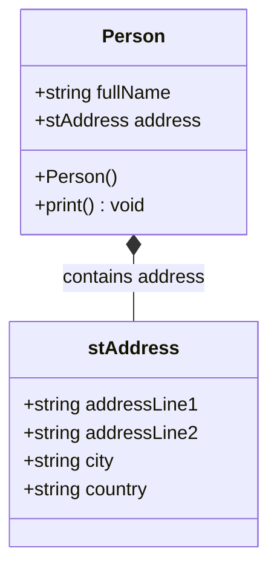

# Structure Inside Class in C++

## 1. Introduction

In C++, a structure (`struct`) can be defined inside a class.

This is known as a **Nested Structure** or **Nested Struct**.

A nested structure allows developers to group related data within the scope of an enclosing class.

Structures can also contain member functions, constructors, setters, and getters.

### Main Idea

**A struct inside a class is a nested member type that helps organize related data and functionality.**

---

## 2. What Is a Nested Structure?

A Nested Structure is a `struct` declared inside another class or structure.

### Syntax

```cpp
class OuterClass
{
    struct InnerStruct
    {
        // Data members
        // Member functions
    };
};
```

### Terminology

- **Outer Class / Enclosing Class:** The class containing the structure.
- **Nested Struct:** The structure defined inside the enclosing class.
- **Member Type:** A type declared as a member of another class.

A nested structure belongs to the scope of its enclosing class.

---

## 3. Original Lesson Code

```cpp
#include <iostream>

using namespace std;

class Person
{
    struct stAddress
    {
        string addressLine1;
        string addressLine2;
        string city;
        string country;
    };

public:
    string fullName;
    stAddress address;

    Person()
    {
        fullName = "Gamal Viona";
        address.addressLine1 = "Building 12";
        address.addressLine2 = "st.Louis";
        address.city = "Hong Kong";
        address.country = "China";
    }

    void print()
    {
        cout << "\nAddress:\n";
        cout << address.addressLine1 << endl;
        cout << address.addressLine2 << endl;
        cout << address.city << endl;
        cout << address.country << endl;
    }
};

int main()
{
    Person person;

    person.print();

    return 0;
}
```

### Expected Output

```text
Address:
Building 12
st.Louis
Hong Kong
China
```

---

## 4. Understanding the Enclosing Class

In this example:

```cpp
class Person
```

`Person` is the Enclosing Class.

It contains:

- A nested structure named `stAddress`.
- A string member named `fullName`.
- An object named `address`.
- A constructor.
- A member function named `print()`.

The structure is defined inside `Person` because the address information is logically related to a person.

---

## 5. Understanding the Nested Struct

```cpp
struct stAddress
{
    string addressLine1;
    string addressLine2;
    string city;
    string country;
};
```

The structure groups four related data members.

### Benefits

1. Better code organization.
2. Logical grouping of related information.
3. Improved readability.
4. Easier maintenance.
5. Support for encapsulation through appropriate access control.

### Important Concept

**A nested structure defines a type; it does not automatically create an object of that type.**

---

## 6. Nested Type vs. Member Object

Consider:

```cpp
struct stAddress
{
    string city;
    string country;
};

public:
    stAddress address;
```

### Explanation

| Identifier | Meaning |
|---|---|
| `stAddress` | Nested structure type |
| `address` | Member object of type `stAddress` |
| `address.city` | Access to the city member |
| `address.country` | Access to the country member |

### Key Principle

**The structure defines the data layout, while an object stores actual values.**

---

## 7. Class Structure Diagram



### Explanation

`Person` defines the nested type `stAddress` and contains an object named `address`.

The nested type describes the address data, while the member object stores that data for each `Person` object.

---

## 8. Initializing the Nested Structure

The `Person` constructor initializes the object's data.

```cpp
Person()
{
    fullName = "Gamal Viona";

    address.addressLine1 = "Building 12";
    address.addressLine2 = "st.Louis";
    address.city = "Hong Kong";
    address.country = "China";
}
```

### Explanation

The dot operator (`.`) accesses members of an object.

For example:

```cpp
address.city = "Hong Kong";
```

- `address` is the structure object.
- `city` is a member of the structure.
- `"Hong Kong"` is the assigned value.

---

## 9. Access Specifiers and Nested Structures

In C++, class members are private by default.

### Example

```cpp
class Person
{
    struct stAddress
    {
        string city;
    };

public:
    stAddress address;
};
```

In this example:

- `stAddress` is a private nested type.
- `address` is a public member object.
- `city` is public because members of a `struct` are public by default.

### Valid Access

```cpp
Person person;

person.address.city = "Riyadh";
```

This is valid because `address` and `city` are accessible.

### Invalid Access

```cpp
Person::stAddress address;
```

This is invalid outside `Person` because the nested type name is private.

### Important Principle

**The accessibility of a nested type name is separate from the accessibility of an object of that type.**

---

## 10. Public Nested Structures

A nested structure can be declared under `public:`.

### Example

```cpp
class Person
{
public:
    struct Address
    {
        string city;
        string country;
    };
};
```

External code can now name the nested type directly:

```cpp
Person::Address address;

address.city = "Riyadh";
address.country = "Saudi Arabia";
```

### Scope Resolution Operator

The `::` operator identifies a type or member within a particular scope.

Here:

```cpp
Person::Address
```

means the `Address` type declared inside `Person`.

---

## 11. Can a Struct Contain Methods?

Yes.

In C++, a structure can contain:

- Data members.
- Member functions.
- Constructors.
- Setters and getters.
- Access specifiers.

### Example

```cpp
struct Address
{
private:
    string _city;

public:
    void setCity(string city)
    {
        _city = city;
    }

    string getCity()
    {
        return _city;
    }
};
```

### Usage

```cpp
Address address;

address.setCity("Riyadh");

cout << address.getCity();
```

### Expected Output

```text
Riyadh
```

### Important Concept

**A struct is not limited to storing data; it can also contain behavior.**

---

## 12. Struct vs. Class

In C++, both `struct` and `class` can contain data members and member functions.

Their main language-level differences concern default access.

| Feature | Struct | Class |
|---|---|---|
| Default member access | Public | Private |
| Default inheritance access | Public | Private |
| Data members | Yes | Yes |
| Member functions | Yes | Yes |
| Constructors | Yes | Yes |
| Setters and getters | Yes | Yes |
| Access specifiers | Yes | Yes |

### Example

```cpp
struct ExampleStruct
{
    int value;
};
```

The `value` member is public by default.

```cpp
class ExampleClass
{
    int value;
};
```

The `value` member is private by default.

---

## 13. Nested Structures and Encapsulation

Encapsulation is an OOP principle that controls access to internal data and implementation details.

Nested structures can support encapsulation when combined with suitable access specifiers.

### Example

```cpp
class Person
{
private:
    struct Address
    {
        string city;
        string country;
    };

    Address address;
};
```

Here, both the nested type name and the member object are private.

External code cannot directly access `address`.

### Key Principle

**Nesting improves organization, while access specifiers control visibility and data protection.**

---

## 14. Access to Enclosing Class Members

A nested structure has access to members of its enclosing class according to C++ member access rules.

However, the nested structure does not automatically have an object of the enclosing class.

### Example

```cpp
class Outer
{
private:
    int secret = 100;

public:
    struct Inner
    {
        void display(Outer& obj)
        {
            cout << obj.secret;
        }
    };
};
```

### Explanation

`Inner` can access the private member `secret` through an `Outer` object.

The nested type has the required access permission, but it still needs an object to access non-static members.

### Important Principle

**Access permission does not automatically provide an instance of the enclosing class.**

---

## 15. Common Misunderstandings

### Misunderstanding 1

"A struct can only contain variables."

**Correction:**

A struct can also contain member functions, constructors, setters, and getters.

### Misunderstanding 2

"Defining a nested struct automatically creates an object."

**Correction:**

A nested struct defines a type. An object must be declared separately.

### Misunderstanding 3

"A nested struct is always public."

**Correction:**

Its accessibility depends on its declaration within the enclosing class.

### Misunderstanding 4

"A private nested struct means every object of that type is inaccessible."

**Correction:**

An accessible object of a private nested type may still expose accessible members.

### Misunderstanding 5

"Nested structures automatically guarantee encapsulation."

**Correction:**

Encapsulation depends on how access to members is controlled.

---

## 16. Key Takeaways

1. A `struct` can be defined inside a class in C++.
2. This is called a Nested Structure.
3. The containing class is the Enclosing Class.
4. A Nested Structure is a member type.
5. Its accessibility depends on access specifiers.
6. Struct members are public by default.
7. A struct can contain setters, getters, constructors, and other member functions.
8. A nested type definition does not automatically create an object.
9. The dot operator accesses members of structure objects.
10. Nested structures help organize related information.
11. Access specifiers determine visibility and data protection.
12. Nested structures are part of the enclosing class's design.

---

## 17. Simple Summary

### Nested Structure

A structure defined inside another class or structure.

### Enclosing Class

The class containing the nested structure.

### Syntax

```cpp
class Person
{
    struct Address
    {
        string city;
    };

public:
    Address address;
};
```

### Main Rules

- A struct can be defined inside a class.
- It is treated as a member type.
- Its accessibility depends on access specifiers.
- It can contain data members and member functions.
- It supports better organization and encapsulation when designed appropriately.

### Final Principle

**A nested structure organizes related data and functionality within the scope of an enclosing class.**

---
