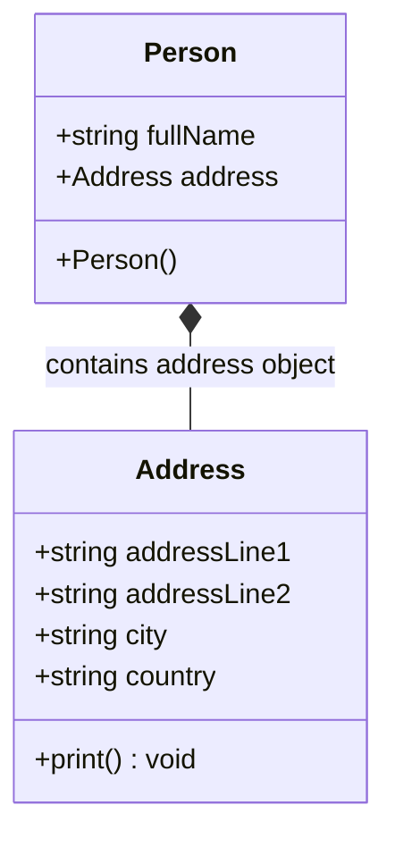

# Nested Classes in C++

## 1. Introduction

In C++, a class can be defined inside another class.

This is called a **Nested Class**.

The containing class is called the **Outer Class** or **Enclosing Class**, while the class defined inside it is called the **Nested Class** or **Inner Class**.

Nested classes help organize related data and functionality within a logical class scope.

### Main Idea

**A nested class is a member type declared inside another class.**

---

## 2. What Is a Nested Class?

A nested class is a class defined within the scope of another class.

### Basic Syntax

```cpp
class Outer
{
    class Inner
    {
        // Members of Inner
    };
};
```

### Terminology

- **Outer Class:** The class containing the nested class.
- **Enclosing Class:** Another name for the outer class.
- **Nested Class:** A class declared inside another class.
- **Inner Class:** An informal alternative name for a nested class.
- **Member Type:** A type declared as a member of a class.

The nested class belongs to the scope of the enclosing class.

---

## 3. Original Lesson Code

```cpp
#include <iostream>

using namespace std;

class Person
{
    class Address
    {
    public:
        string addressLine1;
        string addressLine2;
        string city;
        string country;

        void print()
        {
            cout << "\nAddress:\n";
            cout << addressLine1 << endl;
            cout << addressLine2 << endl;
            cout << city << endl;
            cout << country << endl;
        }
    };

public:
    string fullName;
    Address address;

    Person()
    {
        fullName = "Gamal Viona";
        address.addressLine1 = "Building 12";
        address.addressLine2 = "st.Louis";
        address.city = "Hong Kong";
        address.country = "China";
    }
};

int main()
{
    Person person;

    person.address.print();

    return 0;
}
```

### Expected Output

```text
Address:
Building 12
st.Louis
Hong Kong
China
```

**Note:** For portable code, explicitly include `<string>` when using `std::string`.

---

## 4. Understanding the Enclosing Class

In the original example:

```cpp
class Person
```

`Person` is the enclosing class.

It contains:

- A nested class named `Address`.
- A string data member named `fullName`.
- An object named `address`.
- A constructor.

The `Address` class is logically associated with `Person`.

---

## 5. Understanding the Nested Class

```cpp
class Address
{
public:
    string addressLine1;
    string addressLine2;
    string city;
    string country;

    void print()
    {
        cout << "\nAddress:\n";
        cout << addressLine1 << endl;
        cout << addressLine2 << endl;
        cout << city << endl;
        cout << country << endl;
    }
};
```

The nested class contains both data and behavior.

### Data Members

- `addressLine1`
- `addressLine2`
- `city`
- `country`

### Member Function

- `print()`

The `print()` function displays the address information.

### Key Principle

**A nested class can contain data members, member functions, constructors, and access specifiers just like an ordinary class.**

---

## 6. Nested Class vs. Member Object

Consider:

```cpp
class Person
{
    class Address
    {
    public:
        string city;
    };

public:
    Address address;
};
```

| Identifier | Meaning |
|---|---|
| `Person` | Enclosing class |
| `Address` | Nested class type |
| `address` | Member object of type `Address` |
| `address.city` | Access to a member of the object |

### Important Distinction

Declaring a nested class defines a type.

It does not automatically create an object of that type.

The following declaration creates a member object:

```cpp
Address address;
```

Each `Person` object contains its own `address` object.

---

## 7. Class Structure Diagram



### Explanation

The enclosing class defines `Address` as a nested type and contains an object of that type.

The diagram illustrates object composition, while the code also establishes the nested type's scope.

---

## 8. Initializing a Nested Class Object

In the original code:

```cpp
Person()
{
    fullName = "Gamal Viona";

    address.addressLine1 = "Building 12";
    address.addressLine2 = "st.Louis";
    address.city = "Hong Kong";
    address.country = "China";
}
```

The `Person` constructor assigns values to the members of the `address` object.

The nested `Address` class has no user-declared constructor, so its implicitly declared default constructor is used.

### Important Concept

**A nested class does not automatically share the constructor of its enclosing class.**

Each class has its own construction rules.

---

## 9. Accessing Nested Objects

The original `main()` function contains:

```cpp
Person person;

person.address.print();
```

### Step-by-Step Explanation

1. `Person person;` creates a `Person` object.
2. The `Person` constructor initializes its members.
3. `person.address` accesses the nested-class member object.
4. `.print()` calls the member function of that object.

### Access Chain

```text
person
  |
  +-- address
        |
        +-- print()
```

### Key Principle

**The dot operator (`.`) is used to access members through objects.**

---

## 10. Scope of Nested Classes

A nested class belongs to the scope of its enclosing class.

### Example

```cpp
class Outer
{
public:
    class Inner
    {
    public:
        int value = 10;
    };
};
```

Because `Inner` is public, it can be named from outside:

```cpp
Outer::Inner obj;

cout << obj.value;
```

### Expected Output

```text
10
```

### Scope Resolution Operator

The `::` operator specifies the scope containing a type or member.

```cpp
Outer::Inner
```

means the `Inner` class declared inside `Outer`.

---

## 11. Access Specifiers of Nested Classes

The accessibility of a nested class name depends on the enclosing class's access specifiers.

### Private Nested Class

```cpp
class Outer
{
    class Inner
    {
    };
};
```

Because `Inner` is declared before `public:`, its name is private by default.

Ordinary external code cannot directly declare:

```cpp
Outer::Inner obj; // Error: Inner is private
```

### Public Nested Class

```cpp
class Outer
{
public:
    class Inner
    {
    };
};
```

Now external code can declare:

```cpp
Outer::Inner obj;
```

### Key Principle

**A nested class can be private, protected, or public depending on where it is declared.**

---

## 12. Private Nested Type with a Public Object

Consider the original design:

```cpp
class Person
{
    class Address
    {
    public:
        string city;
        void print() {}
    };

public:
    Address address;
};
```

The name `Address` is private.

However, `address` is a public member object.

Therefore, external code can access its public members:

```cpp
Person person;

person.address.city = "Riyadh";
person.address.print();
```

But it cannot directly name the private type:

```cpp
Person::Address obj; // Error
```

### Important Principle

**The accessibility of a nested type's name is separate from the accessibility of objects and their members.**

---

## 13. Access Between Nested and Enclosing Classes

A nested class has the same access permissions to members of its enclosing class as other members of the enclosing class.

This includes private and protected members.

However, the nested class does not automatically have an instance of its enclosing class.

### Example

```cpp
#include <iostream>
using namespace std;

class Outer
{
private:
    int secret = 100;

public:
    class Inner
    {
    public:
        void print(Outer& obj)
        {
            cout << obj.secret;
        }
    };
};

int main()
{
    Outer outer;
    Outer::Inner inner;

    inner.print(outer);

    return 0;
}
```

### Expected Output

```text
100
```

### Explanation

- `secret` is a private member of `Outer`.
- `Inner` has permission to access it.
- The `print()` function receives a reference to an `Outer` object.
- The reference provides the object needed to access the non-static member.

### Important Rule

**Access permission and possession of an object are separate concepts.**

---

## 14. Does the Outer Class Access Inner Private Members?

Not automatically.

The enclosing class does not receive special access to the nested class's private members merely because it contains the nested class declaration.

### Example

```cpp
class Outer
{
    class Inner
    {
    private:
        int secret = 10;
    };

public:
    void test()
    {
        Inner obj;

        // cout << obj.secret; // Error
    }
};
```

The outer class cannot directly access `Inner::secret`.

Access would require an appropriate mechanism, such as a public member function or friendship.

### Key Principle

**A nested class can access enclosing-class private members, but the reverse permission is not automatic.**

---

## 15. Nested Classes vs. Nested Structures

Both are class types in C++.

### Nested Class

```cpp
class Outer
{
    class Inner
    {
        int value;
    };
};
```

### Nested Structure

```cpp
class Outer
{
    struct Inner
    {
        int value;
    };
};
```

### Comparison

| Feature | Nested Class | Nested Struct |
|---|---|---|
| Keyword | `class` | `struct` |
| Default member access | Private | Public |
| Data members | Supported | Supported |
| Member functions | Supported | Supported |
| Constructors | Supported | Supported |
| Access specifiers | Supported | Supported |
| Nested within another class | Yes | Yes |

### Key Difference

The primary language-level difference is default member and inheritance access.

---

## 16. Benefits of Nested Classes

### Better Organization

Related functionality can be grouped within the class where it logically belongs.

### Logical Separation

A nested class can represent a specific component or responsibility.

### Encapsulation

Access specifiers can control whether the nested type is visible externally.

### Readability

A nested type communicates its relationship to the enclosing class.

### Maintainability

Related definitions remain together, making their relationship easier to understand.

---

## 17. Common Misunderstandings

### Misunderstanding 1

"A nested class is automatically public."

**Correction:**

Its accessibility depends on the enclosing class's access specifiers.

### Misunderstanding 2

"A nested class cannot be used outside its enclosing class."

**Correction:**

A public nested class can be named externally using `Outer::Inner`.

### Misunderstanding 3

"Declaring a nested class automatically creates an object."

**Correction:**

A nested class defines a type. An object must be declared separately.

### Misunderstanding 4

"A nested class cannot access private members of the enclosing class."

**Correction:**

It has the same access permissions as other members of the enclosing class.

### Misunderstanding 5

"A nested class automatically has an enclosing-class object."

**Correction:**

It does not. Accessing non-static members requires an appropriate object or reference.

### Misunderstanding 6

"The enclosing class automatically accesses all private members of the nested class."

**Correction:**

The enclosing class does not receive reverse access automatically.

---

## 18. Key Takeaways

1. A nested class is a class defined inside another class.
2. The containing class is called the Enclosing Class.
3. A nested class is a member type of its enclosing class.
4. Its name belongs to the enclosing class's scope.
5. Its accessibility depends on access specifiers.
6. A public nested class can be named using `Outer::Inner`.
7. Declaring a nested class does not automatically create an object.
8. A nested class can contain data members, functions, and constructors.
9. A nested class can access private members of its enclosing class.
10. It still needs an object to access non-static enclosing-class members.
11. The enclosing class does not automatically access nested-class private members.
12. Nested classes improve organization and logical separation.

---

## 19. Simple Summary

### Nested Class

A class defined inside another class.

### Enclosing Class

The class containing the nested class.

### Syntax

```cpp
class Outer
{
public:
    class Inner
    {
    };
};
```

### Main Rules

- A nested class is a member type of its enclosing class.
- Its accessibility depends on access specifiers.
- A public nested class can be named using `Outer::Inner`.
- Nested classes have access to private and protected members of their enclosing class.
- They do not automatically possess an enclosing-class object.
- The enclosing class does not automatically receive access to the nested class's private members.

### Final Principle

**Nested classes provide a way to organize related types within an enclosing class while following C++ scope, object, and access rules.**

---

**Nested Classes and Constructors in C++**

The next lesson explores constructor initialization when working with nested classes and their enclosing classes.
