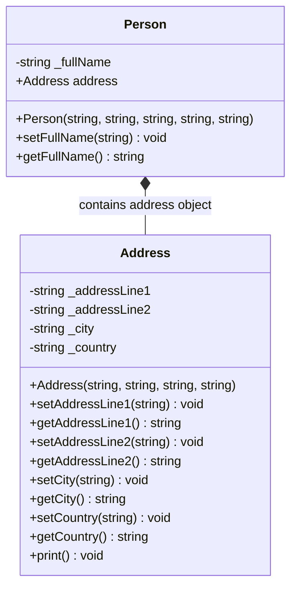
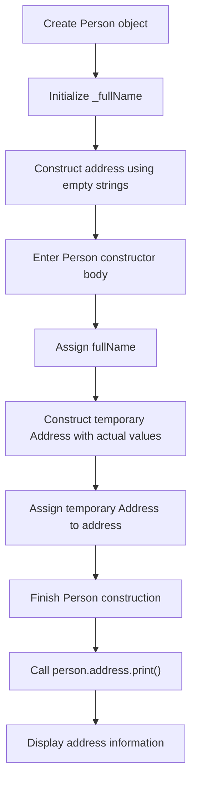

# Nested Classes and Constructors in C++

## 1. Introduction

In C++, a nested class can define its own constructors, data members, and member functions, just like an ordinary class.

When an enclosing class contains an object of a nested class, that object must be properly constructed before the enclosing class's constructor body executes.

This lesson demonstrates how to initialize a nested class object through the enclosing class's constructor.

### Main Idea

**A nested class has its own constructors, and its objects can be initialized through the enclosing class's constructor.**

---

## 2. Understanding Nested Class Constructors

A nested class is a class declared inside another class.

Each class manages the initialization of its own objects.

### Basic Example

```cpp
class Outer
{
    class Inner
    {
    public:
        Inner(int value)
        {
            // Initialize Inner object
        }
    };
};
```

### Important Concepts

- `Outer` is the enclosing class.
- `Inner` is the nested class.
- `Inner(int value)` is the nested class's constructor.
- The nested class can have its own constructors independently of the enclosing class.
- The enclosing class does not automatically pass constructor arguments to its nested class.

---

## 3. Original Lesson Code

```cpp
#include <iostream>

using namespace std;

class Person
{

private:
    string _fullName;

    class Address
    {

    private:
        string _addressLine1;
        string _addressLine2;
        string _city;
        string _country;

    public:
        Address(string addressLine1, string addressLine2, string city, string country)
        {
            _addressLine1 = addressLine1;
            _addressLine2 = addressLine2;
            _city = city;
            _country = country;
        }

        void setAddressLine1(string addressLine1)
        {
            _addressLine1 = addressLine1;
        }

        string getAddressLine1()
        {
            return _addressLine1;
        }

        void setAddressLine2(string addressLine2)
        {
            _addressLine2 = addressLine2;
        }

        string getAddressLine2()
        {
            return _addressLine2;
        }

        void setCity(string city)
        {
            _city = city;
        }

        string getCity()
        {
            return _city;
        }

        void setCountry(string country)
        {
            _country = country;
        }

        string getCountry()
        {
            return _country;
        }

        void print()
        {
            cout << "\nAddress:\n";
            cout << getAddressLine1() << endl;
            cout << getAddressLine2() << endl;
            cout << getCity() << endl;
            cout << getCountry() << endl;
        }

    };

public:
    void setFullName(string fullName)
    {
        _fullName = fullName;
    }

    string getFullName()
    {
        return _fullName;
    }

    Address address = Address("", "", "", "");

    Person(string fullName, string addressLine1, string addressLine2, string city, string country)
    {
        _fullName = fullName;

        //initiate Address class by it's constructor
        address = Address(addressLine1, addressLine2, city, country);
    }

};

int main()
{
    Person person("Ronny Davids Qwari", "st.345", "RD.66", "Beijing", "China");

    person.address.print();

    return 0;
}
```

### Expected Output

```text
Address:
st.345
RD.66
Beijing
China
```

**Note:** The original code is preserved. For portable C++, explicitly include `<string>` when using `std::string`.

---

## 4. Understanding the Class Structure

The program contains two classes:

1. `Person` — Enclosing Class.
2. `Address` — Nested Class.

### Class Diagram



### Explanation

The `Person` class declares the `Address` type inside its private section.

It also contains a public member object named `address`.

Although the nested type's name is private, the public `address` object exposes its public member functions.

---

## 5. Constructor of the Nested Class

The `Address` constructor receives four arguments.

```cpp
Address(string addressLine1, string addressLine2, string city, string country)
{
    _addressLine1 = addressLine1;
    _addressLine2 = addressLine2;
    _city = city;
    _country = country;
}
```

### Explanation

The constructor assigns the supplied values to the object's private data members.

| Parameter | Data Member |
|---|---|
| `addressLine1` | `_addressLine1` |
| `addressLine2` | `_addressLine2` |
| `city` | `_city` |
| `country` | `_country` |

### Important Principle

**A parameterized constructor requires the appropriate arguments when an object is constructed.**

Because `Address` declares a constructor requiring four arguments and has no default constructor, it cannot be default-constructed without arguments.

---

## 6. Encapsulation Inside the Nested Class

The nested class stores its data privately.

```cpp
private:
    string _addressLine1;
    string _addressLine2;
    string _city;
    string _country;
```

It exposes public setters and getters.

### Setter Example

```cpp
void setCity(string city)
{
    _city = city;
}
```

### Getter Example

```cpp
string getCity()
{
    return _city;
}
```

### Benefits

- Controls how external code interacts with internal data.
- Separates implementation details from the public interface.
- Allows validation to be added later.
- Improves maintainability.

### Important Note

Setters and getters provide controlled access points, but they do not automatically validate input.

Validation must be implemented explicitly.

---

## 7. Initializing the Nested Object

The original code declares:

```cpp
Address address = Address("", "", "", "");
```

This is a non-static data member with a default member initializer.

When no constructor member initializer overrides it, `address` is initialized using four empty strings.

### Important Detail

This does not invoke a zero-argument default constructor.

Instead, it invokes the parameterized `Address` constructor with four arguments.

### Key Principle

**A default member initializer provides an initialization expression for a member when the enclosing constructor does not explicitly initialize that member.**

---

## 8. Understanding the Person Constructor

The original constructor is:

```cpp
Person(string fullName, string addressLine1, string addressLine2, string city, string country)
{
    _fullName = fullName;

    address = Address(addressLine1, addressLine2, city, country);
}
```

This constructor receives:

- The person's full name.
- The first address line.
- The second address line.
- The city.
- The country.

### What Happens?

1. The `Person` object begins construction.
2. `_fullName` is default-initialized as an empty string.
3. `address` is constructed using its default member initializer.
4. The `Person` constructor body begins executing.
5. `_fullName` receives the supplied name.
6. A temporary `Address` object is constructed with the supplied address values.
7. That temporary object is assigned to the existing `address` member.

### Important Distinction

The statement:

```cpp
address = Address(addressLine1, addressLine2, city, country);
```

performs assignment to an existing object.

It does not initialize the original `address` member for the first time.

---

## 9. Initialization vs. Assignment

Initialization and assignment are different operations in C++.

### Initialization

Initialization establishes an object's initial state as the object is created.

Example:

```cpp
Address address("Street 1", "Building 2", "Riyadh", "Saudi Arabia");
```

### Assignment

Assignment modifies an object that already exists.

Example:

```cpp
address = Address("Street 3", "Building 4", "Jeddah", "Saudi Arabia");
```

### Comparison

| Initialization | Assignment |
|---|---|
| Happens when an object is created | Happens after an object exists |
| Establishes initial state | Replaces or updates existing state |
| Can invoke a constructor | Can invoke an assignment operator |
| Required for reference and const members | Not available for every type |

### Key Principle

**Constructing an object and assigning to an existing object are not the same operation.**

---

## 10. Execution Flow of the Original Code



### Observation

The original approach constructs `address` with empty values before assigning the intended address.

This works, but it is not the most direct initialization approach.

---

## 11. Better Practice: Member Initializer List

C++ provides a Member Initializer List for initializing data members directly.

### Improved Example

```cpp
class Person
{
private:
    string _fullName;

    class Address
    {
    private:
        string _city;
        string _country;

    public:
        Address(string city, string country)
            : _city(city), _country(country)
        {
        }

        void print() const
        {
            cout << _city << endl;
            cout << _country << endl;
        }
    };

public:
    Address address;

    Person(string fullName, string city, string country)
        : _fullName(fullName),
          address(city, country)
    {
    }
};
```

### Explanation

```cpp
: _fullName(fullName),
  address(city, country)
```

directly initializes both members before the constructor body executes.

### Benefits

1. Avoids unnecessary initial construction followed by assignment.
2. Works with members that do not have default constructors.
3. Supports initialization of const and reference members.
4. Expresses the intended initial state clearly.
5. Is the preferred approach for initializing class members.

---

## 12. Comparing Both Approaches

### Original Approach

```cpp
Address address = Address("", "", "", "");

Person(string fullName, string line1, string line2, string city, string country)
{
    _fullName = fullName;
    address = Address(line1, line2, city, country);
}
```

### Improved Approach

```cpp
Address address;

Person(string fullName, string line1, string line2, string city, string country)
    : _fullName(fullName),
      address(line1, line2, city, country)
{
}
```

### Comparison

| Original Approach | Improved Approach |
|---|---|
| Constructs address with empty values | Constructs address with actual values |
| Assigns another Address afterward | No additional Address assignment |
| Uses constructor-body assignment | Uses Member Initializer List |
| Valid C++ | Valid C++ |
| More operations in this example | More direct initialization |

### Important Note

The improved approach does not require `Address` to have a default constructor.

The member initializer explicitly supplies the constructor arguments.

---

## 13. Member Initialization Order

An important C++ rule is that non-static data members are initialized in the order they are declared inside the class.

They are not initialized according to their written order in the Member Initializer List.

### Example

```cpp
class Example
{
private:
    int first;
    int second;

public:
    Example() : second(20), first(10)
    {
    }
};
```

Despite the initializer list placing `second` first:

1. `first` is initialized first.
2. `second` is initialized second.

### Best Practice

Write member initializers in the same order as their member declarations.

This improves clarity and helps prevent initialization-order mistakes.

---

## 14. Access Specifiers and Nested Class Objects

In the original code:

```cpp
private:
    class Address
    {
        // ...
    };

public:
    Address address;
```

The nested class name `Address` is private.

However, the member object `address` is public.

### Valid Usage

```cpp
Person person("John", "Street 1", "Building 2", "Riyadh", "Saudi Arabia");

person.address.print();
```

This is allowed because the object and its `print()` method are accessible.

### Invalid Usage

```cpp
Person::Address obj("Street 1", "Building 2", "Riyadh", "Saudi Arabia");
```

This is not allowed in ordinary external code because the nested type name is private.

### Key Principle

**The accessibility of a nested class's name is separate from the accessibility of a member object of that type.**

---

## 15. Constructor Independence

Nested classes do not automatically share constructors with their enclosing classes.

Each class defines its own constructors.

### Example

```cpp
class Outer
{
public:
    class Inner
    {
    public:
        Inner(int value)
        {
        }
    };

    Inner obj;

    Outer(int value) : obj(value)
    {
    }
};
```

### Explanation

- `Inner(int)` initializes an `Inner` object.
- `Outer(int)` initializes an `Outer` object.
- The `Outer` constructor explicitly initializes its `obj` member using the `Inner` constructor.

### Key Principle

**The enclosing class is responsible for initializing its nested-class member objects, just as it initializes other data members.**

---

## 16. Improving Getter Functions with const

The original getters do not modify object state.

Therefore, they can be declared `const`.

### Example

```cpp
string getCity() const
{
    return _city;
}
```

The `print()` function can also be declared `const`.

```cpp
void print() const
{
    cout << getCity() << endl;
}
```

### Benefits

- Expresses that the function does not modify the object.
- Allows calling the function on const objects.
- Improves interface clarity.

---

## 17. Passing Strings Efficiently

The original code passes strings by value.

```cpp
void setCity(string city)
{
    _city = city;
}
```

This is valid.

For read-only parameters, passing by const reference can avoid an unnecessary parameter copy.

### Example

```cpp
void setCity(const string& city)
{
    _city = city;
}
```

The same technique can be applied to constructors.

### Important Note

Passing by value is not always inefficient, especially when move semantics are involved.

The best parameter-passing strategy depends on how the function uses and stores the value.

---

## 18. Common Misunderstandings

### Misunderstanding 1

"A nested class automatically uses the enclosing class's constructor."

**Correction:**

Each class has its own constructors.

### Misunderstanding 2

"A parameterized constructor is the same as a default constructor."

**Correction:**

A default constructor can be called without arguments.

A constructor requiring four arguments cannot be called without them unless defaults are provided.

### Misunderstanding 3

"Assigning an Address object inside Person's constructor initializes the member."

**Correction:**

The member is already initialized before the constructor body executes.

The statement performs assignment.

### Misunderstanding 4

"A Member Initializer List is only a performance optimization."

**Correction:**

It is also necessary for initializing certain kinds of members, including references and const members, and members without accessible default constructors.

### Misunderstanding 5

"A private nested class can never be used through a public object."

**Correction:**

An accessible member object can expose the nested class's public operations even if the type name itself is private.

### Misunderstanding 6

"Nested class objects automatically have access to an enclosing class object."

**Correction:**

Nesting grants relevant member access permissions but does not automatically provide an enclosing-class instance.

---

## 19. Key Takeaways

1. Nested classes can define their own constructors.
2. A nested class constructor is independent of the enclosing class constructor.
3. Nested-class member objects must be initialized during construction of the enclosing object.
4. Default member initializers provide initialization expressions for members.
5. Parameterized constructors require appropriate arguments.
6. Constructor-body assignment is different from direct member initialization.
7. Member Initializer Lists initialize members directly.
8. Member Initializer Lists are generally preferred for member initialization.
9. Members are initialized in declaration order.
10. Nested classes can implement encapsulation using private data and public methods.
11. Setters and getters can provide controlled access to private members.
12. A private nested type may still have an accessible public member object.
13. `const` member functions communicate that they do not modify the object's state.
14. Constructor design is an important part of reliable object-oriented programming.

---

## 20. Simple Summary

### Nested Class Constructor

A constructor defined inside a class that is nested within another class.

### Enclosing Class Constructor

A constructor responsible for initializing the enclosing class's own members, including nested-class objects.

### Original Approach

```cpp
Address address = Address("", "", "", "");

Person(string name, string city)
{
    address = Address("", "", city, "");
}
```

### Preferred Approach

```cpp
Address address;

Person(string name, string city)
    : address("", "", city, "")
{
}
```

### Main Rules

- Nested classes have their own constructors.
- Member objects are initialized before the enclosing constructor body.
- Initialization and assignment are different operations.
- Member Initializer Lists allow direct member initialization.
- Proper initialization avoids unnecessary intermediate object states.

### Final Principle

**Initialize nested-class member objects directly through the enclosing class's Member Initializer List whenever appropriate, rather than constructing them with placeholder values and assigning afterward.**

---

