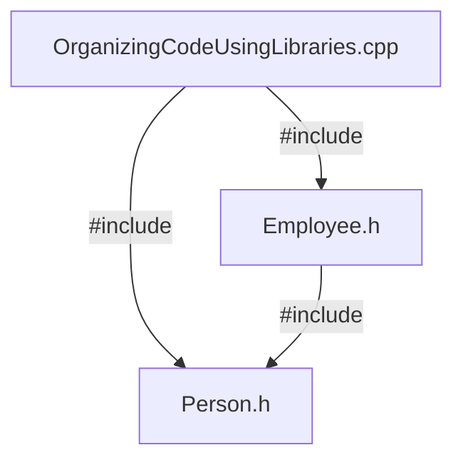

# Separate Classes in Libraries

## 1. Introduction

As C++ projects grow, placing all classes and functions in a single source file makes the code harder to read, maintain, and reuse.

C++ allows developers to organize their code into separate header files (`.h`) and source files (`.cpp`).

This lesson demonstrates how to separate classes into header files and include them in a main source file.

### Main Idea

**Organizing classes into separate files improves code readability, maintainability, modularity, and reusability.**

---

## 2. Project Structure

The original project contains three files:

```text
OrganizingCodeUsingLibraries/
│
├── Person.h
├── Employee.h
└── OrganizingCodeUsingLibraries.cpp
```

### File Responsibilities

| File | Responsibility |
|---|---|
| `Person.h` | Defines the Person base class |
| `Employee.h` | Defines the Employee derived class |
| `OrganizingCodeUsingLibraries.cpp` | Contains the main function |

### Key Concept

Each file has a specific responsibility.

This separation makes the project easier to understand and maintain.

---

## 3. What Is a Header File?

A header file commonly contains declarations that other source files need to use.

Header files usually have the `.h` or `.hpp` extension.

### Common Header Contents

- Class declarations.
- Function declarations.
- Structure declarations.
- Constants.
- Type aliases.
- Templates.
- Inline function definitions.

### Example

```cpp
#pragma once

class Person
{
public:
    void print();
};
```

This header declares a class named `Person` with a public member function.

### Important Note

A header file can contain both declarations and definitions.

However, non-inline function implementations are commonly placed in source files.

---

## 4. What Is a Source File?

A source file usually has the `.cpp` extension.

Source files commonly contain:

- Function implementations.
- Class member function implementations.
- Internal program logic.
- The `main()` function.

### Example

```cpp
#include "Person.h"
#include <iostream>

void Person::print()
{
    std::cout << "Hello from Person";
}
```

The scope resolution operator (`::`) identifies the class to which the function belongs.

### Key Principle

**Header files commonly describe interfaces, while source files commonly provide implementations.**

---

## 5. Understanding #include

The `#include` directive tells the preprocessor to include the contents of another file.

### Standard Library Headers

```cpp
#include <iostream>
#include <string>
```

Angle brackets are conventionally used for standard library and system headers.

### Project Headers

```cpp
#include "Person.h"
#include "Employee.h"
```

Quotation marks are conventionally used for project-specific headers.

### Comparison

| Syntax | Typical Usage |
|---|---|
| `#include <iostream>` | Standard library header |
| `#include <string>` | Standard library header |
| `#include "Person.h"` | Local project header |
| `#include "Employee.h"` | Local project header |

### Important Note

The exact file-search behavior depends on the compiler and its configuration.

---

## 6. What Is #pragma once?

`#pragma once` is a widely supported preprocessor directive that prevents a header file from being included more than once within the same translation unit.

### Example

```cpp
#pragma once

class Person
{
};
```

### Why Is It Important?

Without protection against repeated inclusion, the same class definition may appear multiple times in one translation unit.

This can cause a redefinition error.

### Example

```cpp
#include "Person.h"
#include "Person.h"
```

If `Person.h` contains an unprotected class definition, repeated inclusion may produce an error.

### Key Principle

**`#pragma once` helps prevent multiple inclusion of the same header within one translation unit.**

---

## 7. Understanding Class Redefinition Errors

Consider a header file without include protection.

### Person.h

```cpp
class Person
{
};
```

### Main.cpp

```cpp
#include "Person.h"
#include "Person.h"

int main()
{
    Person person;
}
```

The preprocessor may effectively produce:

```cpp
class Person
{
};

class Person
{
};
```

The compiler then encounters two definitions of the same class.

### Typical Error

```text
'class Person': class type redefinition
```

### Solution

Add include protection to the header.

```cpp
#pragma once
```

This prevents the repeated header contents from being included in the same translation unit.

---

## 8. Include Guards — Alternative to #pragma once

Include Guards provide a standard C++ preprocessing technique for preventing multiple inclusion.

### Example

```cpp
#ifndef PERSON_H
#define PERSON_H

class Person
{
};

#endif
```

### Explanation

- `#ifndef` checks whether the macro is undefined.
- `#define` defines the macro.
- `#endif` ends the conditional preprocessing block.

If the header is included again, its guarded contents are skipped.

### Comparison

| Feature | #pragma once | Include Guards |
|---|---|---|
| Prevents repeated inclusion | Yes | Yes |
| Easy to write | Yes | Requires multiple directives |
| Standard C++ mechanism | No | Yes |
| Widely supported | Yes | Yes |

### Best Practice

Use one consistent include-protection strategy across the project.

---

## 9. Understanding Person.h

The original `Person.h` defines the base class.

### Main Members

```cpp
class Person
{
private:
    int _id;
    string _firstName;
    string _lastName;
    string _email;
    string _phone;

public:
    Person(int id, string firstName, string lastName,
           string email, string phone)
    {
        _id = id;
        _firstName = firstName;
        _lastName = lastName;
        _email = email;
        _phone = phone;
    }

    // Other member functions
};
```

### Responsibilities

The `Person` class manages:

- Personal identification.
- First and last names.
- Email address.
- Phone number.
- Full name generation.
- Console-based email and SMS demonstrations.
- Printing personal information.

### Encapsulation

The class stores its data privately and exposes public methods.

The ID has a getter but no public setter.

### Important Note

The `sendEmail()` and `sendSMS()` functions only print messages to the console in this project.

They do not perform actual email or SMS delivery.

---

## 10. Understanding Employee.h

The original `Employee.h` includes `Person.h`.

```cpp
#pragma once

#include <iostream>
#include <string>
#include "Person.h"

using namespace std;
```

### Why Include Person.h?

Because `Employee` inherits from `Person`.

```cpp
class Employee : public Person
{
    // Employee members
};
```

The compiler needs the complete definition of `Person` when defining the derived class.

### Additional Employee Members

```cpp
private:
    string _title;
    string _department;
    float _salary;
```

These members represent information specific to employees.

### Key Principle

**A derived class header must have access to the definition of its base class.**

---

## 11. Constructor Initialization and Inheritance

The `Employee` constructor uses a Member Initializer List.

```cpp
Employee(int id, string firstName, string lastName,
         string email, string phone, string title,
         string department, float salary)
    : Person(id, firstName, lastName, email, phone)
{
    _title = title;
    _department = department;
    _salary = salary;
}
```

### Explanation

The expression:

```cpp
: Person(id, firstName, lastName, email, phone)
```

initializes the `Person` base-class subobject.

The `Employee` constructor then assigns values to its additional members.

### Construction Order

1. The `Person` base-class subobject is constructed.
2. The `Employee` data members are initialized.
3. The `Employee` constructor body executes.

### Key Principle

**Base-class construction occurs before the derived-class constructor body executes.**

---

## 12. Understanding the Main Source File

The main source file includes both class headers.

```cpp
#include <iostream>
#include <string>
#include "Person.h"
#include "Employee.h"

using namespace std;

int main()
{
    Employee employee(
        10,
        "Fadi",
        "Davids",
        "Da@gmail.com",
        "0920590235",
        "Software Developer",
        "Computer Science",
        55000
    );

    employee.print();

    return 0;
}
```

### Explanation

1. The necessary headers are included.
2. An `Employee` object is created.
3. Constructor arguments initialize the employee.
4. `employee.print()` displays the employee information.

### Expected Output

```text
Info
____________________________
ID        : 10
FirstName : Fadi
lastName  : Davids
FullName  : Fadi Davids
Email     : Da@gmail.com
Phone     : 0920590235
Title     : Software Developer
Department: Computer Science
Salary    : 55000
____________________________
```

---

## 13. Header Dependencies

The project has the following dependency structure:



### Explanation

- The main source file includes `Person.h`.
- The main source file includes `Employee.h`.
- `Employee.h` also includes `Person.h`.
- `#pragma once` prevents repeated inclusion of `Person.h` within the same translation unit.

### Important Note

Including `Person.h` directly in the main file is not required for this particular program because `Employee.h` already includes it.

However, directly including headers for types used by a source file can make dependencies more explicit.

---

## 14. Understanding Translation Units

A Translation Unit is the result of preprocessing a source file, including its expanded headers.

### Example

```cpp
#include "Employee.h"
```

The preprocessor processes the included header and its dependencies.

The compiler then compiles the resulting translation unit.

### Important Principle

**Include protection applies within a translation unit, not globally across an entire project.**

Different source files can include the same header independently.

---

## 15. Inline Functions in Header Files

In the original project, member functions are defined directly inside their class definitions.

### Example

```cpp
class Person
{
public:
    void print()
    {
        // Implementation
    }
};
```

A member function defined inside a class definition is implicitly inline in this ordinary header-based context.

This allows the definition to appear in multiple translation units when the relevant C++ One Definition Rule requirements are satisfied.

### Important Note

The `inline` keyword does not guarantee that the compiler will physically insert the function's instructions at each call site.

It also has an important language-level role concerning definitions across translation units.

---

## 16. Separating Declarations and Implementations

In larger projects, developers often separate class declarations from method implementations.

### Person.h

```cpp
#pragma once
#include <string>

class Person
{
private:
    std::string _name;

public:
    Person(const std::string& name);
    void print() const;
};
```

### Person.cpp

```cpp
#include "Person.h"
#include <iostream>

Person::Person(const std::string& name)
    : _name(name)
{
}

void Person::print() const
{
    std::cout << _name << '\n';
}
```

### Main.cpp

```cpp
#include "Person.h"

int main()
{
    Person person("Fadi");
    person.print();

    return 0;
}
```

### Benefits

- Clear separation of interface and implementation.
- Easier maintenance.
- Better organization for larger codebases.
- Reduced implementation details in public headers.

### Important Note

If implementations are moved to `.cpp` files, those files must also be compiled and linked into the program.

---

## 17. Header-Only vs. Separate Implementation

### Header-Only Approach

```text
Project/
├── Person.h
├── Employee.h
└── Main.cpp
```

Class member functions are implemented directly inside the headers.

This is the approach used in the original lesson.

### Separate Implementation Approach

```text
Project/
├── Person.h
├── Person.cpp
├── Employee.h
├── Employee.cpp
└── Main.cpp
```

Class declarations are placed in headers, while most non-inline method implementations are placed in source files.

### Comparison

| Header-Only | Separate Implementation |
|---|---|
| Fewer files | More files |
| Convenient for small examples | Common in larger projects |
| Implementations visible in headers | Implementations can be hidden in source files |
| Header changes may trigger more recompilation | Can reduce unnecessary recompilation |

Both approaches are valid.

---

## 18. Best Practices for Header Files

### 1. Use Include Protection

Use `#pragma once` or Include Guards.

### 2. Avoid using namespace std in Headers

Avoid:

```cpp
using namespace std;
```

Prefer:

```cpp
std::string name;
std::cout << name;
```

This prevents a header from introducing names into the global namespace of every including file.

### 3. Include Required Headers

If a header uses `std::string`, explicitly include:

```cpp
#include <string>
```

Do not rely on unrelated headers to provide it indirectly.

### 4. Keep Dependencies Clear

Include headers that provide the definitions required by your code.

### 5. Separate Responsibilities

Give each class and file a clear purpose.

### 6. Use Meaningful File Names

Examples:

```text
Person.h
Employee.h
Main.cpp
```

### 7. Avoid Unnecessary Includes

Only include what is required by the file.

---

## 19. Common Misunderstandings

### Misunderstanding 1

"`#pragma once` prevents a library from being loaded multiple times at runtime."

**Correction:**

It prevents repeated inclusion of a header within the same translation unit during preprocessing.

### Misunderstanding 2

"`#pragma once` is mandatory in C++."

**Correction:**

It is optional. Include Guards are a standard alternative.

### Misunderstanding 3

"Header files cannot contain function implementations."

**Correction:**

They can contain implementations, particularly inline functions and templates.

### Misunderstanding 4

"`#include` executes another file."

**Correction:**

It makes the contents of another file available during preprocessing.

### Misunderstanding 5

"Every class must have its own .cpp file."

**Correction:**

A separate `.cpp` file is a common organizational choice, not a language requirement.

### Misunderstanding 6

"Separating classes into headers automatically creates a compiled library."

**Correction:**

Header organization does not automatically produce a static or shared library.

A compiled library requires additional build and linking steps.

---

## 20. Key Takeaways

1. C++ projects can organize classes into separate header files.
2. Header files commonly contain declarations and interfaces.
3. Source files commonly contain implementations.
4. `#include` incorporates header contents during preprocessing.
5. `#pragma once` prevents repeated inclusion within a translation unit.
6. Include Guards provide a standard alternative.
7. Header dependencies must be managed carefully.
8. Derived classes require the definitions of their base classes.
9. Functions defined inside class definitions are implicitly inline in ordinary header-based code.
10. Larger projects often separate declarations and implementations.
11. Header files should avoid unnecessary global namespace pollution.
12. Modular organization improves maintainability and reusability.

---

## 21. Simple Summary

### Header File

A file commonly used to declare classes, functions, and other reusable interfaces.

### Source File

A file commonly used to implement program functionality.

### #include

A preprocessor directive used to include another file's contents.

### #pragma once

A widely supported directive that prevents multiple inclusion of a header within the same translation unit.

### Typical Workflow

1. Create a class.
2. Move the class declaration into a header file.
3. Add include protection.
4. Optionally move method implementations into a source file.
5. Include the header where the class is needed.
6. Compile and link all required source files.

### Final Principle

**Separate classes into well-organized files, protect headers against repeated inclusion, and manage dependencies explicitly to build maintainable C++ projects.**

---

