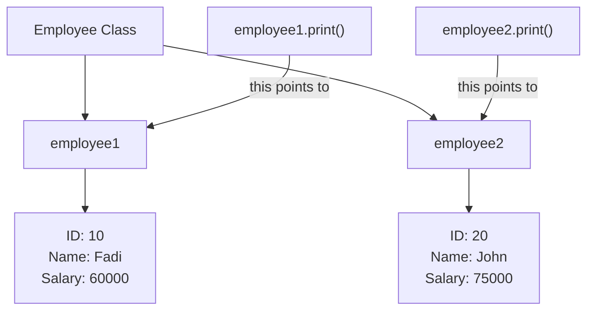
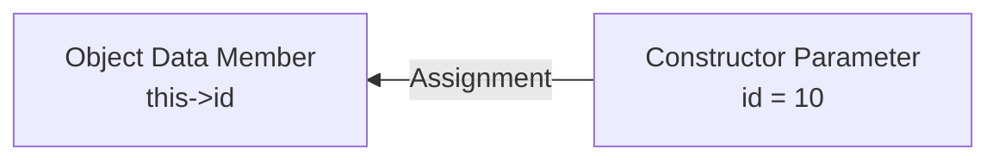
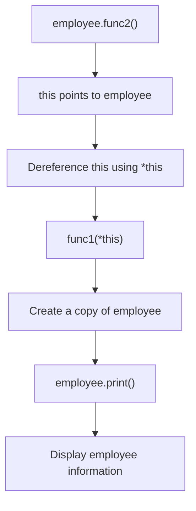
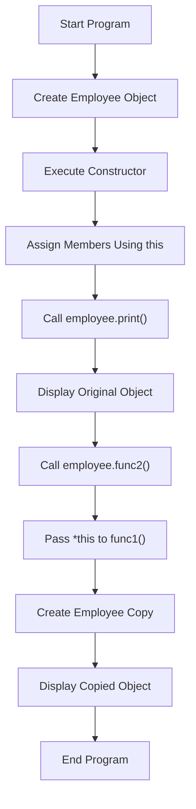

# What Is the `this` Pointer?

## 1. Introduction

In C++, every object has its own non-static data members.

When a non-static member function is called, it needs a way to identify the object on which it is operating.

C++ provides an implicit pointer called `this` for this purpose.

### Definition

The `this` pointer is an implicit pointer that points to the current object on which a non-static member function is invoked.

### Main Idea

**The `this` pointer allows a member function to access the current object and its members.**

---

## 2. Understanding the `this` Pointer

Consider the following class:

```cpp
class Employee
{
public:
    int id;
    string name;
    float salary;
};
```

When multiple objects are created from this class, each object has its own data members.

```cpp
Employee employee1(10, "Fadi", 60000);
Employee employee2(20, "John", 75000);
```

When a member function is called through `employee1`, the `this` pointer points to `employee1`.

When the same function is called through `employee2`, the `this` pointer points to `employee2`.

### Visual Representation



### Key Principle

The value of `this` depends on the object through which the member function is invoked.

---

## 3. Syntax of the `this` Pointer

The general syntax is:

```cpp
this->memberName
```

### Example

```cpp
this->id
this->name
this->salary
```

The arrow operator (`->`) accesses a member through a pointer.

### Equivalent Expressions

```cpp
this->id
```

Is equivalent to:

```cpp
(*this).id
```

### Comparison

| Expression | Meaning |
|---|---|
| `this` | Pointer to the current object |
| `*this` | The current object accessed by dereferencing the pointer |
| `this->id` | Access the current object's ID |
| `(*this).id` | Another way to access the current object's ID |

---

## 4. Resolving Name Conflicts

One of the most common uses of the `this` pointer is distinguishing data members from parameters with identical names.

### Problem

```cpp
class Employee
{
public:
    int id;

    Employee(int id)
    {
        id = id;
    }
};
```

In this example, the constructor parameter hides the class data member with the same name.

The statement:

```cpp
id = id;
```

Assigns the parameter to itself.

It does not assign a value to the object's data member.

This situation is known as **Name Shadowing**.

### Solution

```cpp
Employee(int id)
{
    this->id = id;
}
```

### Explanation

- `this->id` refers to the current object's data member.
- `id` refers to the constructor parameter.

### Visual Representation



### Key Principle

**The `this` pointer resolves naming conflicts between object members and local variables or parameters.**

---

## 5. Using `this` Inside a Constructor

The original lesson demonstrates the following constructor:

```cpp
Employee(int id, string name, float salary)
{
    this->id = id;
    this->name = name;
    this->salary = salary;
}
```

Each constructor parameter is assigned to the corresponding data member of the current object.

### Example

```cpp
Employee employee(10, "Fadi", 60000);
```

### Assignment Process

| Data Member | Parameter Value |
|---|---|
| `this->id` | `10` |
| `this->name` | `"Fadi"` |
| `this->salary` | `60000` |

### Alternative: Member Initializer List

The same members can be initialized using a Member Initializer List.

```cpp
Employee(int id, string name, float salary)
    : id(id), name(name), salary(salary)
{
}
```

A Member Initializer List initializes the members directly instead of assigning values inside the constructor body.

Both approaches are valid for this example, but direct initialization is generally preferred.

---

## 6. Implicit vs. Explicit Member Access

The original code demonstrates two ways of accessing data members.

### Implicit Access

```cpp
void print()
{
    cout << id << " " << name << " " << salary << endl;
}
```

### Explicit Access

```cpp
void print()
{
    cout << this->id << " "
         << this->name << " "
         << this->salary << endl;
}
```

Both implementations produce the same result in this example.

### Why?

Inside a non-static member function, C++ can implicitly access the members of the current object when there is no naming conflict.

### Comparison

| Implicit Access | Explicit Access |
|---|---|
| `id` | `this->id` |
| `name` | `this->name` |
| `salary` | `this->salary` |

### Original Implementation

```cpp
void print()
{
    cout << id << " " << name << " " << salary << endl;

    //cout << this->id << " " << this->name << " " << this->salary << endl;
}
```

The commented statement demonstrates the equivalent explicit member access syntax.

### Key Principle

**Writing `this->` explicitly is optional when member names can be resolved without ambiguity.**

---

## 7. Dereferencing the `this` Pointer

Since `this` is a pointer, the dereference operator (`*`) can be used to access the object it points to.

```cpp
*this
```

### Understanding the Difference

| Expression | Description |
|---|---|
| `this` | Pointer to the current object |
| `*this` | The current object accessed through the pointer |

For a non-const member function of the `Employee` class:

- `this` has the type `Employee*`.
- `*this` is an lvalue expression referring to the current `Employee` object.

### Important Note

Dereferencing `this` does not create a copy of the object by itself.

Whether a copy is created depends on how the resulting expression is used.

---

## 8. Passing the Current Object to Another Function

The original lesson contains two member functions:

```cpp
void func1(Employee employee)
{
    employee.print();
}

void func2()
{
    func1(*this);
}
```

### Explanation

When `func2()` is invoked, the `this` pointer points to the object that invoked it.

The statement:

```cpp
func1(*this);
```

Dereferences the pointer and passes the current object to `func1()`.

### Execution Flow



### Key Principle

**The `this` pointer can be dereferenced to pass the current object to another function.**

---

## 9. Pass by Value

The original implementation uses Pass by Value.

```cpp
void func1(Employee employee)
{
    employee.print();
}
```

When the following statement executes:

```cpp
func1(*this);
```

A copy of the current object is used to initialize the function parameter.

### Characteristics

- A separate object is created.
- The object's data members are copied.
- Modifications to the copied object's ordinary data members do not affect the original object in this example.
- Copying large objects may introduce unnecessary overhead.

### Visual Representation


---

## 10. Pass by Reference

An alternative approach is passing the object by reference.

```cpp
void func1(Employee& employee)
{
    employee.print();
}

void func2()
{
    func1(*this);
}
```

In this case, the function parameter refers to the original object.

No separate Employee object is created.

### Characteristics

- Avoids unnecessary object copying.
- Provides access to the original object.
- Allows modifications to the original object.

### Comparison

| Feature | Pass by Value | Pass by Reference |
|---|---|---|
| Syntax | `Employee employee` | `Employee& employee` |
| Creates a copy | Yes | No |
| Accesses original object | No | Yes |
| Can modify original members directly | No | Yes |
| Avoids object copying | No | Yes |

### Important Note

The original lesson intentionally uses Pass by Value to demonstrate passing the current object.

The reference-based version is an optional improvement.

---

## 11. Passing the Current Object as a Pointer

The current object can also be passed using the `this` pointer directly.

### Example

```cpp
void func1(Employee* employee)
{
    employee->print();
}

void func2()
{
    func1(this);
}
```

In this example, the function receives a pointer to the current object.

### Comparison

| Parameter | Function Call | Passing Method |
|---|---|---|
| `Employee employee` | `func1(*this)` | By Value |
| `Employee& employee` | `func1(*this)` | By Reference |
| `Employee* employee` | `func1(this)` | By Pointer |

---

## 12. The `this` Pointer and Static Member Functions

Static member functions belong to the class rather than being invoked on a particular object.

Therefore, they do not have a `this` pointer.

### Invalid Example

```cpp
class Employee
{
public:
    int id;

    static void print()
    {
        cout << this->id;
    }
};
```

This code produces a compilation error because `this` is unavailable inside a static member function.

### Valid Alternative

```cpp
class Employee
{
public:
    int id;

    static void print(Employee& employee)
    {
        cout << employee.id;
    }
};
```

The static function receives an object explicitly.

### Key Principle

**Static member functions do not have an implicit current object.**

---

## 13. The `this` Pointer and Friend Functions

A non-member friend function can access private and protected members of a class when friendship is granted.

However, it is not a member function of that class.

Therefore, it does not receive a `this` pointer.

### Example

```cpp
class Employee
{
private:
    int id = 10;

public:
    friend void print(Employee& employee);
};

void print(Employee& employee)
{
    cout << employee.id;
}
```

The friend function accesses the object through its parameter.

### Important Note

Friendship grants access privileges.

It does not automatically make a non-member function a member of the class.

A non-static member function of another class that is granted friendship still has its own `this` pointer, referring to its own invoking object.

---

## 14. The `this` Pointer and Const Member Functions

A const member function promises not to modify the object's ordinary non-mutable data members through `this`.

### Example

```cpp
void print() const
{
    cout << this->id << " "
         << this->name << " "
         << this->salary << endl;
}
```

### Pointer Types

| Member Function | Type of `this` |
|---|---|
| Non-const member function | `Employee*` |
| Const member function | `const Employee*` |
| Static member function | Not available |

### Invalid Example

```cpp
void print() const
{
    this->salary = 50000;
}
```

This produces a compilation error because the function attempts to modify a non-mutable data member through a pointer to const.

### Best Practice

Declare member functions as `const` when they are not intended to modify the object's state.

---

## 15. Additional Use Case — Method Chaining

The `this` pointer can also be used to return the current object by reference.

### Example

```cpp
class Employee
{
private:
    int id;
    string name;
    float salary;

public:
    Employee& setId(int id)
    {
        this->id = id;
        return *this;
    }

    Employee& setName(string name)
    {
        this->name = name;
        return *this;
    }

    Employee& setSalary(float salary)
    {
        this->salary = salary;
        return *this;
    }
};
```

### Usage

```cpp
Employee employee;

employee.setId(10)
        .setName("Fadi")
        .setSalary(60000);
```

Each function returns a reference to the same object, allowing another member function to be called immediately.

This technique is known as **Method Chaining**.

---

## 16. Original Lesson Code

```cpp
#include <iostream>

using namespace std;

class Employee
{

public:
    int id;
    string name;
    float salary;

    Employee(int id, string name, float salary)
    {
        this->id = id;
        this->name = name;
        this->salary = salary;
    }

    void func1(Employee employee)
    {
        employee.print();
    }

    void func2()
    {
        func1(*this);
    }

    void print()
    {
        cout << id << " " << name << " " << salary << endl;
        //cout << this->id << " " << this->name << " " << this->salary << endl;
    }

};

int main()
{

    Employee employee(10, "Fadi", 60000);

    employee.print();

    employee.func2();

    return 0;

}
```

### Header Note

The original code is preserved for educational purposes.

Because the program uses `std::string`, explicitly including its corresponding standard library header is recommended:

```cpp
#include <string>
```

---

## 17. Expected Output

```text
10 Fadi 60000
10 Fadi 60000
```

### First Line

```cpp
employee.print();
```

Displays the original object's information directly.

### Second Line

```cpp
employee.func2();
```

Calls `func1(*this)`, which receives a copy of the current object and displays its information.

Both lines contain identical values because the copied object contains the same member values.

---

## 18. Complete Program Execution Flow



---

## 19. Best Practices

### 1. Use `this` to Resolve Naming Conflicts

```cpp
this->name = name;
```

### 2. Avoid Unnecessary Explicit Member Access

When there is no naming conflict, implicit access is usually sufficient.

```cpp
cout << name;
```

### 3. Prefer References When Copying Is Unnecessary

```cpp
void func1(Employee& employee);
```

Use a const reference when the receiving function only needs read access and the called member functions support const access.

### 4. Use Const Member Functions for Read-Only Operations

```cpp
void print() const;
```

### 5. Prefer Member Initializer Lists for Initialization

```cpp
Employee(int id, string name, float salary)
    : id(id), name(name), salary(salary)
{
}
```

### 6. Include Required Standard Library Headers

```cpp
#include <iostream>
#include <string>
```

### 7. Apply Encapsulation in Real Projects

The original example uses public data members for simplicity.

In larger applications, private data members and controlled public interfaces are generally preferred.

---

## 20. Common Misunderstandings

### - Misunderstanding 1

"`this` is available inside every function."

**Correction:**

It is available inside non-static member functions in the ordinary class-member context.

 ### - Misunderstanding 2

"`this` and `*this` are the same."

**Correction:**

`this` is a pointer, while `*this` refers to the object it points to.

### - Misunderstanding 3

"Using `*this` always creates a copy."

**Correction:**

Dereferencing a pointer does not create a copy by itself. Passing the resulting object by value creates a copy in this example.

### - Misunderstanding 4

"`this->` must be written before every data member."

**Correction:**

Explicit use of `this->` is generally optional when there is no naming conflict.

### - Misunderstanding 5

"Static member functions have a `this` pointer."

**Correction:**

Static member functions do not have an implicit invoking object.

### - Misunderstanding 6

"Every object stores its own `this` pointer as a data member."

**Correction:**

The `this` pointer is not an ordinary data member stored separately inside each object.

It is available implicitly in non-static member functions.

### - Misunderstanding 7

"Friendship automatically provides a `this` pointer."

**Correction:**

A non-member friend function does not receive a `this` pointer merely because it has been granted friendship.

---

## 21. Key Takeaways

1. `this` is an implicit pointer to the current object.
2. It is available inside non-static member functions.
3. It can resolve naming conflicts between parameters and data members.
4. The arrow operator (`->`) accesses members through a pointer.
5. `*this` refers to the current object.
6. The current object can be passed by value, reference, or pointer.
7. Passing by value creates a separate object in this example.
8. Static member functions do not have a `this` pointer.
9. Non-member friend functions do not have a `this` pointer.
10. Explicit member access is optional when there is no naming conflict.
11. Const member functions restrict modification through `this`.
12. Returning `*this` by reference enables method chaining.

---

## 22. Simple Summary

- `this` is an implicit pointer available inside non-static member functions.
- It points to the current invoking object.
- Static member functions and non-member friend functions do not have a `this` pointer.
- It is used to resolve name conflicts.
- It can be used to pass the current object to other functions.
- It can improve code clarity when used appropriately.
- It can support method chaining by returning the current object by reference.

### Final Principle

**The `this` pointer provides a direct way for a non-static member function to identify, access, and work with its current object.**

---

