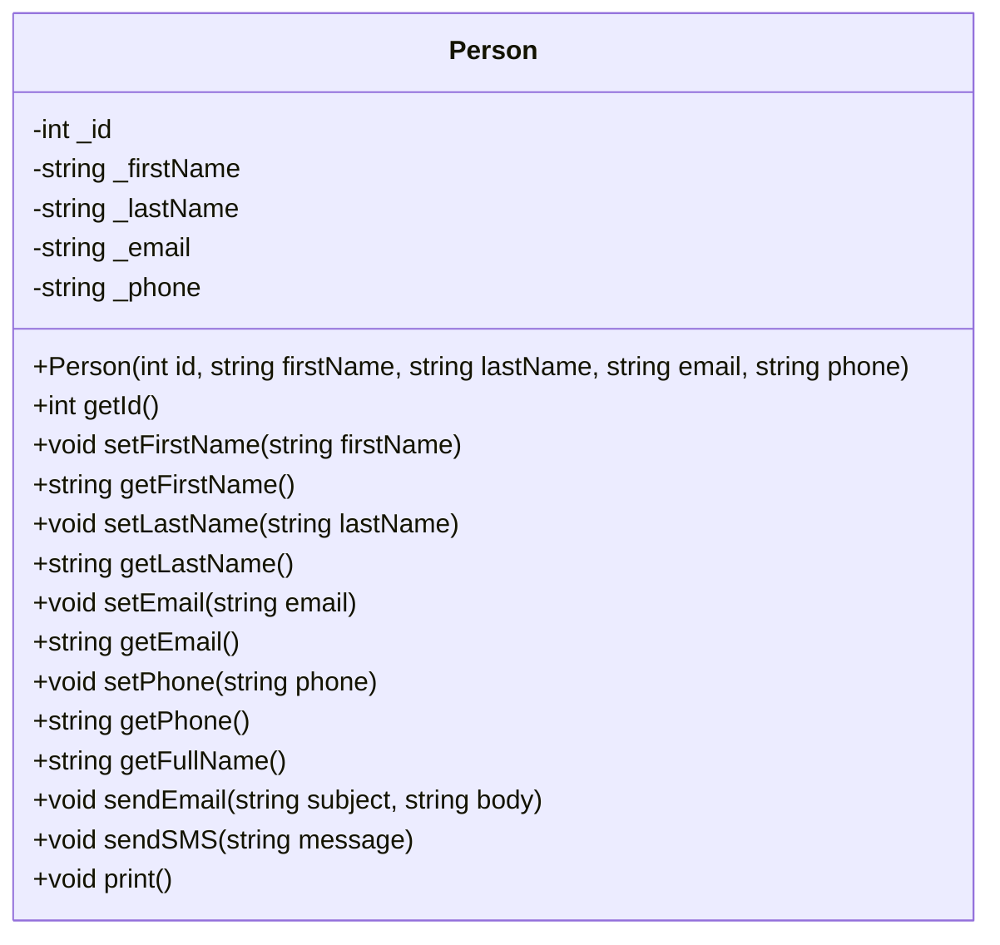
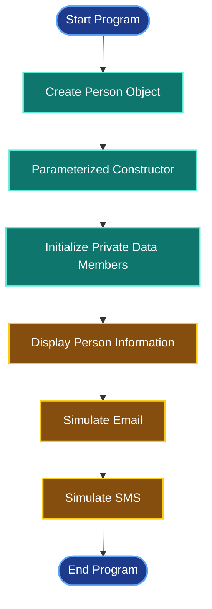

# Project 02 — Person Class

## Overview

This project is a simple C++ application that demonstrates fundamental Object-Oriented Programming (OOP) concepts through a `Person` class.

The class stores personal information, provides methods to access and update its properties, and simulates sending email and SMS messages.

The project was developed as part of my C++ OOP learning journey.

---

## Features

- Create a person using a parameterized constructor.
- Store personal information using private data members.
- Access and modify properties using getters and setters.
- Provide read-only access to the person's ID.
- Generate a full name from the first and last names.
- Display the person's information.
- Simulate sending email messages.
- Simulate sending SMS messages.

**Note:** Email and SMS functionality is simulated through console output. No actual messages are sent.

---

## OOP Concepts Applied

| Concept | Implementation |
|---|---|
| Class & Object | `Person` class and `person1` object |
| Encapsulation | Private data members with public methods |
| Constructor | Parameterized constructor |
| Properties | Getters and setters |
| Read-Only Property | `getId()` without a setter |
| Abstraction | Public methods hide the details of displaying information and simulating messages |

---

## Class Diagram

The following UML diagram illustrates the structure of the `Person` class.



### Diagram Explanation

- `-` represents private members.
- `+` represents public members.
- Private data members protect the object's internal state from direct external access.
- Public methods provide controlled access to the object's data.
- The constructor initializes the object with the required information.

---

## Class Properties

| Property | Type | Access |
|---|---|---|
| `_id` | `int` | Read-only through getter |
| `_firstName` | `string` | Getter and setter |
| `_lastName` | `string` | Getter and setter |
| `_email` | `string` | Getter and setter |
| `_phone` | `string` | Getter and setter |

### Read-Only ID

The ID is initialized through the constructor and can be retrieved using `getId()`.

```cpp
int getId()
{
    return _id;
}
```

There is no public `setId()` method, so the class does not provide a way to modify the ID after construction.

---

## Main Methods

### 1. getFullName()

Combines the person's first and last names.

```cpp
string getFullName()
{
    return getFirstName() + " " + getLastName();
}
```

### 2. sendEmail()

Simulates sending an email by displaying the recipient, subject, and body in the console.

```cpp
person1.sendEmail("Hi", "How are you?");
```

### 3. sendSMS()

Simulates sending an SMS message by displaying the recipient's phone number and message.

```cpp
person1.sendSMS("How are you?");
```

### 4. print()

Displays the person's stored information in a readable format.

```cpp
person1.print();
```

---

## Program Execution Flow



---

## Example Usage

```cpp
int main()
{
    Person person1(
        10,
        "Sany",
        "David",
        "Da@gmail.com",
        "990237727"
    );

    person1.print();

    person1.sendEmail("Hi", "How are you?");
    person1.sendSMS("How are you?");
}
```

### Expected Output

```text
Info
____________________________
ID       : 10
FirstName: Sany
lastName : David
FullName : Sany David
Email    : Da@gmail.com
Phone    : 990237727
____________________________

The following message sent successfully to email: Da@gmail.com
Subject: Hi
Body: How are you?

The following SMS sent successfully to phone: 990237727
How are you?
```

The messages above are console simulations, not confirmations of real delivery.

---

## How to Run

### Requirements

- A C++ compiler supporting C++11 or later.
- Visual Studio, VS Code with a configured compiler, or another C++ development environment.

### Compile and Run

Using the GNU C++ compiler:

```bash
g++ code.cpp -o person
./person
```

On Windows CMD, run the compiled program using:

```cmd
person.exe
```

---

## Project Structure

```text
project_02_person/
├── code.cpp
└── README.md
```

---

## Learning Outcomes

By completing this project, I practiced:

1. Designing a class with private data members.
2. Initializing objects using constructors.
3. Applying encapsulation through getters and setters.
4. Implementing a read-only property.
5. Creating methods that perform specific operations.
6. Organizing related data and behavior into a single class.
7. Applying basic OOP concepts to a practical C++ exercise.

---

## Conclusion

This project reinforces fundamental C++ Object-Oriented Programming concepts by implementing a simple `Person` class.

It demonstrates how constructors, encapsulation, properties, and member functions work together to organize data and behavior in a reusable class.
