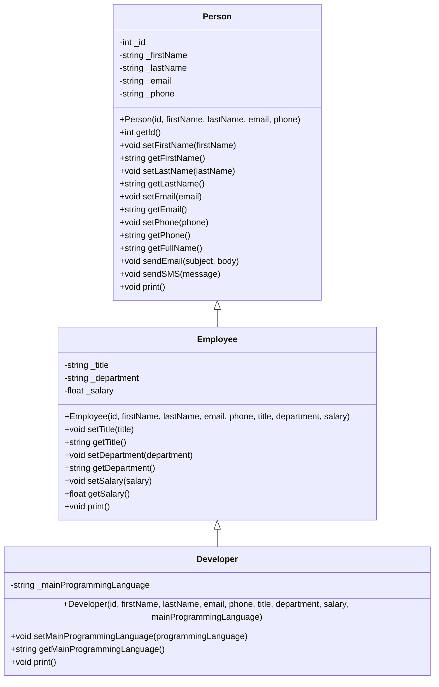
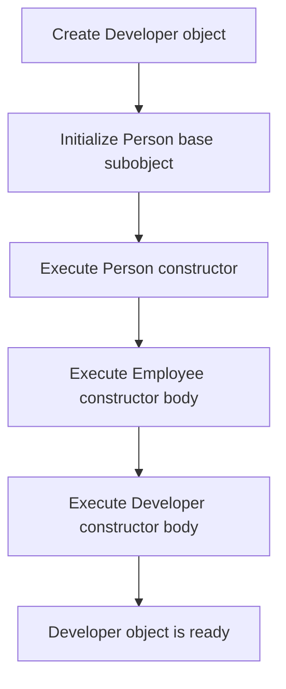
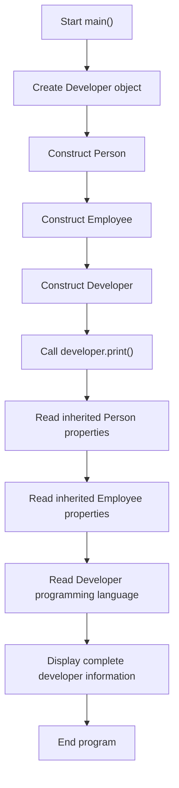

# Project 03 — Developer Class

## Overview

This project demonstrates **Multilevel Inheritance** in C++ using three related classes:

- `Person`
- `Employee`
- `Developer`

The objective is to create a `Developer` class that inherits from `Employee`, which already inherits from `Person`.

The project demonstrates how inheritance allows a derived class to reuse existing properties and methods while introducing additional functionality.

It also reinforces several Object-Oriented Programming (OOP) concepts, including encapsulation, parameterized constructors, constructor chaining, getters and setters, and method redefinition.

---

## 1. Project Objectives

The main objectives of this project are to:

1. Implement multilevel inheritance in C++.
2. Create a three-level class hierarchy.
3. Reuse inherited public methods.
4. Initialize inherited data through parameterized constructors.
5. Apply encapsulation using private data members.
6. Define getters and setters for class properties.
7. Customize the `print()` method in the `Developer` class.
8. Display complete developer information.

---

## 2. Class Hierarchy

The project contains three classes connected through public inheritance.



### Inheritance Structure

```text
Person
  |
  v
Employee
  |
  v
Developer
```

- `Person` is the original Base Class.
- `Employee` inherits from `Person`.
- `Developer` inherits from `Employee`.
- `Developer` indirectly inherits from `Person`.

This structure is called **Multilevel Inheritance**.

---

## 3. Class Responsibilities

### Person Class

The `Person` class represents general personal information.

**Private data members:**

| Property | Type | Description |
|---|---|---|
| `_id` | `int` | Unique person identifier |
| `_firstName` | `string` | First name |
| `_lastName` | `string` | Last name |
| `_email` | `string` | Email address |
| `_phone` | `string` | Phone number |

**Main functionality:**

- Read the person's ID.
- Update and retrieve personal information.
- Generate the full name.
- Simulate sending an email.
- Simulate sending an SMS.
- Print personal information.

The ID is a read-only property in the class interface because it has a getter but no setter.

### Employee Class

The `Employee` class extends `Person` with employment-related information.

**Additional private data members:**

| Property | Type | Description |
|---|---|---|
| `_title` | `string` | Employee job title |
| `_department` | `string` | Employee department |
| `_salary` | `float` | Employee salary |

**Main functionality:**

- Update and retrieve the job title.
- Update and retrieve the department.
- Update and retrieve the salary.
- Display personal and employment information.

The class reuses public methods inherited from `Person`.

### Developer Class

The `Developer` class extends `Employee` with developer-specific information.

**Additional private data member:**

| Property | Type | Description |
|---|---|---|
| `_mainProgrammingLanguage` | `string` | Developer's main programming language |

**Main functionality:**

- Set the main programming language.
- Retrieve the main programming language.
- Display complete developer information.

The `Developer` class reuses public methods inherited from both `Employee` and `Person`.

---

## 4. Implementing Multilevel Inheritance

The `Employee` class inherits publicly from `Person`:

```cpp
class Employee : public Person
{
    // Employee members
};
```

The `Developer` class inherits publicly from `Employee`:

```cpp
class Developer : public Employee
{
    // Developer members
};
```

As a result, `Developer` can access the inherited public methods of both classes.

For example:

```cpp
getId();
getFirstName();
getFullName();
getTitle();
getDepartment();
getSalary();
```

These methods are available to `Developer` through inheritance.

The original private data members remain inaccessible directly from derived classes, so the project uses public getters and setters.

---

## 5. Constructor Chaining

Each class contains a parameterized constructor.

### Person Constructor

```cpp
Person(int id, string firstName, string lastName,
       string email, string phone)
{
    _id = id;
    _firstName = firstName;
    _lastName = lastName;
    _email = email;
    _phone = phone;
}
```

### Employee Constructor

```cpp
Employee(int id, string firstName, string lastName,
         string email, string phone, string title,
         string department, float salary)
    : Person(id, firstName, lastName, email, phone)
{
    _title = title;
    _department = department;
    _salary = salary;
}
```

The `Employee` constructor explicitly initializes its `Person` base-class subobject.

### Developer Constructor

```cpp
Developer(int id, string firstName, string lastName,
          string email, string phone, string title,
          string department, float salary,
          string mainProgrammingLanguage)
    : Employee(id, firstName, lastName, email, phone,
               title, department, salary)
{
    _mainProgrammingLanguage = mainProgrammingLanguage;
}
```

The `Developer` constructor explicitly initializes its `Employee` base-class subobject.

### Constructor Execution Order

When a `Developer` object is created, the constructors execute in the following order:

1. `Person`
2. `Employee`
3. `Developer`



**Important:** Base classes are constructed before derived classes, regardless of the order in which constructor bodies appear in the source code.

---

## 6. Encapsulation

All three classes use private data members to protect their internal state.

For example, the `Developer` class contains:

```cpp
private:
    string _mainProgrammingLanguage = "";
```

The property can be accessed through public methods.

### Setter

```cpp
void setMainProgrammingLanguage(string programmingLanguage)
{
    _mainProgrammingLanguage = programmingLanguage;
}
```

### Getter

```cpp
string getMainProgrammingLanguage()
{
    return _mainProgrammingLanguage;
}
```

### Example

```cpp
developer.setMainProgrammingLanguage("Python");

cout << developer.getMainProgrammingLanguage();
```

This approach demonstrates encapsulation by providing controlled access through public methods.

---

## 7. Method Redefinition

Each class defines its own `print()` method.

### Person

Displays personal information.

### Employee

Displays personal and employment information.

### Developer

Displays personal information, employment information, and the main programming language.

The `Developer` implementation includes:

```cpp
cout << "Main Programming Language: "
     << getMainProgrammingLanguage() << endl;
```

When the program calls:

```cpp
developer.print();
```

the `Developer::print()` implementation executes.

### Important C++ Distinction

In this project, the Base Class `print()` method is not declared `virtual`.

Therefore, the methods demonstrate **method redefinition and name hiding**, rather than virtual function overriding with runtime polymorphism.

Virtual functions are covered separately in a later lesson.

---

## 8. Creating a Developer Object

The `main()` function creates a `Developer` object:

```cpp
Developer developer(
    10,
    "Fadi",
    "Davids",
    "Da@gmail.com",
    "0920590235",
    "Software Developer",
    "Computer Science",
    55000,
    "C++"
);

developer.print();
```

The constructor receives personal, employment, and developer-specific information.

The `print()` method then displays the complete record.

---

## 9. Expected Output

```text
Info
_____________________________________
ID                       : 10
FirstName                : Fadi
lastName                 : Davids
FullName                 : Fadi Davids
Email                    : Da@gmail.com
Phone                    : 0920590235
Title                    : Software Developer
Department               : Computer Science
Salary                   : 55000
Main Programming Language: C++
_____________________________________
```

The output includes properties originating from all three classes.

---

## 10. Program Execution Flow



---

## 11. How to Compile and Run

### Requirements

- A C++ compiler supporting C++11 or later.
- A terminal or command-line environment.

### Compile Using g++

From the project directory:

```bash
g++ code.cpp -o developer
```

### Run on Windows CMD

```cmd
developer.exe
```

### Run on Linux or macOS

```bash
./developer
```

The program displays the developer's complete information.

---

## 12. OOP Concepts Demonstrated

| Concept | Implementation |
|---|---|
| Classes and Objects | `Person`, `Employee`, `Developer` |
| Encapsulation | Private data members with public getters and setters |
| Inheritance | `Employee : public Person` |
| Multilevel Inheritance | `Person → Employee → Developer` |
| Constructor Chaining | Derived constructors initialize their base classes |
| Code Reusability | Inherited getters and methods |
| Method Redefinition | Each class defines its own `print()` |
| Scope and Access Control | Private members accessed through public methods |

---

## 13. Learning Outcomes

After completing this project, I practiced how to:

- Design a multilevel class hierarchy.
- Reuse functionality from multiple inheritance levels.
- Initialize base-class subobjects through constructor initializer lists.
- Access inherited public methods.
- Protect data using encapsulation.
- Add specialized properties to derived classes.
- Customize a method's implementation for a specific class.
- Create and use objects from the most-derived class.

---

## 14. Conclusion

The **Developer Class Project** demonstrates how multilevel inheritance can organize related classes and reduce the need to duplicate existing functionality.

By extending `Person` into `Employee` and then `Developer`, the program builds a more specialized class while preserving access to inherited public functionality.

This project reinforces important Object-Oriented Programming principles and provides practical experience with class hierarchies, constructor chaining, encapsulation, and method redefinition.

---

